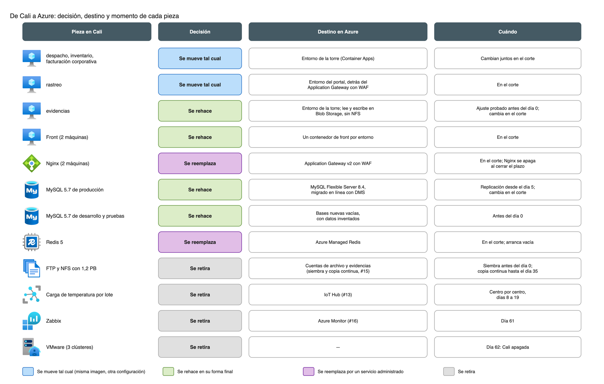

# Estrategia de migración del núcleo y escenario de campaña (Carga C)

Este documento define cómo se pasa del núcleo que hoy corre en el datacenter de Cali a la plataforma logística nueva (`carga-a-plataforma-logistica.md`): qué se mueve tal como está, qué se rehace, cómo se migra la base de datos, en qué fechas conviven los dos sistemas, cómo es el corte de dos horas y cuándo se apaga Cali. También dimensiona el escenario de campaña con las tres reglas del enunciado. Usa la red, el firewall, la telemetría y los datos personales ya diseñados, con sus mismos nombres y reglas.

## Contenido

1. Contexto y alcance
2. Qué se mueve tal cual y qué se rehace
3. La base de datos: de MySQL 5.7 a MySQL 8.4
4. Calendario de la convivencia
5. El corte
6. Después del corte: plazo de vuelta atrás y apagado de Cali
7. Escenario de campaña
8. Diagramas
9. Costo: qué se paga dos veces y por cuánto tiempo
10. Supuestos y confirmaciones pendientes de FríoAndes
11. Validación y cierre

### Términos usados

| Término | Qué significa aquí |
|---|---|
| Convivencia | El periodo en que Cali y Azure funcionan al mismo tiempo. Empieza el día 0 y dura como máximo 90 días |
| DMS | Azure Database Migration Service, el servicio que copia la base de Cali a MySQL Flexible Server y la mantiene al día hasta el corte |
| Carga inicial | La primera copia completa de la base. Después de ella, DMS solo aplica los cambios que van ocurriendo en Cali (replicación continua) |
| Corte | La ventana de hasta dos horas, en la madrugada de un domingo, en la que la base y el tráfico de despacho y rastreo pasan de Cali a Azure |
| Punto de no retorno | El momento del corte después del cual Azure recibe escrituras reales. Desde ahí, volver a Cali ya no es limpio |
| Plazo de vuelta atrás | Los días después del corte en que Cali se mantiene intacta, sin tráfico, como contingencia. Lo nombran también `red-firewall-y-publicacion.md` y la tabla de políticas |
| Congelamiento de esquema | Periodo en que no se cambia la estructura de la base de Cali (tablas, columnas, índices) |
| Rehost, replatform, reemplazar, reconstruir, retirar | Las cinco formas de migrar una pieza: moverla tal cual, moverla con ajustes de plataforma, cambiarla por un servicio administrado, rehacerla o apagarla |

## 1. Contexto y alcance

### 1.1 Lo que hay hoy en Cali

El núcleo corre en 14 máquinas virtuales sobre VMware, en tres clústeres de dos servidores cada uno:

| Clúster | Qué corre | Soporte |
|---|---|---|
| Datos | MySQL 5.7 en CentOS 7: producción (sin réplica, con un volcado nocturno a la 01:00 en el mismo clúster), desarrollo y pruebas. Redis 5 en CentOS 7 | Fuera de soporte |
| Aplicación | 4 máquinas Ubuntu 20.04 con Docker (2 de producción, 1 de desarrollo y 1 de pruebas), con los contenedores despacho, inventario, facturación corporativa, rastreo y evidencias. 2 máquinas con Nginx y 2 con el front, en Ubuntu 22.04 | Ubuntu 20.04 solo con soporte extendido de pago |
| Transversal | FTP y NFS con el archivo de 1,2 PB, en CentOS 7. Zabbix en Ubuntu 20.04 | Fuera de soporte, y el archivo no tiene copia fuera de ese servidor |

### 1.2 Qué resuelve este documento

- La decisión de cada componente: qué se mueve tal cual durante la convivencia y qué se rehace en la plataforma nueva, sin pagar dos diseños más allá de los 90 días.
- La migración de la base de MySQL 5.7 a MySQL 8.4, con lo que exige del origen y de la aplicación.
- El calendario de la convivencia, con fecha de apagado de Cali, y cómo se acomoda a las campañas.
- El guion del corte de dos horas, que solo arrastra el diferencial transaccional y no los 1,2 PB.
- Qué significa volver atrás antes y después del corte.
- El dimensionamiento de campaña: +40 % solo en la capa de aplicación, el portal por 2.000 solicitudes por minuto y la telemetría por 180 camiones.

### 1.3 Qué toma de los otros diseños

| Viene de | Qué se usa aquí |
|---|---|
| `carga-a-plataforma-logistica.md` (#12) | Container Apps con dos entornos por ambiente (torre y portal), MySQL Flexible Server 8.4 con alta disponibilidad zonal y réplica en Central US, Azure Managed Redis, Key Vault y Entra ID |
| `red-topologia-subnetting.md` (#8) | `snet-cali-integration` (`10.101.2.160/27`) para DMS y las máquinas de copia; la copia continua del archivo fuera del firewall (sección 6.3); el paso de cada centro a la conexión directa; la latencia medida desde Cali (sección 3) |
| `red-firewall-y-publicacion.md` (#9) | Los hitos de la convivencia (sección 5.1), las reglas temporales FW-401 a FW-504, el cambio de DNS del portal (sección 3.8) y el orden de apagado (sección 5.5) |
| `carga-b-telemetria.md` (#13) | IoT Hub, la alerta que no depende de Cali ni de Fabric, el retiro de la carga por lote de cada centro (sección 4.6) y la telemetría de campaña (sección 6.3) |
| `seguridad-datos-personales-perimetro.md` (#10) | Pruebas y desarrollo sin datos personales reales; el cliente ve sus guías, comprobantes y fotos, nunca la flota |

### 1.4 Qué queda en otros diseños

- La siembra de los 1,2 PB y la copia continua del archivo, con sus cálculos: #15 (`carga-c-siembra-1-2pb.md`). Este documento solo fija cuándo deben estar listas.
- Las cifras de costo de la migración y del mes de campaña: #25 y #26. Aquí se dice qué se paga dos veces y por cuánto tiempo.
- El detalle de lo que vigila Azure Monitor y el apagado de Zabbix: #16. Aquí se fija la fecha.
- La plantilla de cambio de infraestructura, que usa este corte como ejemplo: #30.

## 2. Qué se mueve tal cual y qué se rehace

### 2.1 El criterio

El enunciado pide que los módulos actuales no queden como un segundo sistema permanente. La regla que sigue este documento es:

- **Lo que se mueve tal cual** a Azure es lo que ya está empaquetado de forma portátil: los contenedores. Llegan con la misma lógica y solo cambian su configuración.
- **Lo que se queda tal cual en Cali** durante la convivencia tiene una fecha de retiro dentro de los 90 días, escrita en la sección 6.
- **Lo que se rehace** se construye una sola vez, directamente en su forma final, para no pagar primero una copia de Cali y después el diseño definitivo. Es el caso de la base, la caché, el proxy, el monitoreo y la carga de temperatura.

### 2.2 Los cinco componentes de la aplicación

Los nombres son los del enunciado. La plataforma nueva organiza los servicios como los define la Carga A (guías, inventario, asignación de muelle y ruta, facturación corporativa), así que la tabla dice también dónde queda cada contenedor de hoy.

| Contenedor de hoy | Decisión | Dónde queda en Azure | Por qué |
|---|---|---|---|
| despacho | **Se mueve tal cual** (replatform mínimo) | Entorno de la torre. Se separa en dos aplicaciones, guías y asignación de muelle y ruta, solo como despliegue: misma imagen y mismo código | Ya es un contenedor. Rehacerlo no aporta nada a la migración y alargaría el plan |
| inventario | **Se mueve tal cual** | Entorno de la torre | Ídem. No se expone en el portal |
| facturación corporativa | **Se mueve tal cual** | Entorno de la torre. El portal muestra solo la facturación del cliente que consulta, a través del servicio de rastreo | Ídem |
| rastreo | **Se mueve tal cual** | Entorno del portal, detrás del Application Gateway con WAF | Ídem. Su capacidad de campaña se calcula aparte (sección 7.3) |
| evidencias | **Se rehace la forma de leer y escribir archivos**; el resto del contenedor se mueve tal cual | Entorno de la torre. Lee y escribe en el almacenamiento de Azure con su identidad administrada, sin NFS | Container Apps solo monta recursos compartidos de Azure Files y no monta Blob Storage, donde vive el archivo (sección 2.4). Sin este ajuste, evidencias no puede correr en la plataforma nueva |

**Los cinco contenedores cambian juntos, en el corte.** No se mueve módulo por módulo, por tres razones:

1. Los cinco comparten la misma base. Si un módulo pasara a Azure antes que la base, cada consulta cruzaría la VPN hasta Cali. La latencia medida desde Cali hasta East US 2 tiene una mediana de 85 a 97 ms por viaje de ida y vuelta (`red-topologia-subnetting.md`, sección 3.3): una pantalla que hace 20 consultas seguidas tardaría casi dos segundos solo en la red.
2. Una escritura en dos bases a la vez (Cali y Azure) exigiría una sincronización en los dos sentidos, que MySQL no ofrece entre 5.7 y 8.4 (sección 3.5).
3. Un solo corte es una sola ventana de riesgo, ensayada de punta a punta, en vez de cinco.

Antes del corte los cinco ya están desplegados en Azure, probados contra la base replicada y sin usuarios.

### 2.3 Las piezas de apoyo

| Pieza de hoy | Decisión | Destino | Cuándo |
|---|---|---|---|
| 2 máquinas con el front (Ubuntu 22.04) | **Se rehace el empaquetado**: el front pasa a un contenedor | Una aplicación de front en cada entorno de Container Apps | Desplegado antes del día 0; recibe usuarios en el corte |
| 2 máquinas con Nginx | **Se reemplaza** por un servicio administrado | Application Gateway v2 con WAF (#9) | Recibe a los clientes en el corte; Nginx se apaga al cerrar el plazo de vuelta atrás |
| MySQL 5.7 de producción | **Se rehace** sobre MySQL Flexible Server 8.4, migrando los datos en línea con DMS | `snet-data` de producción | Replicación desde el día 5; cambia en el corte (sección 3) |
| MySQL 5.7 de desarrollo y de pruebas | **Se rehacen vacías**, con datos inventados | `snet-data` de desarrollo y de pruebas | Antes del día 0. No se migran: pruebas y desarrollo no llevan datos personales reales (#10) |
| Redis 5 | **Se reemplaza** por Azure Managed Redis | `snet-data-pe` | No hay datos que mudar: es una caché y se llena sola con el primer tráfico |
| Servidor FTP y NFS con 1,2 PB | **Se retira**. Los datos se siembran antes y se mantienen al día con la copia continua (#15) | Cuentas de archivo y evidencias en `snet-archive` | La siembra termina antes del día 0; la copia continua termina la noche después del corte |
| Carga por lote de temperatura (FTP cada hora) | **Se queda tal cual en Cali** hasta que cada centro envía en línea, y después **se retira** | La reemplaza IoT Hub (#13) | Centro por centro, entre los días 8 y 19 (sección 4.3) |
| Zabbix | **Se queda tal cual en Cali** vigilando lo que sigue allí, y después **se retira** | Azure Monitor (#16) | Se apaga el día 61, con Cali |
| VMware (3 clústeres, 6 servidores) | **Se retira** | — | Día 62 (14 de marzo de 2027) |

### 2.4 Ajustes que se piden al equipo de desarrollo

El enunciado permite pedir adaptaciones a la aplicación, justificadas y sin implementarlas en este reto. Todas tienen que estar terminadas y probadas en el ambiente de pruebas antes del día 0, porque durante la convivencia la base de Cali no admite cambios de esquema (sección 3.3).

| Ajuste | Contenedores | Por qué lo exige la plataforma |
|---|---|---|
| Leer y escribir archivos con la API de Blob Storage y la identidad administrada, en vez de un montaje NFS | evidencias | Container Apps no monta Blob Storage. El nombre de cada archivo en Azure es su ruta relativa de hoy, así que la base no cambia |
| Funcionar con MySQL 8.4 | Los cinco | La base pasa de 5.7 a 8.4 (sección 3.3) |
| Leer la configuración y los secretos de variables y de Key Vault, sin archivos locales | Los cinco | Las réplicas de Container Apps se crean y se destruyen solas |
| No guardar sesión ni archivos en el disco del contenedor | Los cinco | Ídem; una réplica nueva no tiene el disco de la anterior |
| Exponer un chequeo de salud por HTTP | Los cinco | Container Apps y el Application Gateway lo usan para sacar de servicio una réplica que falla |
| Emitir métricas, registros y trazas con OpenTelemetry | Los cinco | Lo usa la observabilidad (#16) y la validación del corte |
| Iniciar sesión con Entra ID en la consola | despacho, inventario, facturación corporativa, evidencias | MFA y acceso condicional para los 450 usuarios internos (#12, #7) |
| Filtrar por cliente todo lo que expone el portal | rastreo | Cada cliente ve solo sus guías, comprobantes, fotos y facturas (#10) |
| Un modo de mantenimiento que deje la aplicación de Cali en solo lectura y muestre un aviso en el portal | despacho, rastreo | Lo usa el corte para detener las escrituras sin apagar el servicio (sección 5.3) |
| Una exportación de las guías, movimientos de inventario y facturas creados después de una fecha | despacho, inventario, facturación corporativa | Es la única forma de volver a Cali después del punto de no retorno (sección 6.2) |

## 3. La base de datos: de MySQL 5.7 a MySQL 8.4

### 3.1 Migración en línea con DMS

La base de producción se migra con **DMS en modo en línea**: una carga inicial y después la replicación continua de los cambios, leyendo el registro binario (binlog) de Cali, hasta el corte. Así, el corte no copia la base: solo espera a que la réplica alcance al origen y cambia el destino de la aplicación.

- **Nivel:** DMS Premium de 4 vCores, que es el que exige la migración en línea. Microsoft no lo cobra durante los primeros 183 días desde su creación, y la convivencia completa cabe en ese plazo.
- **Dónde corre:** en `snet-cali-integration` de producción, como ya lo reservó la red.
- **Por dónde pasa:** del servicio de migración a la base de Cali por el Azure Firewall y la VPN (FW-501, TCP 3306), y a la cuenta de almacenamiento temporal de la migración (FW-502). Las dos reglas se retiran en el corte.
- **Destino:** MySQL Flexible Server 8.4 de producción, en `snet-data`. Microsoft recomienda subirlo de tamaño mientras dura la carga inicial y bajarlo después. Ese cambio se hace en ventanas y no toca a Cali.

DMS admite como destino las versiones 5.7, 8.0 y 8.4, y migrar desde una versión menor a una mayor.

### 3.2 Lo que exige la base de Cali

| Requisito de DMS | Qué se hace en Cali | Cuándo |
|---|---|---|
| Registro binario activo, en formato ROW | `log_bin` y `binlog_format=ROW` en el servidor de producción. Activar `log_bin` exige reiniciar MySQL | Ventana del día 1, en un reinicio de pocos minutos. Es la única intervención en la base de Cali antes del corte |
| Que el binlog no se borre antes de que DMS lo lea | `expire_logs_days=3`: tres días, para cubrir un fin de semana sin revisión | Día 1 |
| Usuario de migración | Usuario con `REPLICATION CLIENT`, `REPLICATION SLAVE` y `SELECT`, solo desde `10.101.2.160/27` | Día 1 |
| Sin bases con mayúsculas y minúsculas mezcladas en el nombre | Se revisa el inventario de bases. Flexible Server no las admite | Antes del día 0 |
| Espacio en disco para tres días de binlog | Se mide el volumen diario del binlog en la primera semana | Días 1 a 5 |

El volcado nocturno de la 01:00 se mantiene hasta el corte, como respaldo de Cali.

### 3.3 El salto de 5.7 a 8.4

MySQL no permite actualizar un servidor directamente de 5.7 a 8.4: obliga a pasar por 8.0. DMS no actualiza el servidor; copia los datos de forma lógica a un servidor 8.4 nuevo, y por eso sí admite ese salto. Aun así, la aplicación tiene que funcionar con 8.4, y hay tres consecuencias:

1. **La compatibilidad se prueba antes del día 0.** Se corre la verificación de actualización de MySQL Shell (`util.checkForServerUpgrade` con versión de destino 8.4) contra una copia de la base de Cali en un ambiente aislado, y se corrigen los hallazgos en la aplicación. Los casos típicos de este salto son: palabras que pasaron a ser reservadas, el juego de caracteres por defecto (`utf8mb4` con su nueva intercalación), consultas que dependían de la caché de consultas (eliminada en 8.0) y la autenticación (8.4 usa `caching_sha2_password` por defecto, así que el conector de la aplicación tiene que soportarlo).
2. **Los parámetros del servidor nuevo copian los de Cali.** Microsoft pide igualar `sql_mode`, la versión de TLS y todo parámetro que en Cali no tenga su valor por defecto. Se agrega `time_zone`, para que las horas guardadas no cambien.
3. **Congelamiento de esquema desde que arranca DMS hasta el corte.** DMS replica cambios de esquema solo hacia destinos 5.7 y 8.0. Con destino 8.4, una tabla o columna creada en Cali durante la convivencia no llega a Azure. Por eso, entre el día 5 y el corte, la aplicación de Cali solo recibe correcciones sin cambios de esquema. Los cambios de esquema se hacen en Azure, después del corte.

Además, DMS no copia la cláusula `DEFINER` de vistas, rutinas y disparadores: los crea con el usuario de la migración. El equipo de desarrollo revisa ese inventario antes del ensayo.

### 3.4 Carga inicial

El enunciado no da el tamaño de la base, así que en vez de suponerlo se calcula hasta qué tamaño la carga inicial cabe en una ventana de 22:00 a 04:00 (6 horas, 21.600 segundos):

| Ancho de banda disponible en la noche | Tamaño máximo que cabe en una ventana |
|---|---|
| 300 Mbps (el enlace de 400 Mbps, menos la copia continua del archivo, unos 37 Mbps, y margen) | 300 Mbps × 21.600 s / 8 = 810 GB |
| 150 Mbps (la mitad del enlace) | 405 GB |

Basta con confirmar que la base de producción pesa menos de unos 400 GB para que la carga inicial quepa en una noche incluso con la mitad del enlace. La carga inicial arranca un sábado a las 22:00 (día 5), para tener el domingo de margen. Si la base pesa más, se arranca un sábado y se deja correr hasta la noche del domingo, porque la carga inicial no detiene la base de Cali.

### 3.5 Por qué no hay replicación de vuelta

MySQL solo replica de una versión menor a una igual o mayor. De 8.4 hacia 5.7 no hay replicación ni bajada de versión posible. Por lo tanto:

- **Volver atrás limpio solo es posible durante el corte**, antes del punto de no retorno, mientras Azure no haya recibido escrituras reales (sección 5.5).
- **La regla FW-505 y su pareja en el NSG de `snet-data` no se crean.** El diseño del firewall las dejó condicionadas a esta decisión. Se retiran de `firewall-policy.csv` en este mismo cambio.
- Después del corte, volver a Cali exige la exportación de lo creado en Azure (sección 6.2).

### 3.6 Alta disponibilidad y réplica de Central US

La Carga A fija alta disponibilidad zonal y una réplica de lectura en Central US para cumplir el RPO de 15 minutos. Las dos se activan **antes del corte**, en la ventana del día 13, cuando la carga inicial ya terminó y DMS está solo replicando cambios. Así, desde el primer minuto en Azure la base ya cumple el RPO.

El ensayo del día 20 mide si la alta disponibilidad o la réplica atrasan a DMS. Si lo hacen, se desactivan en la ventana siguiente al ensayo y se activan en la primera ventana después del corte. Mientras tanto, el respaldo automático de Flexible Server permite restaurar a cualquier momento de los últimos días. Esa decisión se anota en el reporte del ensayo.

## 4. Calendario de la convivencia

### 4.1 Las campañas

El enunciado nombra tres campañas sin dar fechas. Este calendario las supone así, y durante ellas no hay cambios productivos salvo incidente:

| Campaña | Fechas supuestas | Cómo se fija |
|---|---|---|
| Fin de año | 15 de noviembre de 2026 al 10 de enero de 2027 | Despachos de fin de año y regreso de vacaciones |
| Semana Santa | 15 al 28 de marzo de 2027 | La semana anterior al Domingo de Ramos (21 de marzo) hasta el Domingo de Resurrección (28 de marzo) |
| Mitad de año | 15 de junio al 15 de julio de 2027 | Vacaciones de mitad de año y prima de servicios |

Hoy es 13 de octubre de 2026. Empezar la convivencia antes del 15 de noviembre dejaría menos de cinco semanas para tener la plataforma, la siembra y las adaptaciones listas, y la campaña de fin de año partiría la convivencia en dos. Por eso **el día 0 es el lunes 11 de enero de 2027**, el primer día después de la campaña.

Con ese inicio, el **día 90 es el domingo 11 de abril de 2027**. La campaña de Semana Santa cae dentro de la convivencia, así que el plan termina todo cambio antes del 15 de marzo y deja Semana Santa solo para operar.

### 4.2 Las ventanas

Los cambios productivos van de 22:00 a 04:00, fuera de campaña. Entre el 11 de enero y el 14 de marzo hay 63 noches útiles. Este plan usa unas 30. Las demás quedan de reserva para repetir un paso que falle.

### 4.3 Fases y fechas

| Fase | Días | Fechas | Qué pasa |
|---|---|---|---|
| Preparación | Antes del día 0 | Hasta el 10 de enero de 2027 | Plataforma desplegada en los tres ambientes con el código de infraestructura y el pipeline (#20 a #24). Producción en Azure queda encendida al mínimo y sin usuarios: no es un cambio productivo, porque nadie la usa. Adaptaciones de la aplicación probadas en pruebas. Siembra del archivo cargada en Azure y copia continua corriendo (#15). Prueba de carga de campaña en pruebas (sección 7.6) |
| Inicio de la convivencia | 0 | Lunes 11 de enero | Túneles de Cali hacia Azure por los dos proveedores. Reglas temporales de los dos lados (grupos 400 y 500, `red-firewall-y-publicacion.md`, sección 5.4). Reenvío de DNS entre Cali y el hub |
| Binlog y piloto de centro | 1 | Martes 12 de enero | Reinicio de MySQL de Cali con binlog (sección 3.2). Primer centro conectado directo a Azure, como piloto |
| Centros | 3 a 12 | 14 al 23 de enero | Los otros siete centros, uno o dos por noche. Los sensores de cuartos fríos de cada centro empiezan a enviar en línea a IoT Hub apenas el centro queda conectado |
| Carga inicial de la base | 5 | Sábado 16 de enero | Arranca DMS. Desde aquí rige el congelamiento de esquema en Cali |
| Camiones | 1 a 19 | 12 al 30 de enero | Alta de los camiones en IoT Hub, en grupos de unos 30. No dependen de Cali ni de los centros |
| Fin de la carga por lote | 8 a 19 | 19 al 30 de enero | Cada centro envía en línea y por FTP en paralelo durante 7 días. Si los dos coinciden, se retira la regla FW-402 de ese centro |
| Alta disponibilidad de la base | 13 | Domingo 24 de enero | Alta disponibilidad zonal y réplica en Central US (sección 3.6) |
| Pruebas en Azure con datos replicados | 6 a 19 | 17 al 30 de enero | Pruebas de solo lectura de los cinco contenedores contra la base replicada, con usuarios clave de despacho y facturación |
| **Ensayo del corte** | 20 | **Domingo 31 de enero**, 01:00 a 03:00 | El corte completo sobre un servidor temporal (sección 5.2) |
| Reserva para un segundo ensayo | 27 | Domingo 7 de febrero | Solo si el primero no cumple los criterios |
| Aviso a clientes corporativos | 27 | Domingo 7 de febrero | Aviso de la ventana de mantenimiento del portal, siete días antes |
| **Corte** | 34 | **Domingo 14 de febrero**, 01:00 a 03:00 | Sección 5 |
| Cierre de la copia del archivo | 35 | Lunes 15 de febrero | Última sincronización, verificación y fin de la copia continua. Se retira la regla temporal del NSG de `snet-archive` |
| Plazo de vuelta atrás | 34 a 55 | 14 de febrero al 7 de marzo | Cali intacta y sin tráfico (sección 6.1). Incluye el primer cierre de facturación mensual en Azure, el 1 de marzo |
| Cierre del plazo | 56 | Lunes 8 de marzo | Se retiran el NAT y el firewall de aplicaciones de Cali, los grupos temporales 400 y 500, las reglas temporales de los NSG y las VPN de los centros hacia Cali |
| Apagado de Cali | 56 a 62 | 8 al 14 de marzo | Servidores de Cali, Zabbix y VMware, en el orden de la sección 6.3. **Cali queda apagada el domingo 14 de marzo (día 62)** |
| Margen | 63 a 90 | 15 de marzo al 11 de abril | Semana Santa sin cambios. Lo que haya quedado pendiente se cierra entre el 29 de marzo y el 11 de abril |

### 4.4 Si se mueve una fecha

| Si pasa esto | Qué se hace |
|---|---|
| El ensayo no cumple los criterios | Se repite el 7 de febrero y el corte pasa al 21 de febrero. El resto del calendario se corre una semana y Cali se apaga el 21 de marzo, dentro de Semana Santa, así que ese apagado pasa al 29 de marzo. Sigue dentro del día 90 |
| El corte se suspende el mismo día (sección 5.4) | Fechas de reserva: domingo 21 y domingo 28 de febrero |
| La preparación se atrasa | El día 0 se puede correr. **El corte no puede pasar del domingo 7 de marzo**: con el plazo de vuelta atrás de 21 días se cierra el 28 de marzo, el apagado va del 29 de marzo al 4 de abril y el día 90 sigue cumpliéndose. Un día 0 posterior al 1 de febrero obliga a acortar el plazo de vuelta atrás o a pasar la convivencia completa después de Semana Santa |

## 5. El corte

### 5.1 Qué cubre y qué no

El corte cubre el cambio de la base transaccional y del tráfico de despacho y de rastreo. **No cubre la copia del archivo de 1,2 PB.** Ese volumen se siembra antes del día 0 (#15) y la copia continua lo mantiene al día durante toda la convivencia: unos 12 TB al mes, es decir, unos 400 GB al día.

En el corte solo queda por copiar lo que llegó al archivo de Cali desde la última pasada de la copia continua. Si la copia pasa cada hora, son unos 17 GB (12 TB / 30 días / 24 horas). A 200 Mbps eso toma unos 11 minutos y corre en paralelo con la validación de la base.

La base tampoco se copia en el corte. DMS la mantiene al día desde el día 5, y en el corte solo se espera a que el retraso de la réplica llegue a cero.

La telemetría no participa del corte. Ya funciona en Azure desde antes del día 0 y la alerta a la guardia de calidad sigue llegando durante la madrugada del corte.

### 5.2 El ensayo

El ensayo del día 20 repite el corte completo, con los mismos tiempos, sin tocar el tráfico real:

- Una segunda actividad de DMS replica la base de Cali hacia el **servidor temporal** que la red ya reservó en `snet-data` de producción. El ensayo se hace en producción y no en pruebas porque usa datos personales reales, y pruebas no los lleva.
- Se ejecuta el guion de la sección 5.3, con el portal en un nombre de prueba en lugar del nombre público. La base de Cali no se pone en solo lectura: se toma el retraso de la réplica en un momento dado.
- Se mide cuánto toma cada paso y se ajusta el guion. Si un paso pasa de su tiempo, el ensayo falla.
- Al terminar, el servidor temporal y su actividad de DMS se eliminan.

### 5.3 Guion

Domingo 14 de febrero de 2027. Hora de Colombia. El servicio queda en mantenimiento de 01:00 a 03:00 como máximo, y la hora de 03:00 a 04:00 queda libre para atender cualquier problema antes de que empiece el despacho.

| Hora | Paso | Responsable | Tiempo |
|---|---|---|---|
| Días antes | TTL del registro público del portal y del registro interno de la torre a 5 minutos (`red-firewall-y-publicacion.md`, sección 3.8). Comité de cambios aprobado. Avisos enviados (sección 5.6) | Líder del corte | — |
| Sábado 22:00 | Congelamiento de cambios en Cali y en Azure. Revisión de que DMS va con retraso cercano a cero y de que la réplica de Central US está al día | Líder del corte, base de datos | — |
| 00:30 | Volcado completo de la base de Cali, en lugar del volcado de la 01:00. Es el respaldo de vuelta atrás | Base de datos | 30 min |
| 00:55 | Primera decisión: seguir o suspender. Se suspende si falta alguien o algún criterio previo | Líder del corte | 5 min |
| 01:00 | La aplicación de Cali entra en modo de mantenimiento: torre en solo lectura y aviso en el portal. La base de Cali queda en `read_only` y `super_read_only` | Aplicación, base de datos | 5 min |
| 01:05 | Se espera a que DMS marque cero segundos de retraso. Se anota la posición final del binlog | Base de datos | 5 min |
| 01:10 | Se inicia el corte en DMS y se confirma que terminó | Base de datos | 10 min |
| 01:20 | Validación de datos: conteo de filas de todas las tablas y una suma de verificación por columnas clave de guías, inventario y facturas, con la misma consulta en Cali y en Azure. En paralelo, última sincronización del archivo (sección 5.1) | Base de datos, archivo | 20 min |
| 01:40 | Los cinco contenedores de producción pasan a su número normal de réplicas y abren escrituras contra Flexible Server | Aplicación | 10 min |
| 01:50 | DNS: el registro público del portal pasa a la IP del Application Gateway y el registro interno de la torre al entorno de la torre en Azure | Red | 5 min |
| 01:55 | Pruebas de humo con un cliente de prueba: inicio de sesión en la torre con Entra ID y MFA desde Cali y desde un centro; creación de una guía de prueba; consulta de esa guía en el portal; carga y consulta de una evidencia; consulta de una factura | Usuarios clave, pruebas | 30 min |
| 02:25 | **Segunda decisión: seguir o volver atrás** (sección 5.4) | Líder del corte con despacho y calidad | 5 min |
| 02:30 | Si se sigue: se quitan los datos del cliente de prueba y se abre el servicio. Este es el **punto de no retorno**. Si se vuelve atrás: sección 5.5 | Aplicación | 30 min |
| 03:00 | Fin del mantenimiento. Monitoreo reforzado hasta las 06:00, con el equipo del corte disponible | Todos | — |
| 04:00 | Empieza el despacho sobre Azure. La torre de control confirma la operación a las 04:30 | Despacho | — |

### 5.4 Criterios para seguir

Se sigue si se cumplen todos estos criterios. Si falla uno, se vuelve atrás sin discutir:

| Criterio | Cómo se comprueba |
|---|---|
| DMS terminó el corte sin errores | Estado de la actividad en DMS |
| Conteos y sumas de verificación iguales en Cali y en Azure | El reporte de la validación de las 01:20 |
| Las pruebas de humo pasan completas | La lista firmada por los usuarios clave |
| Los cinco contenedores responden sus chequeos de salud y no hay errores 5xx en el Application Gateway | Azure Monitor (#16) |
| La réplica de Central US está al día | Métrica de retraso de la réplica |
| Son las 02:30 o antes | Reloj. Si a las 02:30 no hay decisión, se vuelve atrás |

### 5.5 Volver atrás durante el corte

Hasta las 02:30 Azure solo recibió los datos del cliente de prueba, así que volver atrás es limpio y no pierde nada:

1. El registro público del portal y el registro interno de la torre vuelven a las direcciones de Cali. Con el TTL de 5 minutos, el cambio llega en minutos.
2. La base de Cali sale de `read_only`. No recibió ninguna escritura desde las 01:00.
3. La aplicación de Cali sale del modo de mantenimiento.
4. En Azure, los contenedores vuelven a su mínimo y la base de Azure se descarta. Para otro intento se crea una nueva actividad de DMS desde el principio, porque la del corte ya terminó.

Toma menos de 30 minutos y termina antes de las 03:00. Las reglas temporales del firewall no cambian, porque todavía no se ha retirado ninguna.

### 5.6 Aprobación y avisos

La aprobación y los avisos quedan en la plantilla de infraestructura (#30), que usa este corte como ejemplo. Lo mínimo es:

| A quién | Qué se le dice | Cuándo |
|---|---|---|
| Comité de cambios: gerencia de operaciones, responsable de calidad y líder técnico | Pide la aprobación con el guion, el reporte del ensayo y los criterios para seguir | Lunes 8 de febrero |
| Torre de control (despacho) | La torre queda en solo lectura de 01:00 a 03:00. A las 04:00 abre en Azure, con la misma dirección y el mismo inicio de sesión de Entra ID | Siete días antes y el sábado |
| Guardia de calidad | La alerta de temperatura no cambia y sigue llegando por los mismos canales. Tendrá un contacto directo con el equipo del corte | Siete días antes y a las 00:55 |
| Clientes corporativos | El portal queda en mantenimiento de 01:00 a 03:00 | Correo siete días antes y aviso en el portal |
| Equipo del corte: base de datos, red, aplicación, pruebas y usuarios clave | Guion, turnos y canal del corte | Después del ensayo |

## 6. Después del corte: plazo de vuelta atrás y apagado de Cali

### 6.1 El plazo de vuelta atrás

El plazo dura **21 días**, del 14 de febrero al 7 de marzo de 2027. Se elige así por dos razones:

- Cubre tres semanas completas de despacho y el primer cierre de facturación mensual en Azure (1 de marzo). Es lo que más probablemente muestre un error que las pruebas no vieron.
- Termina una semana antes de Semana Santa, lo que deja la semana del 8 al 14 de marzo para apagar Cali con ventanas normales.

Durante el plazo, Cali queda intacta y sin tráfico: la base de Cali en solo lectura, el NAT y el firewall de aplicaciones configurados, la VPN de cada centro hacia Cali como respaldo y Zabbix vigilando.

### 6.2 Qué significa volver atrás después del corte

Volver atrás después del punto de no retorno **no es limpio**, porque los datos creados en Azure no pueden replicarse a 5.7 (sección 3.5). Las salidas ante una falla grave son, en este orden:

1. **Corregir en Azure.** Es lo normal ante cualquier falla de la aplicación o de la configuración.
2. **Pasar a Central US** con el procedimiento de continuidad de la Carga A, si lo que falla es la región.
3. **Volver a Cali**, solo si las dos anteriores no resuelven una falla que impida despachar. Lo decide el comité de cambios. Se hace en tres pasos: la base de Cali sale de solo lectura; se cargan en Cali, con la exportación pedida al equipo de desarrollo (sección 2.4), las guías, los movimientos de inventario y las facturas creados en Azure desde el corte; y se vuelven los registros de DNS. Lo que la exportación no cubra se vuelve a digitar.

La tercera salida existe para no quedar sin camino ante algo imprevisto. No se espera usarla, y por eso no justifica mantener Cali más allá de los 21 días.

### 6.3 Orden de apagado

Sigue el orden de `red-firewall-y-publicacion.md`, sección 5.5, con fechas:

| Orden | Fecha | Qué se apaga o se retira |
|---|---|---|
| 1 | Domingo 14 de febrero, en el corte | FW-501, FW-502 y su pareja en el NSG de `snet-data`. La cuenta de almacenamiento de la migración y su token. El servicio DMS se elimina el día siguiente, cuando la validación queda firmada |
| 2 | Domingo 14 de febrero, en el corte | El portal deja de publicarse desde Cali. El NAT y el firewall de aplicaciones quedan configurados, sin tráfico |
| 3 | 19 al 30 de enero, centro por centro | FW-402 de cada centro, cuando su carga por lote queda reemplazada |
| 4 | Lunes 15 de febrero | La regla temporal del NSG de `snet-archive`, al terminar la copia continua del archivo |
| 5 | Lunes 8 de marzo, al cerrar el plazo | El NAT del portal y el firewall de aplicaciones de Cali. Los grupos temporales 400 y 500 completos (incluidas FW-401, FW-503 y FW-504). Las reglas temporales de los NSG. Las VPN de los centros hacia Cali |
| 6 | 8 al 12 de marzo | Servidores de Cali, en este orden: las 4 máquinas de aplicación y las 2 de front; las 2 de Nginx; Redis; las 3 bases MySQL, con un último volcado de producción guardado en el archivo de Azure; el servidor FTP y NFS, cuando #15 confirma que el archivo en Azure está completo. Con cada servidor se retiran las políticas del firewall de Cali que lo protegían |
| 7 | Sábado 13 de marzo | Zabbix, cuando #16 confirma que todo lo que vigilaba ya está cubierto por Azure Monitor o dejó de existir |
| 8 | Domingo 14 de marzo (día 62) | Los tres clústeres de VMware. Revisión final de `firewall-policy.csv`: se quitan las reglas temporales y el verificador no debe listar ninguna. `snet-cali-integration` queda vacía |

Después del día 62 el firewall de Cali queda solo como firewall de sede: usuarios, salida a internet y túneles hacia Azure.

### 6.4 Monitoreo durante la convivencia

Zabbix sigue vigilando todo lo que está en Cali hasta que se apaga: servidores, la base de Cali y su replicación, el firewall y los túneles. Azure Monitor vigila la plataforma nueva desde el día 0. El detalle de qué se mide y de los dos objetivos de servicio está en #16. Este documento le pide dos señales propias de la migración:

- El retraso de la replicación de DMS, con alerta si pasa de 5 minutos fuera de la carga inicial.
- El atraso de la copia continua del archivo, con alerta si pasa de un día de crecimiento (unos 400 GB).

## 7. Escenario de campaña

### 7.1 Las tres reglas

El enunciado da tres reglas distintas que no se mezclan:

| Parte | Regla | Dónde se aplica |
|---|---|---|
| Capa de aplicación | +40 % de cómputo, la hipótesis del negocio | Entorno de la torre: los servicios internos y su front |
| Portal | Se dimensiona con el pico de 2.000 solicitudes por minuto durante unas 4 horas, no con el 40 % | Entorno del portal y Application Gateway |
| Telemetría | Se dimensiona con 180 camiones | IoT Hub y Stream Analytics |

La base, la caché, el firewall y la red no son capa de aplicación: el 40 % no se les aplica. Se validan con la prueba de carga (sección 7.6).

### 7.2 Capa de aplicación: +40 %

En operación normal, cada servicio tiene al menos 2 réplicas, en zonas distintas, para que la caída de una zona no lo detenga. Guías tiene 3 porque concentra el trabajo de los 450 usuarios internos. Cada réplica tiene 1 vCPU y 2 GiB.

| Servicio, en el entorno de la torre | Réplicas normales | Réplicas de campaña (+40 %, redondeado hacia arriba) |
|---|---|---|
| Front de la torre | 2 | 3 (2,8) |
| Guías | 3 | 5 (4,2) |
| Asignación de muelle y ruta | 2 | 3 (2,8) |
| Inventario | 2 | 3 (2,8) |
| Facturación corporativa | 2 | 3 (2,8) |
| Evidencias | 2 | 3 (2,8) |
| **Total** | **13 vCPU** | **20 vCPU** (13 × 1,4 = 18,2; el redondeo por servicio suma 20) |
| Nodos D4 del perfil dedicado (4 vCPU, 16 GiB) | 4 | 6 (4 × 1,4 = 5,6) |

**Encaje con la red.** Los 6 nodos de campaña coinciden con las "unas 6 máquinas con el 40 %" que usó la red para dimensionar `snet-app-torre`, y quedan muy por debajo del techo de 20 nodos.

**Solo en el horario de despacho.** El 40 % se aplica de 04:00 a 22:00 durante los días de campaña. De noche la torre no se usa, y las réplicas vuelven al mínimo normal.

### 7.3 Portal: 2.000 solicitudes por minuto

| | Pico ordinario | Pico de campaña |
|---|---|---|
| Solicitudes por segundo | 800 / 60 = 13,3 | 2.000 / 60 = 33,3 |
| Réplicas de rastreo necesarias, a 15 solicitudes por segundo por réplica (supuesto) | 13,3 / 15 = 0,9, es decir 1 | 33,3 / 15 = 2,2, es decir 3 |
| Más una réplica para tolerar la caída de una zona | 2 | 4 |
| Front del portal (contenido casi estático) | 2 | 3 |
| Application Gateway | 20 unidades reservadas (2 instancias) | Las mismas 20 unidades cubren las 18 que pide la campaña (`red-firewall-y-publicacion.md`, sección 3.3) |

Por la ley de Little, con 0,3 segundos por respuesta, el pico de campaña tiene unas 10 solicitudes en curso al mismo tiempo (33,3 × 0,3). La carga es pequeña: el tamaño lo manda la disponibilidad, no la potencia.

El portal corre en el perfil de consumo del entorno, que cobra por réplica activa. Su escalado sigue la concurrencia HTTP: mínimo 2 réplicas y máximo 10. Así, las réplicas extra solo existen durante las horas del pico, unas 4 por día de campaña.

### 7.4 Telemetría: 180 camiones

| | Normal (120 camiones) | Campaña (180 camiones) |
|---|---|---|
| Temperatura de camiones | 2,0 mensajes por segundo | 3,0 |
| Posición de camiones | 4,0 | 6,0 |
| Cuartos fríos (32, sin cambio) | 1,07 | 1,07 |
| **Total** | **Unos 7,1 por segundo** | **Unos 10,1 por segundo** |

El diseño de telemetría ya comprobó que ninguna pieza cambia de tamaño con los 180 camiones: dos unidades S1 de IoT Hub reciben 800.000 mensajes al día frente a unos 682.000 en campaña, y Stream Analytics se valida en la prueba de carga (`carga-b-telemetria.md`, sección 6.3).

### 7.5 Lo que no cambia en campaña

| Componente | Por qué no cambia |
|---|---|
| MySQL Flexible Server | No es capa de aplicación. Se valida en la prueba de carga que el uso de CPU quede por debajo del 70 % con la carga de campaña. Si no, se sube de tamaño en una ventana antes de la campaña, como cambio de datos y no como parte del 40 % |
| Azure Managed Redis | Ídem. El rastreo es casi todo lectura y la caché absorbe las consultas repetidas |
| Application Gateway | Ya reserva la capacidad de campaña (sección 7.3) |
| Azure Firewall, VPN Gateway | El portal no pasa por el enlace de Cali. Los 450 usuarios internos son los mismos en campaña |

### 7.6 Cómo se aplica sin hacer cambios en campaña

Durante una campaña no se hacen cambios en producción, así que la capacidad de campaña tiene que estar lista antes y activarse sola:

- **Torre:** una regla de escalado por calendario (el escalador cron de KEDA que admite Container Apps) sube el mínimo de réplicas a los valores de campaña de 04:00 a 22:00, hora de Colombia, en las fechas de la sección 4.1. La regla se configura en una ventana normal antes de cada campaña, como cambio de infraestructura con su plantilla, y se retira después. La escala por concurrencia sigue activa encima de ese mínimo.
- **Portal:** no necesita regla de calendario. Escala solo con la concurrencia.
- **Prueba de carga:** en el ambiente de pruebas, antes del día 0 y antes de cada campaña, con 2.000 solicitudes por minuto sostenidas durante 4 horas en el portal, la carga de la torre aumentada en 40 % y el tráfico simulado de 180 camiones. La prueba confirma los supuestos de las secciones 7.2 y 7.3 (15 solicitudes por segundo por réplica y el uso de la base) y ajusta los números antes de producción.

### 7.7 Si la convivencia cruzara una campaña

El calendario de la sección 4 evita que la convivencia corte una campaña antes del apagado: Semana Santa queda en el margen. Si un atraso obligara a convivir durante una campaña:

- No se hace ningún paso de la sección 4.3 durante la campaña. El calendario se detiene y retoma al terminar.
- Si la campaña cae antes del corte, la operación sigue en Cali, con el 40 % de hoy sin resolver. La capacidad fija de Cali es justamente el problema que motiva el proyecto.
- Si cae después del corte, la operación ya corre en Azure con las reglas de la sección 7.6, y Cali espera apagada o en su plazo de vuelta atrás.

## 8. Diagramas

El primer diagrama muestra, para cada pieza de Cali, qué decisión se toma (moverla tal cual, rehacerla, reemplazarla o retirarla), adónde va en Azure y cuándo.

El segundo diagrama recorre las fases de la convivencia, con las fechas de la sección 4.3, y el estado de cada pieza en cada una: en Cali, en Azure, en paralelo o apagada.

Los dos se generan con `tools/build_carga_c_diagrams.py`.

## 9. Costo: qué se paga dos veces y por cuánto tiempo

Las cifras van en #25 (costo único de la migración) y #26 (mes estable y campaña). Este documento fija lo que esas estimaciones deben contar:

| Concepto | Duración | Qué cuenta |
|---|---|---|
| Producción en Azure sin usuarios | Desde que se despliega (antes del 11 de enero) hasta el corte (14 de febrero) | Container Apps al mínimo, Flexible Server, Managed Redis, Application Gateway y firewall. La base se sube de tamaño solo durante la carga inicial |
| Servidor temporal del ensayo | Unos días alrededor del 31 de enero | Un Flexible Server del mismo tamaño que producción |
| DMS Premium de 4 vCores | Del 16 de enero al 15 de febrero | Sin costo: entra en los 183 días que Microsoft no cobra |
| Cali y Azure a la vez | Hasta el 14 de marzo (día 62) | Lo que FríoAndes siga pagando por Cali (energía, soporte de VMware, soporte extendido de Ubuntu). El enunciado no da esos costos |
| Horas del equipo | Ensayo, corte y apagado | Unas 2 noches de ensayo y corte con 6 a 8 personas, y unas 15 noches de cambios durante la convivencia |

### Decisiones que bajan o evitan gasto

| Decisión | Alternativa descartada | Qué se evita |
|---|---|---|
| Cali se apaga el día 62 | Esperar hasta el día 90 | 28 días de pagar dos plataformas |
| Bases de desarrollo y pruebas creadas vacías | Migrar también esas dos bases | Dos migraciones más y llevar datos personales a ambientes con menos controles |
| Ensayo en el servidor temporal, que se borra al terminar | Un ambiente de preproducción permanente con datos reales | Un servidor de base de datos encendido todo el año |
| Sin replicación de vuelta a Cali | Mantener una segunda migración de Azure a Cali durante el plazo | Un servidor de replicación inversa que además MySQL no admite de 8.4 a 5.7 |
| Producción en Azure al mínimo hasta el corte | Producción a tamaño completo desde el despliegue | Las réplicas y los nodos que no se usan mientras no hay usuarios |
| El portal escala por concurrencia y la torre por calendario | La capacidad de campaña encendida toda la campaña, las 24 horas | Las horas de cómputo fuera del pico del portal y fuera del horario de despacho |

## 10. Supuestos y confirmaciones pendientes de FríoAndes

### 10.1 Confirmaciones que necesita el diseño

| Tema | Pregunta para FríoAndes | Qué pasa si la respuesta cambia |
|---|---|---|
| Fechas de campaña | ¿Cuáles son las fechas reales de las tres campañas? | Mueve el día 0, el corte y el apagado. El corte no puede pasar del 7 de marzo de 2027 con las fechas supuestas |
| Fecha de inicio | ¿Se acepta empezar la convivencia el 11 de enero de 2027? | Ídem |
| Plazo de vuelta atrás | ¿Se aceptan 21 días, sabiendo que después del corte volver a Cali no es limpio? | Un plazo más largo retrasa el apagado de Cali; no puede pasar del día 90 |
| Tamaño de la base | ¿La base de producción pesa menos de unos 400 GB? ¿Cuánto binlog genera al día? | Si pesa más, la carga inicial usa el fin de semana completo (sección 3.4). El binlog define el espacio de disco en Cali |
| Binlog en Cali | ¿La base de producción ya tiene `log_bin`? | Si ya lo tiene, se evita el reinicio del día 1 |
| Evidencias que llegan por FTP | ¿Alguien sube evidencias directamente al servidor FTP, sin pasar por el contenedor evidencias? | Si sí, ese flujo también tiene que cambiar de destino en el corte |
| Usuarios clave en el corte | ¿Despacho y facturación pueden poner usuarios clave en el ensayo y en el corte, de madrugada? | Sin ellos, las pruebas de humo no validan el negocio |
| Último volcado de Cali | ¿Cuánto tiempo hay que conservar el último volcado de la base de Cali después del apagado? | Define su retención en el archivo de Azure |

### 10.2 Supuestos del diseño

| Supuesto | Por qué se asume |
|---|---|
| Campañas del 15 de noviembre al 10 de enero, del 15 al 28 de marzo de 2027 y del 15 de junio al 15 de julio | El enunciado nombra las campañas sin fechas |
| El día 0 es el lunes 11 de enero de 2027, el corte el domingo 14 de febrero y el apagado de Cali el domingo 14 de marzo (día 62) | Es la primera fecha libre de campaña con tiempo para preparar, y termina antes de Semana Santa |
| Una réplica de rastreo de 1 vCPU atiende 15 solicitudes por segundo | Se confirma con la prueba de carga de campaña |
| La copia continua del archivo pasa al menos una vez por hora | Deja unos 17 GB por copiar en el corte. Lo fija #15 |
| El plazo de vuelta atrás dura 21 días | Cubre el primer cierre de facturación en Azure y termina antes de Semana Santa |
| Los contenedores de hoy no tienen dependencias entre sí fuera de la base y del archivo | Permite moverlos tal cual con solo ajustes de configuración |
| La aplicación puede quedar en solo lectura con un modo de mantenimiento | Es una de las adaptaciones pedidas. Sin ella, el corte tendría que apagar la aplicación de Cali |

## 11. Validación y cierre

| Criterio de aceptación | Evidencia en este documento |
|---|---|
| Cada uno de los 5 componentes actuales tiene una decisión explícita (se mueve tal cual o se rehace) con justificación, y el plan de convivencia respeta el límite de 90 días con fecha de apagado de Cali | Sección 2.2 (los cinco contenedores, con los nombres del enunciado) y 2.3 (las piezas de apoyo). Sección 4.3: Cali se apaga el 14 de marzo de 2027, día 62, con margen hasta el día 90 (11 de abril) |
| El plan de corte detalla que solo arrastra el diferencial transaccional, no los 1,2 PB | Sección 5.1: la base llega al corte replicada por DMS y el archivo sembrado y al día. El corte solo espera el retraso cero de la réplica y copia unos 17 GB de archivo en paralelo. Guion en la sección 5.3 |
| El dimensionamiento de campaña aplica el +40 % únicamente a la capa de aplicación, sin extenderlo al portal ni a la telemetría | Sección 7: +40 % solo en el entorno de la torre (7.2), el portal por 2.000 solicitudes por minuto (7.3) y la telemetría por 180 camiones (7.4). La base, la caché y la red quedan fuera (7.5) |
