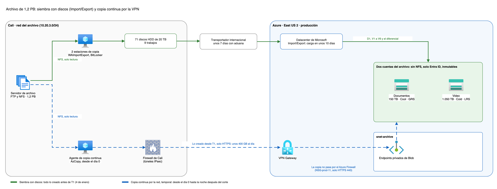
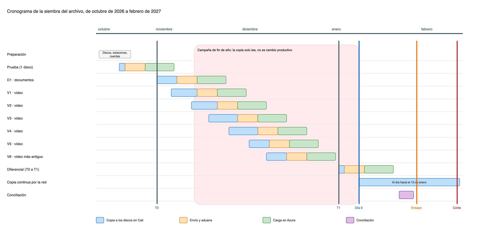

# Siembra y transferencia del archivo de 1,2 PB (Carga C)

Este documento define cómo llega a Azure el archivo histórico de Cali sin usar el enlace operativo de 400 Mbps: por qué no puede ir por la red, con qué medio físico se envía, cuántos discos hacen falta, en qué fechas, en qué cuentas de almacenamiento queda y cómo se mantiene al día hasta el corte. Completa el plan de migración (`carga-c-migracion-y-campana.md`), que solo fija cuándo tiene que estar listo.

## Contenido

1. Contexto y alcance
2. Por qué no puede ir por la red
3. El medio: Azure Import/Export con discos propios
4. Dónde queda el archivo en Azure
5. Discos, trabajos y cronograma
6. El diferencial: lo que llega al archivo después de copiar los discos
7. Verificación
8. Diagramas
9. Costo
10. Supuestos y confirmaciones pendientes de FríoAndes
11. Validación y cierre

### Términos usados

| Término | Qué significa aquí |
|---|---|
| Siembra | La carga inicial del archivo en Azure por un camino distinto de la red, antes de la convivencia |
| Import/Export | Servicio de Azure que recibe discos propios del cliente en un datacenter de Microsoft y copia su contenido a una cuenta de almacenamiento |
| Trabajo de importación | Un envío de hasta 10 discos hacia una sola cuenta de almacenamiento |
| WAImportExport | La herramienta de Microsoft que prepara los discos: copia los archivos, los cifra con BitLocker y genera el diario que Azure usa para importarlos |
| Copia continua | La copia por la red de lo que llega al archivo de Cali después de la siembra, hasta el corte |
| T0 y T1 | Las dos fechas de corte de la siembra: T0 separa lo que va en los discos principales y T1 lo que va en el envío del diferencial |
| Inmutabilidad | Una política de Azure que impide modificar o borrar un archivo hasta una fecha, ni siquiera un administrador |

## 1. Contexto y alcance

### 1.1 Lo que hay hoy

El archivo vive en una sola máquina CentOS 7 con FTP y NFS, en el clúster transversal de Cali (`10.20.3.0/24`). No tiene copia fuera de ese servidor.

| Contenido | Volumen | Cómo es |
|---|---|---|
| Video de muelles y de entregas | 1,05 PB | Objetos grandes |
| Fotos, comprobantes y PDF | 110 TB | La mayoría pesa menos de 2 MB. Si promedian 1 MB, son unos 110 millones de archivos |
| Históricos de temperatura que hoy se cargan por lote | 40 TB | Archivos que envían los centros cada hora |
| **Total** | **1,2 PB** | Crece unos 12 TB al mes, sobre todo video y fotos. Retención contractual de 5 años |

### 1.2 Qué resuelve este documento

- El cálculo del tiempo por la red y la conclusión de que no es viable.
- El medio físico, sabiendo que Azure Data Box Heavy ya no existe.
- Las cuentas de Azure que reciben el archivo: cuántas, en qué nivel de acceso, con qué redundancia e inmutabilidad.
- Cuántos discos y trabajos hacen falta, y el cronograma hasta el ensayo del corte.
- Cómo se cierra el diferencial de unos 12 TB al mes entre la copia a los discos y el corte.
- Cómo se verifica que no falta nada.

### 1.3 Qué toma de los otros diseños

| Viene de | Qué se usa aquí |
|---|---|
| `carga-c-migracion-y-campana.md` (#14) | El calendario: día 0 el 11 de enero de 2027, ensayo el 31 de enero, corte el 14 de febrero. evidencias lee y escribe por la API de Blob con el nombre de cada archivo igual a su ruta relativa de hoy, sin NFS |
| `red-topologia-subnetting.md` (#8) | `snet-archive` para los endpoints privados del archivo; la copia continua va de la VPN al endpoint privado sin pasar por el Azure Firewall (sección 6.3); el descarte de Data Box (sección 6.4) |
| `red-firewall-y-publicacion.md` (#9) | La regla temporal NSG-prod-11 de `snet-archive` y su retiro al terminar la copia continua |
| `seguridad-datos-personales-perimetro.md` (#10) | El escaneo de malware apagado durante la migración, y fotos y comprobantes en una cuenta separada del video para escanear solo esa cuenta después |
| `gobierno-auditoria-facturacion.md` (#6) | Evidencias con retención inmutable de cinco años, bloqueada |

### 1.4 Qué queda en otros diseños

- Las cifras de costo de la migración y del mes estable: #25 y #26. Aquí se dan las cantidades y los precios de lista de cada línea.
- Qué parte del archivo lee Fabric y cómo: #17 y #18.
- El paso del video a niveles más baratos después de la migración: #26, con lo que decida #17 sobre la muestra de video.

## 2. Por qué no puede ir por la red

1,2 PB son 1,2 × 10¹⁵ bytes, es decir 9,6 × 10¹⁵ bits.

| Escenario | Cálculo | Tiempo |
|---|---|---|
| Usando el enlace completo de 400 Mbps | 9,6 × 10¹⁵ / 400 × 10⁶ = 24 × 10⁶ segundos | **278 días**, unos 9 meses |
| Usando la mitad del enlace, porque la operación necesita el resto | 9,6 × 10¹⁵ / 200 × 10⁶ = 48 × 10⁶ segundos | **556 días**, unos 18 meses |
| Usando el enlace completo solo durante los 90 días de convivencia | 400 × 10⁶ × 90 × 86.400 / 8 | 389 TB, el 32 % del archivo |

Además, mientras se copia, el archivo sigue creciendo: en 278 días suma unos 111 TB más (278 / 30 × 12 TB).

**No es viable por la red.** El enlace es compartido y no hay enlace dedicado hacia la nube: aun usándolo completo, sin dejar nada para la operación, la copia tomaría tres veces lo que dura la convivencia. La red solo alcanza para seguir el crecimiento, unos 37 Mbps sostenidos (sección 6).

## 3. El medio: Azure Import/Export con discos propios

### 3.1 Opciones

| Opción | Capacidad | ¿Sirve desde Colombia? | Por qué |
|---|---|---|---|
| Azure Data Box Heavy | Unos 770 TB útiles; harían falta 2 | **No** | Microsoft lo retiró y ya no se puede pedir |
| Azure Data Box (120 TB o 525 TB) | 3 equipos de 525 TB | **No** | El equipo no cruza fronteras comerciales: Microsoft lo envía y lo recibe en un datacenter de Azure del mismo país, y Colombia no tiene región de Azure |
| Azure Data Box Disk | 40 TB por pedido; harían falta 30 pedidos | **No** | La misma restricción de país, y 30 pedidos no son manejables |
| **Azure Import/Export** | Discos propios, sin límite de trabajos | **Sí** | Se envían discos propios a un datacenter de Microsoft desde otro país, con un transportador internacional. East US 2 y Central US reciben envíos |
| Por la red | — | No | Sección 2 |

El issue pedía dimensionar dispositivos Data Box Heavy. Con ese equipo habrían hecho falta 2 (1.200 / 770, redondeado hacia arriba), pero no se puede pedir. El dimensionamiento de este documento es el del medio que sí está disponible: Import/Export.

### 3.2 Cómo funciona

1. Se prepara cada disco con WAImportExport: copia los archivos, los cifra con BitLocker (AES de 256 bits) y genera un diario por disco.
2. Se crea un trabajo de importación en Azure, uno por cada grupo de hasta 10 discos, apuntando a una sola cuenta de almacenamiento, y se sube el diario de cada disco.
3. Se envían los discos al datacenter de East US 2 con un transportador internacional y se registra el número de guía en el trabajo.
4. Microsoft recibe los discos, copia su contenido a la cuenta y los devuelve con la cuenta del transportador que dio FríoAndes.

### 3.3 Requisitos que condicionan el diseño

| Requisito de Import/Export | Consecuencia |
|---|---|
| **No admite cuentas con NFS 3.0** | Las cuentas del archivo no pueden tener NFS 3.0, como suponía la red. Ya no hace falta: evidencias pasa a la API de Blob (#14) y la copia continua usa HTTPS (sección 6). Esto también permite la inmutabilidad, que Azure no admite en cuentas con NFS 3.0 (sección 4.3) |
| Hasta 10 discos por trabajo, y cada trabajo va a una sola cuenta | Los trabajos se arman por cuenta: uno para documentos y seis para video (sección 5) |
| Discos SATA: HDD de 2,5" o 3,5" con sectores lógicos de 512 bytes, o SSD de 2,5". No sirven discos USB ni discos externos con su caja | Se usan HDD de 3,5" SATA III de 20 TB con formato 512e, que reportan sectores lógicos de 512 bytes. Sirven adaptadores USB a SATA para prepararlos, si reportan 512 bytes |
| Una sola partición NTFS por disco | WAImportExport la crea al preparar el disco |
| WAImportExport corre en Windows de 64 bits con BitLocker. La lista oficial nombra Windows 10 y Windows Server 2012 R2 | Las estaciones de copia usan Windows. En la primera semana se prueba la herramienta en Windows Server 2022; si no funciona, se usa Windows 10 Enterprise en una máquina aislada que solo hace la copia |
| Cargo de USD 80 por disco procesado, más el envío de ida (lo paga FríoAndes) y el de vuelta (a la cuenta de su transportador) | Sección 9 |

### 3.4 Seguridad del envío

- **Cifrado.** Cada disco viaja cifrado con BitLocker. La llave la protege una llave de FríoAndes en Key Vault (llave administrada por el cliente), no queda escrita en el paquete y Microsoft la usa solo para la importación.
- **Cadena de custodia.** Se lleva un inventario con el serial de cada disco y el trabajo al que pertenece. Los discos se empacan entre dos personas, en cajas selladas, y se envían con seguimiento.
- **Datos personales.** El archivo tiene fotos, firmas y video de destinatarios y conductores. El envío a Estados Unidos es la misma transmisión a Microsoft como encargado que ya aceptó #10. Los discos no se pueden leer sin la llave.
- **Al volver.** Los discos regresan a FríoAndes. Se borran de forma segura antes de reutilizarlos o desecharlos, y su destino queda anotado en el inventario.

## 4. Dónde queda el archivo en Azure

### 4.1 Dos cuentas

#10 pidió separar fotos y comprobantes del video, para escanear malware solo donde hace falta. Este diseño lo resuelve con dos cuentas en producción, en East US 2, ambas con endpoint privado de Blob en `snet-archive`, sin llave compartida (solo Entra ID) y **sin NFS 3.0 ni espacio de nombres jerárquico**:

| | Cuenta de documentos | Cuenta de video |
|---|---|---|
| Contenido | Fotos, comprobantes y PDF (110 TB) e históricos de temperatura (40 TB), en contenedores separados | Video de muelles y de entregas (1,05 PB) |
| Volumen inicial | 150 TB | 1.050 TB |
| Crecimiento | Unos 1,1 TB al mes (fotos y comprobantes) | Unos 10,9 TB al mes |
| Nivel por defecto | Cool | **Cold**: la importación queda directamente en Cold, sin pasar un mes en un nivel más caro |
| Redundancia | GRS, con copia en Central US | LRS, como punto de partida |
| Escaneo de malware | Apagado durante la siembra y la copia continua. Se enciende al cerrar la conciliación (sección 7), para lo que suban los conductores y los centros | No |
| Quién lee | evidencias y, a través de rastreo, el cliente sus propios comprobantes y fotos | evidencias, para quien atiende un reclamo |

Los históricos de temperatura van con los documentos y no con el video porque son trazabilidad contractual, como los comprobantes: van en la cuenta con copia geográfica. Como los centros dejan de enviarlos cuando cada uno pasa a IoT Hub (#14), el escaneo de malware de esa cuenta no los alcanza.

**Acceso público durante la siembra.** Import/Export escribe en la cuenta por la excepción de servicios de confianza de Microsoft, y Azure no admite esa excepción si el acceso público está desactivado del todo. Por eso, mientras dura la siembra, las dos cuentas tienen el acceso público "habilitado desde redes seleccionadas", sin ninguna red ni dirección IP permitida y con esa excepción, igual que las cuentas de telemetría (#13). Todo lo demás entra por el endpoint privado. Cuando se carga el último trabajo, el acceso público se desactiva del todo.

**Por qué el video queda en LRS.** El video es el 88 % del volumen. En Cold, LRS cuesta USD 0,0036 por GB al mes y GRS 0,00803: para 1.050 TB, unos USD 3.780 frente a 8.430 al mes. LRS ya guarda tres copias dentro del datacenter, que es más de lo que tiene hoy el archivo. Si FríoAndes exige copia geográfica también para el video, #26 cuantifica la diferencia.

### 4.2 Nombres

El nombre de cada archivo en Azure es su ruta relativa en el servidor de Cali. Así, evidencias encuentra cada archivo con la misma ruta que tiene guardada en la base, sin cambiar datos (#14, sección 2.4). Cada carpeta de primer nivel del servidor se vuelve un contenedor.

### 4.3 Inmutabilidad y borrado a los cinco años

#6 pide evidencias con retención inmutable de cinco años, bloqueada. Como las cuentas no tienen NFS 3.0, Azure lo permite. Hay un detalle propio de la siembra: **un archivo importado tiene como fecha de creación el día de la importación, no la de hace años**. Una política de cinco años contados desde la creación guardaría una foto de 2023 hasta 2031, más de lo que permite el contrato y la Ley 1581.

Por eso:

- Se usa **inmutabilidad por versión**, que permite fijar la fecha de vencimiento de cada archivo.
- Después de cada importación, un proceso toma la fecha original de cada archivo del listado de Cali, la guarda como etiqueta del archivo y fija su inmutabilidad hasta esa fecha más cinco años.
- Los archivos nuevos que llegan después del corte toman la política por defecto del contenedor: cinco años desde su creación, que en ese caso sí es su fecha real.
- **El borrado al vencer** lo hace un proceso mensual que lee la etiqueta de fecha original. No se puede usar el ciclo de vida de Azure contando días desde la creación, porque para los archivos importados esa fecha es la de la importación.
- **Los archivos con más de cinco años al momento de la siembra** se importan, pero no se bloquean. Quedan marcados para borrarlos cuando FríoAndes confirme si se pueden eliminar (es la pregunta 1 de la sesión de aclaraciones). Si lo confirma antes de preparar los discos, ni siquiera se envían (sección 9.2).

El primer envío, un disco de prueba (sección 5.3), comprueba que la importación funciona en un contenedor con inmutabilidad por versión.

## 5. Discos, trabajos y cronograma

### 5.1 Cuántos discos

Cada disco de 20 TB se llena hasta 18 TB, dejando un 10 % para el sistema de archivos, el diario y el margen de la herramienta.

| Cuenta | Volumen | Discos (volumen / 18 TB, redondeado hacia arriba) | Trabajos (hasta 10 discos) |
|---|---|---|---|
| Documentos | 150 TB | 9 | 1 (D1) |
| Video | 1.050 TB | 59 | 6 (V1 a V5 de 10 discos, V6 de 9) |
| Diferencial, documentos | Unos 2,4 TB | 1 | 1 |
| Diferencial, video | Unos 22,8 TB | 2 | 1 |
| **Total** | **Unos 1.225 TB** | **71** | **9** |

Se compran 74 discos: los 71 y 3 de repuesto por si alguno falla en la preparación.

### 5.2 Estaciones de copia y velocidad

Dos estaciones Windows con WAImportExport, en la red del archivo de Cali (`10.20.3.0/24`), conectadas al servidor de archivo por 10 GbE y con el recurso NFS montado en solo lectura. Cada estación prepara hasta 5 discos a la vez, así que entre las dos llenan un trabajo completo de 10 discos.

El límite no son los discos, que escriben a más de 150 MB/s cada uno. El límite es cuánto puede leer el servidor de archivo sin degradar a evidencias, que lo sigue usando todos los días:

| Horario | Lectura máxima del servidor | Por qué |
|---|---|---|
| 04:00 a 22:00 (despacho) | 250 MB/s | evidencias sigue leyendo y escribiendo en el servidor |
| 22:00 a 04:00 | 500 MB/s | Uso mínimo del archivo |
| **Promedio del día** | **312,5 MB/s, unos 27 TB al día** | (18 × 250 + 6 × 500) / 24 |

Estos valores son un supuesto. La primera semana se mide la latencia de evidencias con la copia corriendo y se ajustan. La copia solo lee el servidor, así que no es un cambio productivo y puede correr durante la campaña de fin de año. Si en campaña la lectura degrada a evidencias, se baja el tope diurno y el cronograma usa el margen de la sección 5.4.

**Por qué no se lee el NFS a través de la VPN desde Azure.** Con unos 90 ms de viaje de ida y vuelta, cada archivo pequeño cuesta varias idas y vueltas de NFS. Para 110 millones de archivos, eso domina el tiempo. Las estaciones de copia y el agente de la copia continua (sección 6) leen el NFS dentro de la red de Cali.

### 5.3 Cronograma

Fechas de 2026 y 2027. El tránsito supuesto es de 7 días puerta a puerta, incluida la aduana, y la carga en Azure toma 10 días desde que llegan los discos. Ambos se confirman con la prueba.

| Paso | Volumen | Copia a discos | Envío | Llega a East US 2 | En Azure |
|---|---|---|---|---|---|
| Preparación: confirmaciones con Microsoft y el transportador, compra de discos, estaciones, cuentas de Azure | — | 13 al 23 de octubre | — | — | — |
| **Prueba**: 1 disco con unos 2 TB de fotos | 2 TB | 20 y 21 de octubre | 22 de octubre | 29 de octubre | 8 de noviembre |
| **T0**: listado del archivo de Cali. Todo lo que exista antes de T0 va en D1 y V1 a V6 | — | Lunes 2 de noviembre | — | — | — |
| D1: documentos | 150 TB | 2 al 7 de noviembre | 9 de noviembre | 16 de noviembre | 26 de noviembre |
| V1: video más reciente | 180 TB | 7 al 14 de noviembre | 16 de noviembre | 23 de noviembre | 3 de diciembre |
| V2 | 180 TB | 14 al 20 de noviembre | 23 de noviembre | 30 de noviembre | 10 de diciembre |
| V3 | 180 TB | 20 al 27 de noviembre | 30 de noviembre | 7 de diciembre | 17 de diciembre |
| V4 | 180 TB | 27 de noviembre al 4 de diciembre | 7 de diciembre | 14 de diciembre | 24 de diciembre |
| V5 | 180 TB | 4 al 10 de diciembre | 11 de diciembre | 18 de diciembre | 28 de diciembre |
| V6: video más antiguo | 150 TB | 10 al 16 de diciembre | 17 de diciembre | 24 de diciembre | 3 de enero |
| **T1**: listado del archivo. Lo creado entre T0 y T1 va en el envío del diferencial | — | Lunes 4 de enero | — | — | — |
| Diferencial: documentos y video | Unos 25 TB | 4 y 5 de enero | 6 de enero | 13 de enero | 23 de enero |
| Copia continua por la red, de lo creado desde T1 | Unos 400 GB al día | Desde el día 0, 11 de enero (sección 6) | — | — | Al día hacia el 15 de enero |
| Conciliación (sección 7) | — | 25 al 29 de enero | — | — | — |
| **Ensayo del corte** con el archivo completo | — | Domingo 31 de enero | — | — | — |

La prueba sale antes de que empiece la copia grande y vuelve antes de que se envíe V1. Así, el tránsito, la aduana, la carga y la inmutabilidad por versión se comprueban con un disco y no con diez.

**Orden.** Primero los documentos, que son los que más consulta evidencias y los que ve el cliente en el portal. Después el video, del más reciente al más antiguo, porque los reclamos casi siempre son sobre entregas recientes.

### 5.4 Margen y qué pasa si algo se atrasa

El límite real no es el día 0: es el **corte del 14 de febrero**. Hasta el corte, evidencias sigue corriendo en Cali y leyendo el servidor de Cali, así que nada de lo que se siembra se usa antes. Además, la carga de V5 y V6 cae en la semana de Navidad, cuando el tránsito y la carga pueden tardar más que lo supuesto.

| Si pasa esto | Qué se hace |
|---|---|
| La prueba muestra un tránsito o una carga más lentos | Se recalcula el cronograma antes de enviar V1. Hay unas 4 semanas de margen entre la conciliación y el corte |
| La lectura en campaña tiene que bajar | Cada 50 MB/s menos de lectura diurna alarga la copia unos 6 días. El margen absorbe hasta unos 150 MB/s menos |
| Se rechaza o se pierde un disco | Se vuelve a copiar con un disco de repuesto y va en el envío siguiente |
| V6 (el video más antiguo) no está cargado para el corte | El corte sigue. Mientras llega, si un reclamo necesita uno de esos videos, operación lo copia a mano desde el servidor de Cali, que sigue encendido hasta el 12 de marzo (#14, sección 6.3) |
| Los documentos (D1) o el diferencial no están cargados para el corte | El corte no se hace: es un criterio para seguir del guion (#14, sección 5.4) |

## 6. El diferencial: lo que llega al archivo después de copiar los discos

El archivo crece unos 12 TB al mes, unos 400 GB al día. Ese crecimiento se cierra en tres tramos, sin que el corte tenga que copiar volumen:

| Tramo | Qué cubre | Cómo llega |
|---|---|---|
| Antes de T0 (2 de noviembre) | Todo el archivo existente, 1,2 PB | Discos D1 y V1 a V6 |
| Entre T0 y T1 (2 de noviembre al 4 de enero) | 63 días × 400 GB, unos 25 TB | Un envío más de discos: el diferencial |
| Desde T1 | Unos 400 GB al día | La copia continua por la red, desde el día 0 |

El tramo del medio va en discos y no por la red por dos razones: los túneles de Cali hacia Azure se activan el día 0 (#14), y aunque existieran antes, 25 TB más el crecimiento diario tardarían más de un mes en ponerse al día por la red.

### 6.1 La copia continua

| | Cómo es |
|---|---|
| Quién copia | Un agente en una máquina Linux nueva en Cali, en la red del archivo (`10.20.3.0/24`), con el recurso NFS montado en solo lectura. Empuja los archivos a Azure con AzCopy |
| Por dónde | Por la VPN hasta el endpoint privado de Blob de cada cuenta en `snet-archive`, sin pasar por el Azure Firewall, como ya decidió la red (sección 6.3 de `red-topologia-subnetting.md`). El DNS de Cali resuelve los nombres privados con el resolver del hub |
| Puerto | Solo HTTPS (443). Las cuentas ya no tienen NFS, así que la regla NSG-prod-11 deja de permitir los puertos 111 y 2048 |
| Identidad | Una entidad de servicio con certificado, con permiso de escritura solo en las dos cuentas del archivo. Vence el día 90. Sin token SAS ni llave de la cuenta |
| Qué copia | Cada hora, los archivos creados o modificados desde la pasada anterior, más una pasada completa los domingos. Si el archivo está organizado por carpetas de fecha, la pasada de cada hora recorre solo las carpetas del mes en curso y del anterior |
| Topes de ancho de banda | 50 Mbps de 04:00 a 22:00 y 250 Mbps de 22:00 a 04:00: hasta 405 + 675 = 1.080 GB al día, frente a unos 400 GB de crecimiento |
| Ponerse al día | Entre T1 (4 de enero) y el día 0 (11 de enero) se acumulan unos 2,8 TB. Con 680 GB al día por encima del crecimiento, la copia queda al día en unos 4 días, hacia el 15 de enero |
| Después | El promedio queda en los unos 37 Mbps que ya usó la red para dimensionar el VPN Gateway |

Una pasada por hora deja, en el peor momento, unos 17 GB por copiar. Es lo que el corte sincroniza en paralelo con la validación de la base (#14, sección 5.1).

**Por qué no AzCopy `sync`.** `sync` compara el origen completo con el destino completo en cada pasada. Con más de 110 millones de archivos, cada pasada tardaría horas solo en listar. La copia por fecha de modificación solo toca lo nuevo.

### 6.2 Cuándo termina

La noche después del corte (lunes 15 de febrero) se hace la última pasada y una conciliación final (sección 7). Desde ahí, evidencias escribe directamente en Azure. Se apaga el agente y se retira la regla NSG-prod-11, como ya fija #14.

## 7. Verificación

| Momento | Qué se verifica | Cómo |
|---|---|---|
| Cada trabajo | Que Azure copió todo lo que tenía cada disco | El registro de errores de cada disco que entrega el trabajo de importación. Un archivo con error se vuelve a enviar por la copia continua |
| Cada trabajo | Fechas originales e inmutabilidad | El proceso de la sección 4.3, con su propio registro |
| Conciliación (25 al 29 de enero) | Que están todos los archivos | Se compara el listado completo de Cali (ruta, tamaño y fecha) con el inventario de Blob de las dos cuentas. Toda diferencia se copia por la red |
| Conciliación | Que el contenido es el mismo | Se calcula el MD5 de una muestra del 1 % de los archivos en Cali y en Azure, desde una máquina de `snet-admin`, dentro de la región |
| Conciliación | Que la llave compartida sigue desactivada y que el acceso público queda desactivado del todo, ya sin la excepción de Import/Export | Azure Policy de la landing zone (#5) |
| Noche del 15 de febrero | Lo mismo, después de la última pasada | Ídem |

**Criterio para el ensayo:** el 100 % de los archivos del listado de T1 está en Azure con el mismo tamaño, la muestra de MD5 coincide completa y no hay errores pendientes. Al cerrar la conciliación se enciende el escaneo de malware de la cuenta de documentos (#10).

El atraso de la copia continua tiene su alerta en el monitoreo de la migración: avisa si pasa de un día de crecimiento, unos 400 GB (#14, sección 6.4).

## 8. Diagramas

El primer diagrama muestra los dos caminos: los discos, desde las estaciones de copia hasta las dos cuentas por Import/Export, y la copia continua, desde el agente de Cali por la VPN hasta los endpoints privados de `snet-archive`.

El segundo diagrama es el cronograma de la sección 5.3: copia, tránsito y carga de cada trabajo, la copia continua, la conciliación, la campaña de fin de año y los hitos del plan de migración.

Los dos se generan con `tools/build_carga_c_diagrams.py`.

## 9. Costo

### 9.1 Líneas para el costo de la migración (#25)

Precios de lista de East US 2, consultados en la API pública de precios de Azure.

| Línea | Cálculo | USD | Supuesto |
|---|---|---|---|
| Discos | 74 × 450 | 33.300 | HDD de 20 TB, SATA III, 512e, a unos USD 450 puestos en Cali. Se cotiza |
| Cargo de Import/Export | 71 discos × 80 | 5.680 | Precio de lista por disco procesado |
| Envío internacional de ida y vuelta, con aduana | 9 envíos × 2 × unos 600 | Unos 10.800 | Una caja de hasta 10 discos por envío. Se cotiza con el transportador |
| Escritura de los documentos | Unos 115 millones de archivos × 0,20 por 10.000 (Cool GRS) | Unos 2.300 | Un archivo pequeño es una escritura |
| Escritura del video | 1,05 × 10¹⁵ / 4 MiB, unos 250 millones de bloques × 0,18 por 10.000 (Cold LRS) | Unos 4.500 | El peor caso: cada bloque de 4 MiB cuenta como una escritura |
| Fecha original e inmutabilidad por archivo | Unos 117 millones de archivos × 2 operaciones | Unos 2.300 | Dos escrituras por archivo, al precio de la cuenta de documentos |
| Estaciones de copia | 2 × 3.000 | 6.000 | Si FríoAndes no tiene equipos que sirvan |
| Almacenamiento antes de que la plataforma entre en operación | Ver la sección 9.3 | — | Se cuenta en #25 hasta el corte |
| **Total sin almacenamiento** | | **Unos 65.000** | |

No incluye las horas del equipo: la preparación, unas 7 semanas de cambio de discos en las estaciones y la conciliación.

### 9.2 Decisiones que bajan o evitan gasto

| Decisión | Alternativa descartada | Qué se evita |
|---|---|---|
| Siembra con discos propios | Copiar por la red | La red no alcanza: 278 días usando todo el enlace (sección 2) |
| El video se importa directo a Cold | Importar a Hot y moverlo después | Para 1.050 TB, Hot LRS cuesta unos USD 19.320 al mes y Cold LRS 3.780: unos USD 15.500 al mes mientras se esperaba el cambio de nivel |
| Video en LRS | Video en GRS | Unos USD 4.650 al mes en Cold (sección 4.1) |
| Escaneo de malware apagado durante la siembra | Escanear el 1,2 PB al importar | Unos USD 180.000, ya calculados en #10 |
| La copia continua empuja desde Cali por HTTPS | Una máquina de copia en Azure que lee el NFS de Cali por la VPN | La máquina en Azure, su Defender for Servers y, sobre todo, la lentitud del NFS con 90 ms de latencia |
| No enviar lo que tenga más de cinco años, si FríoAndes lo confirma | Enviarlo todo | Cada 100 TB menos son 6 discos (unos USD 3.200 entre disco y cargo) y unos USD 360 al mes en Cold |

### 9.3 Almacenamiento durante la siembra

Con todo cargado, a precios de lista: video, 1.050.000 GB × 0,0036 = USD 3.780 al mes; documentos, 150.000 GB × 0,02 = USD 3.000 al mes (Cool GRS). Son unos USD 6.780 al mes desde enero, que van creciendo a medida que llegan los trabajos desde finales de noviembre. #25 cuenta los meses hasta el corte y #26 el mes estable, con el crecimiento y los cinco años de retención.

## 10. Supuestos y confirmaciones pendientes de FríoAndes

### 10.1 Confirmaciones que necesita el diseño

| Tema | Pregunta | Qué pasa si la respuesta cambia |
|---|---|---|
| Import/Export desde Colombia | ¿Microsoft confirma la recepción en East US 2 de envíos desde Colombia, los tiempos de carga y la capacidad para unos 71 discos? | Si no, el archivo tendría que sembrarse por partes a lo largo de meses, y la convivencia de 90 días no alcanza |
| Aduana y transportador | ¿Qué transportador y agente de aduana usa FríoAndes para exportar e importar temporalmente los discos, y cuánto tarda puerta a puerta? | Mueve el cronograma. El supuesto es de 7 días |
| Archivos de más de cinco años | ¿El 1,2 PB incluye archivos de más de cinco años? ¿Se pueden borrar? | Si se pueden borrar, no se envían: menos discos y menos almacenamiento |
| Lectura del servidor de archivo | ¿Qué velocidad de lectura aguanta el servidor sin degradar a evidencias? ¿Tiene una interfaz de 10 GbE libre? | Cambia la duración de la copia: el supuesto es de 27 TB al día |
| Organización del archivo | ¿El archivo está organizado en carpetas por fecha? ¿Los archivos se modifican después de creados? | Define cómo recorre el archivo la copia continua cada hora |
| Redundancia del video | ¿El contrato con los clientes exige copia geográfica también del video? | El video pasaría a GRS, unos USD 4.650 más al mes |

### 10.2 Supuestos del diseño

| Supuesto | Por qué se asume |
|---|---|
| Los discos son HDD de 20 TB, 3,5" SATA III, con formato 512e, y se llenan hasta 18 TB | Son discos de mercado que cumplen los requisitos de Import/Export |
| El servidor de archivo entrega 250 MB/s en horario de despacho y 500 MB/s de noche, unos 27 TB al día | No hay datos del servidor. Se mide la primera semana |
| El tránsito toma 7 días puerta a puerta y la carga en Azure 10 días desde que llegan los discos | Microsoft no publica tiempos. Se mide con el disco de prueba |
| Las fotos y comprobantes promedian 1 MB, unos 110 millones de archivos | El enunciado dice que la mayoría pesa menos de 2 MB |
| El crecimiento se reparte en unos 1,1 TB al mes de documentos y unos 10,9 TB de video | Sale de la proporción del archivo actual (110 TB frente a 1,05 PB), como en #10 |
| Los archivos casi no se modifican después de creados | Son video, fotos, comprobantes firmados e históricos. La conciliación encuentra los que sí cambiaron |
| La importación funciona en contenedores con inmutabilidad por versión | Se comprueba con el disco de prueba. Si no, la inmutabilidad se activa al terminar cada importación |
| WAImportExport funciona en Windows Server 2022 | La lista oficial es antigua. Si no funciona, se usa Windows 10 Enterprise aislada |
| Las dos cuentas del archivo existen en producción antes del 20 de octubre | Un trabajo de importación necesita su cuenta. Son la primera pieza de producción que se crea con el código de infraestructura (#20 a #22) |

## 11. Validación y cierre

| Criterio de aceptación | Evidencia en este documento |
|---|---|
| El documento muestra el cálculo de tiempo teórico por 400 Mbps compartido y concluye explícitamente que no es viable por red | Sección 2: 278 días con el enlace completo y 556 con la mitad, frente a 90 días de convivencia. "No es viable por la red" |
| Se dimensiona la cantidad de dispositivos Azure Data Box Heavy necesarios para 1,2 PB, y se define cómo se cierra el diferencial de crecimiento (~12 TB/mes) en el corte | Sección 3.1: con Data Box Heavy harían falta 2, pero está retirado y Data Box no se envía a Colombia; el medio disponible es Import/Export, dimensionado en la sección 5 (71 discos en 9 trabajos). Sección 6: el diferencial se cierra con un envío más de discos (T0 a T1) y la copia continua por la red desde T1, así que el corte solo sincroniza la última hora, unos 17 GB |
