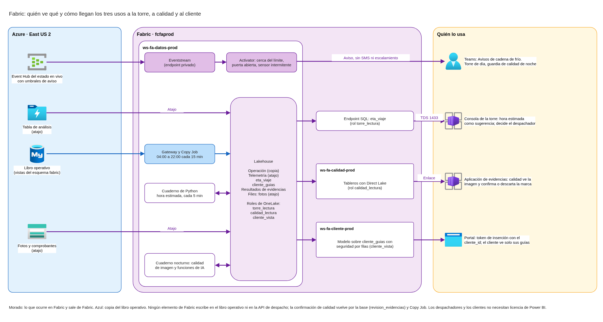
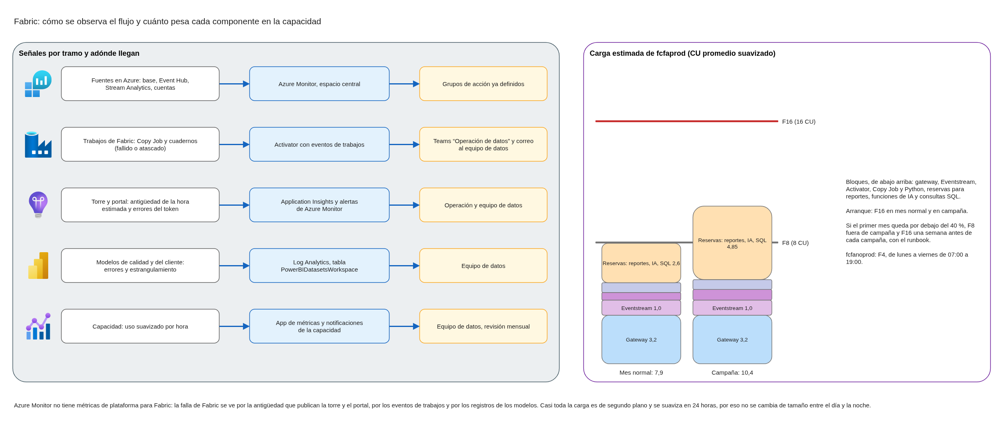

# Microsoft Fabric: acceso, usos de inteligencia artificial, observabilidad y capacidad

Este documento define cómo usan Microsoft Fabric la torre de control, el equipo de calidad y el cliente corporativo: quién ve qué y con qué permisos; cómo funcionan los tres usos de inteligencia artificial (aviso temprano de excursión o de sensor caído, hora estimada de llegada y apoyo al archivo de evidencias); cómo se observa el flujo; qué tamaño tiene la capacidad y cómo se reduce fuera de campaña. Parte de los espacios de trabajo, capacidades, caminos de datos y región de `fabric-workspaces-ingesta-region.md`, y usa la telemetría, los datos personales, las identidades, la observabilidad y la migración ya diseñadas, con sus mismos nombres.

## Contenido

1. Contexto y alcance
2. Acceso por rol
3. Aviso temprano de excursión y de sensor caído
4. Hora estimada de llegada
5. Apoyo al archivo de evidencias
6. Resumen de los tres usos
7. Observabilidad del flujo
8. Capacidad, licencias y reducción fuera de campaña
9. Diagramas
10. Supuestos, ajustes a la aplicación y confirmaciones pendientes de FríoAndes

### Términos usados

| Término | Significado en este documento |
|---|---|
| Rol de seguridad de OneLake | Un permiso de lectura sobre tablas o carpetas concretas de un lakehouse, asignado a grupos de Entra ID. Afecta a los usuarios con rol Viewer o con permiso de lectura del elemento |
| Atajo interno | Un atajo de OneLake entre espacios de trabajo. Lee con la identidad de quien consulta, así que el rol de OneLake del destino es el techo |
| Direct Lake | El modo en que un modelo semántico lee las tablas Delta de OneLake sin copiarlas ni programar actualizaciones |
| Token de inserción | El permiso temporal que el servidor del portal pide a Power BI para mostrar el reporte a un cliente, con su identidad efectiva |
| Eventstream | El elemento de Fabric que lee eventos en tiempo real, en este caso del Event Hub del estado en vivo |
| Activator | El motor de reglas de Fabric que evalúa eventos por objeto (por sensor) y envía avisos |
| Funciones de IA | Funciones de Fabric que aplican un modelo de lenguaje ya entrenado (gpt-5-mini por defecto) a texto o imágenes desde un cuaderno |
| Suavizado | La forma en que Fabric reparte el consumo de una operación: 24 horas para las de segundo plano y de 5 a 64 minutos para las interactivas |
| CU | Unidad de capacidad. Una capacidad F16 tiene 16 CU |

---

## 1. Contexto y alcance

### 1.1 Qué necesita FríoAndes

La torre de control, el turno de calidad y la vista analítica del cliente corporativo consumen inteligencia artificial a través de Fabric, con tres reglas que no se negocian:

- La decisión de despacho sigue siendo de una persona en la torre. La inteligencia artificial sugiere.
- El cliente no ve la flota completa ni el video.
- La alerta de temperatura de menos de un minuto no depende de Fabric: vive en la telemetría y funciona aunque Fabric no esté.

Las cifras que dimensionan el diseño: 120 camiones en ruta (180 en campaña), 32 cuartos fríos, 450 usuarios internos, unos 2.000 clientes corporativos, despacho de 04:00 a 22:00 y vigilancia las 24 horas, con la guardia de calidad de noche.

### 1.2 Qué toma de los otros diseños

| Diseño | Qué toma |
|---|---|
| `fabric-workspaces-ingesta-region.md` | Espacios `ws-fa-datos`, `ws-fa-torre`, `ws-fa-calidad` y `ws-fa-cliente` por ambiente; capacidades `fcfaprod` y `fcfanoprod` en East US 2; atajos a la telemetría y al archivo; Copy Job del libro operativo por el gateway de red virtual; grupos de administración |
| `carga-b-telemetria.md` | Alerta de menos de un minuto, reglas y destinatario según la hora; Event Hub del estado en vivo; tablas de detalle, resumen de 5 minutos y alertas; topes de Direct Lake; reglas de licencias de Power BI |
| `seguridad-iam-cifrado.md` | Grupos `grp-fa-despacho` y `grp-fa-calidad`; clientes como invitados ligados a un `cliente_id`; MFA; Key Vault |
| `seguridad-datos-personales-perimetro.md` | Qué no ve el cliente; sin reconocimiento facial; transmisión a Microsoft en Estados Unidos |
| `observabilidad-slo-zabbix.md` | Espacio central de Log Analytics, Application Insights por ambiente, grupos de acción, Logic App para Teams |
| `carga-c-migracion-y-campana.md` | Tres campañas (fin de año, Semana Santa, mitad de año), sin cambios productivos durante una campaña |

### 1.3 Qué queda en otros diseños

- El precio de cada mes de Fabric, normal y de campaña, y el ahorro frente a copiar el archivo: `docs/costs/costo-fabric.md`, con los tamaños y horas de la sección 8.
- La lista consolidada de decisiones que bajan gasto, con las de la sección 8.4.
- La aplicación de la torre, del portal y de evidencias: los ajustes que piden se listan en la sección 10.2.

---

## 2. Acceso por rol

### 2.1 Cómo consume cada público

| Público | Grupo | Dónde ve la inteligencia artificial | Rol en Fabric | Licencia de Power BI |
|---|---|---|---|---|
| Despachadores | `grp-fa-despacho` | En la consola de la torre: hora estimada de llegada junto a cada guía, y avisos en Teams | Ninguno | No necesita |
| Líderes de la torre | `grp-fa-torre-lideres` | Reportes de `ws-fa-torre`, incluida la precisión de la hora estimada | Member de `ws-fa-torre-*` | Pro |
| Calidad, incluida la guardia de noche | `grp-fa-calidad` | Tableros de `ws-fa-calidad` y avisos en Teams | Viewer de `ws-fa-calidad-prod` | Pro |
| Líderes de calidad | `grp-fa-calidad-lideres` | Los mismos tableros, y crean reportes | Member de `ws-fa-calidad-*` | Pro |
| Cliente corporativo | Invitado ligado a un `cliente_id` | Reporte insertado en el portal de rastreo | Ninguno: el portal entra con su entidad de servicio | No necesita |
| Equipo de datos | `grp-fa-fabric-admin` | Todo | Admin de los espacios | Pro |

Así, la mayoría de los usuarios internos no necesitan licencia de Power BI: los despachadores ven la inteligencia artificial dentro de la consola que ya usan.

### 2.2 Qué datos ve cada uno

Roles de seguridad de OneLake en el lakehouse de `ws-fa-datos-prod`. Los espacios de consumo leen por atajos internos con la identidad de quien consulta, así que estos roles son el techo de lo que cualquier reporte puede mostrar.

| Rol | Miembros | Lee | No lee |
|---|---|---|---|
| `torre_lectura` | Identidad administrada del servicio de la torre y `grp-fa-torre-lideres` | Guías (sin la ubicación del punto de entrega), viajes y paradas, activos, resumen y alertas de telemetría, `eta_viaje` y precisión de la hora estimada | Detalle de telemetría, imágenes, resultados de evidencias |
| `calidad_lectura` | `grp-fa-calidad` y `grp-fa-calidad-lideres` | Activos, guías (sin ubicación), telemetría completa, alertas, resultados de la revisión de evidencias y su confirmación | Imágenes: se abren en la aplicación de evidencias, que registra cada acceso |
| `cliente_vista` | Identidad fija del modelo del cliente | Solo `cliente_guias` | Todo lo demás |

`cliente_guias` es una tabla curada, una fila por guía: cliente, estado, temperatura mínima, máxima y promedio del viaje o de la permanencia en bodega, excursiones y cuándo se resolvieron, y hora estimada de llegada. La escribe el mismo cuaderno que calcula la hora estimada (sección 4.2). Nunca lleva posición, camión, conductor ni video.

### 2.3 Vista del cliente

- Modelo semántico en `ws-fa-cliente-prod` con Direct Lake sobre `cliente_guias` y seguridad por filas por `cliente_id`.
- El servidor del portal pide un token de inserción V2 con su entidad de servicio, que se autentica con un certificado guardado en Key Vault y es Member de `ws-fa-cliente-prod`. Pone como identidad efectiva el `cliente_id` del usuario, que sale del vínculo que administra FríoAndes y nunca de un parámetro del navegador.
- El cliente no necesita licencia de Power BI: es el modelo en que la aplicación es dueña de los datos.

### 2.4 La decisión de despacho

- Ningún elemento de Fabric escribe en el libro operativo ni llama a la API de despacho.
- Las acciones de Activator solo notifican (Teams y correo).
- La consola de la torre muestra la hora estimada y los avisos como sugerencias; asignar, reprogramar o desviar lo hace siempre un despachador.
- Las marcas de la revisión de evidencias son sugerencias que calidad confirma o descarta (sección 5.3).

### 2.5 Ajustes del tenant de Fabric

| Ajuste | Para quién |
|---|---|
| Embed content in apps | Solo el grupo de la entidad de servicio del portal |
| Allow service principals to use Power BI APIs | Solo ese grupo |
| Users can access data stored in OneLake with apps external to Fabric | Activo: lo exige el uso de atajos con seguridad de OneLake |
| Copilot y funciones con Azure OpenAI | Activo para `ws-fa-datos-*`. Con la capacidad en Estados Unidos no hace falta el procesamiento entre geografías |
| Azure Log Analytics connections for workspace administrators | Solo `grp-fa-fabric-admin` |

---

## 3. Aviso temprano de excursión y de sensor caído

### 3.1 Qué agrega a la alerta

La alerta de la telemetría avisa cuando la lectura ya salió del rango o el sensor lleva 90 segundos sin señal. El aviso temprano llega antes: cuando la temperatura se acerca al límite, cuando una puerta lleva más de lo normal abierta o cuando un sensor empieza a fallar a ratos. No reemplaza la alerta ni su escalamiento.

### 3.2 Cómo se calcula

Un Eventstream en `ws-fa-datos-prod` lee el Event Hub del estado en vivo, el mismo que alimenta el mapa de la torre, con un grupo de consumidores propio (`fabric`) y por un endpoint privado administrado que aprueba el namespace de Event Hubs. Activator evalúa reglas por sensor sobre ese flujo.

| Aviso | Regla en Activator | Cuánto se adelanta |
|---|---|---|
| Cerca del límite | El promedio de 5 minutos de la temperatura sube por encima del umbral de aviso del sensor (máximo del rango menos el margen que fija calidad), o baja por debajo del umbral inferior | Minutos antes de salir del rango |
| Puerta abierta de más | Puerta abierta, verdadera durante 3 minutos en cuartos fríos y 10 en camiones | La alerta salta a los 5 y 15 minutos |
| Sensor intermitente | Total de lecturas en 10 minutos por debajo del 70 % de lo esperado (20 en cuartos fríos, 10 en camiones con viaje activo) | La alerta de sin señal solo salta cuando se corta del todo |

Los umbrales son propiedades de cada evento: Activator compara la temperatura con el umbral del mismo sensor, sin reglas fijas por tipo de carga.

### 3.3 Destinatarios

Activator publica en el canal de Teams "Avisos de cadena de frío". De día lo sigue la torre y de noche la guardia de calidad, con notificación en el teléfono. No hay SMS ni escalamiento: siguen siendo exclusivos de la alerta.

### 3.4 Lo que pide a la telemetría

- La tabla de rangos que mantiene calidad suma una columna de margen de aviso por cuarto frío y por tipo de carga.
- Stream Analytics agrega a cada evento del estado en vivo los dos umbrales de aviso del sensor.
- El namespace de Event Hubs suma el grupo de consumidores `fabric` y aprueba el endpoint privado administrado de Fabric.

### 3.5 Segundo release

El pronóstico con funciones de series de tiempo (una curva que estima cuándo cruzará el límite cada sensor) necesita meses de historial para calibrar los márgenes y un Eventhouse encendido las 24 horas. Se evalúa con los datos del primer trimestre de operación.

---

## 4. Hora estimada de llegada

### 4.1 Método

Estadística del propio historial, sin entrenar un modelo:

1. **Tiempos por tramo**, recalculados cada semana: para cada tramo (centro a parada y parada a parada), la mediana y el percentil 80 del tiempo real de viaje, por franja horaria y tipo de día, con los viajes y paradas del libro operativo. Un tramo con pocos viajes usa la mediana de su franja en la misma ciudad.
2. **Hora estimada** de cada guía pendiente: la hora de la última posición o de la última parada cumplida, más las medianas de los tramos que faltan, ajustada por el atraso que ya lleva el viaje frente a su plan. Se muestra como un rango entre la mediana y el percentil 80.
3. **Precisión**: cada llegada real se compara con la hora estimada que había 60 y 30 minutos antes. Los líderes de la torre ven el error por ruta y franja.

### 4.2 Cálculo y frecuencia

Un cuaderno de Python en `ws-fa-datos-prod` corre cada 5 minutos de 04:00 a 22:00 y cada 15 minutos de noche. Lee la última posición de cada camión con viaje activo (detalle de telemetría del día en curso), los viajes y paradas y los tiempos por tramo; sobrescribe `eta_viaje` (una fila por guía pendiente) y actualiza `cliente_guias`.

### 4.3 Cómo llega a la torre

- El servicio de la torre consulta `eta_viaje` por el endpoint SQL del lakehouse cada minuto, con su identidad administrada, miembro del rol `torre_lectura`, y reintenta ante errores transitorios.
- La consola muestra la hora junto a cada guía como "estimada", con su rango y su antigüedad.
- Si Fabric no responde, la consola muestra la última hora conocida con su antigüedad y, pasados 15 minutos, vuelve a la hora planeada.
- Red: TDS por TCP 1433 desde `snet-app-torre` hacia las etiquetas de servicio `PowerBI` y `Sql`, como pide Microsoft para el endpoint SQL (reglas FW-325 a 327 de `red-firewall-y-publicacion.md`).

---

## 5. Apoyo al archivo de evidencias

### 5.1 Qué se revisa y con qué

Un cuaderno nocturno en `ws-fa-datos-prod` revisa las fotos y comprobantes del día anterior, unos 37.000 archivos con el supuesto de 1 MB por archivo:

| Etapa | A qué archivos | Cómo | Qué marca |
|---|---|---|---|
| 1. Calidad de imagen | Todas las fotos y comprobantes nuevos | Medidas de imagen en Spark, sin inteligencia artificial: nitidez, brillo y resolución | "Posible ilegible" |
| 2. Revisión con inteligencia artificial | Fotos de carga de entregas con reclamo abierto o con excursión en el viaje, las marcadas en la etapa 1 y una muestra aleatoria del 10 % del resto | Función de IA multimodal de Fabric (gpt-5-mini) con salida estructurada | "Ilegible", "carga visiblemente dañada", motivo corto y confianza |

Antes de activar la etapa 2 completa, una semana piloto mide los tokens reales con `ai.stats`: Microsoft no publica cuántos tokens cuenta una imagen.

### 5.2 Video

Segundo release. Las funciones de IA aceptan imágenes, no video, así que analizar un clip exige extraer cuadros, y su costo se estima con los datos del piloto de fotos. En el primer release, el tablero de calidad lista los clips de cada reclamo abierto con su enlace a la aplicación de evidencias; Fabric no analiza video.

### 5.3 Uso del resultado

- Las marcas son sugerencias. El tablero de calidad las lista con un enlace a la aplicación de evidencias, donde calidad ve la imagen y confirma o descarta la marca. La aplicación guarda esa respuesta en la tabla `revision_evidencias` de la base, que vuelve a Fabric con Copy Job.
- Fabric solo lee el archivo; no borra, mueve ni modifica evidencias.
- La instrucción al modelo evalúa solo la legibilidad y el estado de la carga, nunca identifica personas: no hay reconocimiento facial.
- Las imágenes se procesan en el servicio de Azure OpenAI de Fabric en Estados Unidos, que no guarda las instrucciones, las entradas ni las salidas. Es la misma transmisión a Microsoft como encargado de los demás datos.

---

## 6. Resumen de los tres usos

| Uso | Fuente de datos | Consumidor | Frecuencia | Release |
|---|---|---|---|---|
| Aviso temprano de excursión y de sensor caído | Event Hub del estado en vivo (temperatura, puertas, lecturas, umbrales de aviso) | Torre de día y guardia de calidad de noche, en Teams | Continua, por evento | Primero; el pronóstico con series de tiempo, segundo |
| Hora estimada de llegada | Posiciones (detalle de telemetría), viajes y paradas (libro operativo), tiempos por tramo | Consola de la torre; vista del cliente por `cliente_guias` | Cada 5 minutos de día y 15 de noche; tiempos por tramo cada semana | Primero |
| Apoyo al archivo de evidencias | Fotos y comprobantes nuevos (cuenta de documentos), reclamos y excursiones | Calidad, en su tablero y en la aplicación de evidencias | Cada noche | Primero para fotos y comprobantes; video, segundo |

---

## 7. Observabilidad del flujo

Azure Monitor no tiene métricas de plataforma para la capacidad de Fabric. Por eso el flujo se observa en cinco tramos que terminan en los mismos destinatarios de la observabilidad de la plataforma:

| Tramo | Señal | Dónde | Quién recibe |
|---|---|---|---|
| Fuentes en Azure | Métricas y registros de la base, el Event Hub, Stream Analytics y las cuentas | Azure Monitor, espacio central | Los grupos de acción ya definidos |
| Trabajos de Fabric (Copy Job, cuadernos de hora estimada, mantenimiento, evidencias) | Trabajo fallido o atascado | Activator suscrito a los eventos de trabajos de `ws-fa-datos-prod` (misma región) | `grp-fa-fabric-admin`, canal "Operación de datos" y correo |
| Lo que ven la torre y el cliente | Antigüedad de la hora estimada y de `cliente_guias`; errores al pedir el token de inserción | Application Insights de cada servicio; alertas de Azure Monitor | Operación y equipo de datos: antigüedad mayor a 15 minutos de 04:00 a 22:00, errores de token por encima del 5 % en 5 minutos |
| Modelos de calidad y del cliente | Errores de consulta y demoras por estrangulamiento (`capacityThrottlingMs` mayor que 0) | `ws-fa-cliente-prod` y `ws-fa-calidad-prod` conectados al espacio central de Log Analytics (tabla `PowerBIDatasetsWorkspace`); alerta con consulta | Equipo de datos |
| Capacidad | Uso suavizado por hora y estrangulamiento | App de métricas de capacidad y notificaciones de la capacidad | Equipo de datos, revisión mensual |

La falla de Fabric aparece donde la operación ya mira (la antigüedad en la consola y en Azure Monitor), aunque Fabric no publique métricas en Azure Monitor.

---

## 8. Capacidad, licencias y reducción fuera de campaña

### 8.1 Carga estimada de `fcfaprod`

| Componente | Cálculo | CU promedio |
|---|---|---|
| Eventstream | 0,222 CU hora por hora activa + procesador de rendimiento bajo 0,778 + tráfico (unos 487.000 eventos al día de 0,5 KB, entrada y salida, a 0,342 por GB) | 1,0 |
| Activator | 5 reglas × 0,02222 por hora + 487.000 eventos × 0,000011111 + 3 cálculos por evento × 0,00000278, por día | 0,5 |
| Gateway de red virtual | 4 CU mientras está encendido, unas 19 horas al día | 3,2 |
| Copy Job | 72 ejecuciones de 1 minuto a 3 CU hora | 0,15 |
| Cuaderno de Python de hora estimada | 240 ejecuciones de 3 minutos × 2 vCores × 0,5 CU | 0,5 |
| Reservas sin tasa publicada | Reportes 1,5; funciones de IA 1,0; consultas SQL de la torre 0,1 | 2,6 |
| **Mes normal** | | **unos 7,9** |
| **Mes de campaña** | Eventos +40 % y reportes ×2,5 | **unos 10,4** |

El mantenimiento nocturno de las tablas y la etapa 1 de evidencias corren en Spark con facturación a demanda, fuera de la capacidad.

Casi toda la carga es de segundo plano, que Fabric suaviza en 24 horas. Por eso bajar de tamaño de noche no sirve: el uso de noche arrastra el del día. Real-Time Intelligence, además, no aplica la demora de 20 segundos y solo rechaza cuando la capacidad agota una hora completa.

### 8.2 Tamaño

| Capacidad | Tamaño | Horas | Precio de lista mensual |
|---|---|---|---|
| `fcfaprod` | F16 en mes normal y en campaña al arranque (49 % y 65 % del estimado) | 730 | USD 2.102,40 |
| `fcfanoprod` | F4: el gateway de pruebas consume 4 CU mientras está encendido | Lunes a viernes de 07:00 a 19:00, unas 260 horas | USD 187,20 |

Después del primer mes de operación, el equipo de datos mide el uso suavizado con la app de métricas. Si queda por debajo del 40 % de F16, `fcfaprod` pasa a F8 (USD 1.051,20) fuera de campaña y vuelve a F16 una semana antes de cada campaña.

### 8.3 Licencias

Licencias Pro para quien crea o ve reportes internos: equipo de datos, líderes de torre y de calidad, calidad y guardia. Con el supuesto de 40 personas son USD 560 al mes, o ninguna compra adicional si FríoAndes tiene Microsoft 365 E5, que incluye Pro. Una capacidad F64, que deja ver reportes con la licencia gratuita, solo compensa con más de unas 525 personas viendo reportes. Los despachadores y los clientes no necesitan licencia.

### 8.4 Cómo se reduce fuera de campaña

1. **Runbook de Azure Automation**, con identidad administrada y el rol personalizado "Operador de capacidad Fabric" (read, write, suspend y resume sobre cada capacidad). Pausa y reanuda `fcfanoprod` según el horario y cambia el tamaño de `fcfaprod` con el calendario de campañas. El calendario se aprueba antes de cada campaña, y el cambio se hace en la ventana de 22:00 a 04:00: durante la campaña no se toca nada.
2. **Facturación a demanda de Spark** en `fcfaprod`, con un máximo de CU, para los trabajos nocturnos: no exigen una capacidad más grande.
3. **Gateway con apagado a los 30 minutos sin uso** y copias del libro operativo solo de 04:00 a 22:00, más una a las 22:15 y otra a las 03:45.
4. **Sin F64**: licencias Pro para los pocos usuarios que ven reportes.

`fcfaprod` no se pausa nunca: el aviso de noche, la hora estimada y la vista del cliente la necesitan encendida. Al pausar una capacidad, Fabric cobra el consumo suavizado pendiente, así que la pausa de `fcfanoprod` se programa después de los trabajos de prueba.

---

## 9. Diagramas

El primer diagrama muestra el lakehouse de datos con sus roles de OneLake, los tres usos con sus fuentes y consumidores, y por dónde llega cada uno: Teams, la consola de la torre por el endpoint SQL, el portal con el token de inserción y la aplicación de evidencias.

El segundo muestra las señales de cada tramo con su destino y la carga estimada de la capacidad con su mecanismo de reducción.

Los dos se generan con `red/tools/build_drawio_diagrams.py`.

---

## 10. Supuestos, ajustes a la aplicación y confirmaciones pendientes de FríoAndes

### 10.1 Confirmaciones que necesita el diseño

| Tema | Pregunta para FríoAndes | Qué pasa si la respuesta cambia |
|---|---|---|
| Licencias | ¿Tiene Microsoft 365 E5 o licencias Pro? ¿Cuántas personas de calidad y de liderazgo verán reportes? | Cambia el costo de licencias; con más de unas 525 personas conviene F64 |
| Hora estimada | ¿La aplicación registra la hora real de llegada a cada parada? | Sin ella, los tiempos por tramo salen de las posiciones y la precisión baja |
| Teams | ¿Quién sigue de noche los canales "Avisos de cadena de frío" y "Operación de datos"? | Cambian los destinatarios de los avisos |
| Márgenes de aviso | ¿Qué margen fija calidad por tipo de carga y por cuarto frío? | Cambia cuántos avisos salen al día |
| Evidencias | ¿Cuántos reclamos y excursiones hay al mes? | Define el tamaño de la etapa 2 y su costo |

### 10.2 Ajustes que se piden a la aplicación

| Servicio | Ajuste |
|---|---|
| Torre | Consultar `eta_viaje` por el endpoint SQL con su identidad administrada y reintentos; mostrar la hora como "estimada" con rango y antigüedad; volver a la hora planeada después de 15 minutos sin dato; publicar la antigüedad como métrica |
| Portal | Pedir el token de inserción V2 con la entidad de servicio (certificado en Key Vault), con el `cliente_id` del vínculo como identidad efectiva; publicar errores y antigüedad |
| Evidencias | Mostrar las marcas de la revisión desde el enlace del tablero de calidad y guardar la confirmación en `revision_evidencias` |

### 10.3 Supuestos del diseño

| Supuesto | Por qué se asume |
|---|---|
| Unas 40 personas crean o ven reportes internos | Calidad, guardia, líderes y equipo de datos; los despachadores usan la consola |
| Los eventos del estado en vivo pesan unos 0,5 KB | El estado de un sensor o camión con sus umbrales |
| El cuaderno de Python consume a la tasa de Spark por vCore | Microsoft no publica una tasa propia |
| El gateway de red virtual consume 4 CU encendido | Blog oficial de Fabric; se confirma con la app de métricas |
| Reservas de 1,5 CU para reportes y 1,0 para funciones de IA | Sin tasa publicada; se miden el primer mes y en el piloto de fotos |
| La base registra la hora real de llegada a cada parada | La hora estimada se calcula con ese historial |
| Las fotos y comprobantes nuevos son unos 37.000 al día | 1,1 TB al mes con archivos de 1 MB, el mismo supuesto de la siembra del archivo |
| Los costos son precios de lista en East US 2, con 730 horas al mes, sin descuentos | Es la base común del cálculo de costos de la plataforma |
