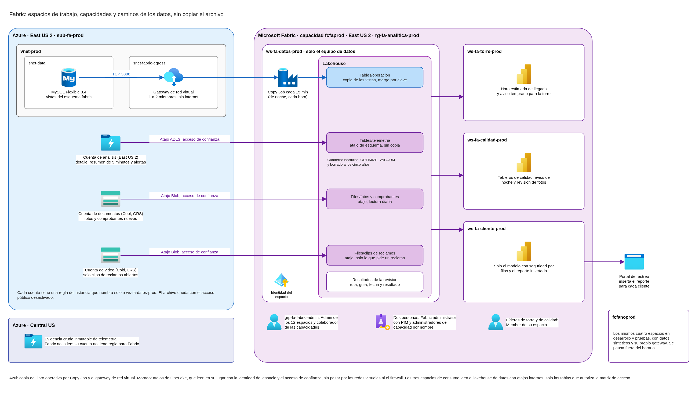
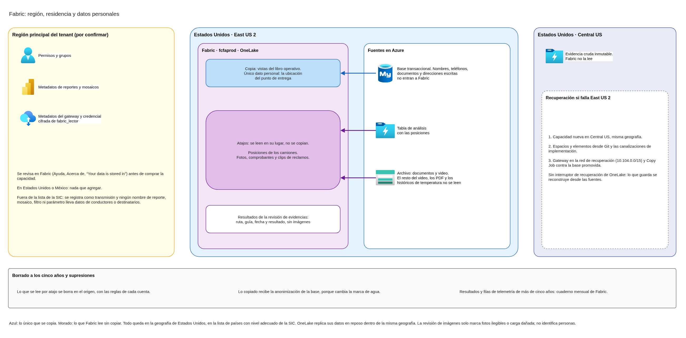

# Microsoft Fabric: espacios de trabajo, ingesta sin duplicar y región

Este documento define cómo se organiza Microsoft Fabric para la inteligencia artificial de la torre de control: qué espacios de trabajo y capacidades hay y quién de FríoAndes los administra; cómo llegan a Fabric el libro operativo, la telemetría y el archivo histórico sin una segunda copia de 1,2 PB; qué parte se copia, por qué y qué cuesta leer el resto en su lugar; en qué región vive Fabric y dónde quedan los datos personales de conductores y destinatarios. Usa la red, el firewall, la telemetría, los datos personales, la gobernanza, la plataforma logística, la migración y la siembra del archivo ya diseñados, con sus mismos nombres y decisiones.

## Contenido

1. Contexto y alcance
2. Espacios de trabajo, capacidades y administración
3. Cómo llega Fabric a los datos
4. Libro operativo
5. Telemetría
6. Archivo histórico
7. Región, residencia y datos personales
8. Lo que se copia y lo que cuesta
9. Diagramas
10. Supuestos y confirmaciones pendientes de FríoAndes

### Términos usados

| Término | Significado en este documento |
|---|---|
| Capacidad | El recurso de Azure (`Microsoft.Fabric/capacities`) que da el cómputo de Fabric. Se mide en unidades de capacidad (CU), se puede pausar y cambiar de tamaño |
| Espacio de trabajo | El contenedor de Fabric donde viven los elementos (lakehouse, cuadernos, modelos, reportes) y donde se asignan los roles Admin, Member, Contributor y Viewer |
| OneLake | El almacenamiento de Fabric. Cada espacio de trabajo es una carpeta de OneLake |
| Lakehouse | El elemento de Fabric que guarda tablas (carpeta Tables) y archivos (carpeta Files) en OneLake |
| Atajo | Un acceso directo de OneLake que apunta a datos que viven en otro lugar, sin copiarlos. Se ve como una carpeta más |
| Identidad del espacio de trabajo | Una entidad de servicio de Entra ID que Fabric crea y administra para un espacio. Sus credenciales nunca se ven ni se rotan a mano |
| Acceso de confianza | El mecanismo por el que una cuenta de almacenamiento con firewall acepta a un espacio de trabajo concreto, con una regla de instancia que nombra ese espacio |
| Gateway de red virtual | Un servicio administrado de Fabric que se inyecta en una subred de FríoAndes para llegar a fuentes privadas. Lo usan Copy Job, canalizaciones, réplicas espejo y modelos |
| Copy Job | El elemento de Fabric que copia datos de una fuente a un destino, completo o solo lo nuevo y cambiado |
| Región principal | La región de Azure ligada al tenant de Fabric al crearlo. Guarda metadatos aunque la capacidad esté en otra región |
| Día N | Los días del plan de migración: día 0, inicio de la convivencia; día 34, corte; día 90, límite de la convivencia |

---

## 1. Contexto y alcance

### 1.1 Qué necesita FríoAndes

La torre de control, el turno de calidad y la vista analítica del cliente corporativo van a consumir inteligencia artificial a través de Microsoft Fabric: aviso temprano de excursiones de temperatura y de sensores caídos, hora estimada de llegada y apoyo al archivo de evidencias. Para eso Fabric necesita leer tres fuentes que ya tienen su lugar en Azure:

| Fuente | Dónde vive | Tamaño |
|---|---|---|
| Libro operativo: guías, viajes, inventario, evidencias y reclamos | MySQL Flexible Server 8.4 en `snet-data`, East US 2, con alta disponibilidad zonal y réplica en Central US | La base de producción; se estima por debajo de 400 GB |
| Telemetría | Tres tablas Delta en la cuenta de análisis, East US 2. La evidencia cruda inmutable está en Central US | Unos 15 GB al mes, unos 900 GB en cinco años |
| Archivo histórico | Dos cuentas en East US 2: documentos (fotos, comprobantes, PDF e históricos de temperatura, 150 TB, Cool GRS) y video (1,05 PB, Cold LRS) | 1,2 PB, crece unos 12 TB al mes |

Copiar el archivo a Fabric significaría pagar dos veces el almacenamiento de 1,2 PB, más la lectura de todo lo que está en niveles fríos. En este diseño Fabric lee cada fuente en su lugar, y solo copia una parte pequeña y justificada del libro operativo.

### 1.2 Qué toma de los otros diseños

| Diseño | Qué toma |
|---|---|
| `gobierno-landing-zone.md` | Un solo tenant de Entra ID; suscripciones de producción, desarrollo y pruebas; convención de grupos `grp-fa-*`; PIM para administradores; regiones permitidas East US 2 y Central US (P-02); etiqueta `costo=fabric` y presupuesto propio de Fabric |
| `gobierno-auditoria-facturacion.md` | Fabric se identifica por recurso y medidor y se clasifica antes que pruebas; no se crean copias permanentes en Fabric |
| `red-topologia-subnetting.md` y `red-firewall-y-publicacion.md` | `snet-fabric-egress` en los tres ambientes, delegada al gateway de red virtual; el gateway llega a `snet-data` por el puerto 3306 y no sale a internet |
| `seguridad-datos-personales-perimetro.md` | Inventario de datos personales; envío a Microsoft en Estados Unidos como transmisión a un encargado; región de Fabric en un país de la lista de la SIC; regla de borrado a los cinco años; sin reconocimiento facial |
| `carga-b-telemetria.md` | La alerta de menos de un minuto no pasa por Fabric; tablas de detalle, resumen de 5 minutos y alertas en la cuenta de análisis; vista del cliente con Power BI insertado y seguridad por filas |
| `carga-a-plataforma-logistica.md` | MySQL Flexible Server 8.4, alta disponibilidad zonal y réplica en Central US |
| `carga-c-migracion-y-campana.md` | Calendario de la convivencia y regla de que los cambios de esquema se hacen antes del día 0 |
| `carga-c-siembra-1-2pb.md` | Las dos cuentas del archivo, sin espacio de nombres jerárquico, solo Entra ID, acceso público desactivado al terminar la siembra, inmutabilidad por versión |

### 1.3 Qué queda en otros diseños

- Los tres usos de inteligencia artificial, la matriz de acceso por rol, el tamaño de las capacidades, la pausa fuera de campaña y la observabilidad de Fabric: `fabric-acceso-casos-uso-costo.md`.
- El costo de Fabric en mes normal y de campaña, y el ahorro frente a copiar el archivo: `docs/costs/costo-fabric.md`, con las cifras de la sección 8.
- El paso del video a niveles más baratos: el costo mensual estable, con la regla de la sección 6.4.
- MFA, acceso condicional y la matriz completa de roles: el diseño de identidades, accesos y cifrado, con lo que pide la sección 2.5.

---

## 2. Espacios de trabajo, capacidades y administración

### 2.1 Espacios de trabajo

| Espacio | Para qué | Qué contiene | Quién lo usa |
|---|---|---|---|
| `ws-fa-datos-prod` | Punto único de entrada de los datos | Un lakehouse con los atajos a la telemetría y al archivo, las tablas copiadas del libro operativo, los resultados de la revisión de evidencias y el cuaderno de mantenimiento | Ninguna persona del negocio. Los otros tres espacios leen de aquí con atajos internos |
| `ws-fa-torre-prod` | Torre de control | Hora estimada de llegada y aviso temprano para la torre | Despachadores |
| `ws-fa-calidad-prod` | Calidad y turno de noche | Tableros de calidad de la telemetría, aviso temprano de noche y revisión de fotos | Calidad y guardia de calidad |
| `ws-fa-cliente-prod` | Vista del cliente corporativo | Solo el modelo semántico con seguridad por filas y el reporte que inserta el portal | Los clientes, a través del portal de rastreo |

El video, las posiciones de los camiones y los datos que identifican a la operación quedan en un solo espacio que administra el equipo de datos. El espacio del cliente nunca tiene un atajo al archivo ni a la flota: lo que no está ahí no se puede exponer por error.

**Ambientes.** Los mismos cuatro espacios existen en desarrollo y en pruebas (`ws-fa-datos-dev`, `ws-fa-datos-test` y así con los demás), unidos por canalizaciones de implementación de tres etapas. Desarrollo y pruebas leen las cuentas y la base de sus propias suscripciones, con datos sintéticos, y usan el `snet-fabric-egress` de su ambiente.

### 2.2 Capacidades

| Capacidad | Espacios | Encendida | Suscripción y grupo de recursos | Región |
|---|---|---|---|---|
| `fcfaprod` | Los cuatro de producción | Siempre: el aviso temprano de noche y la vista del cliente la necesitan | `sub-fa-prod`, `rg-fa-analitica-prod` | East US 2 |
| `fcfanoprod` | Los ocho de desarrollo y pruebas | En horario de trabajo; se pausa el resto del tiempo | `sub-fa-dev`, `rg-fa-analitica-dev` | East US 2 |

- El nombre de una capacidad solo admite minúsculas y números, y no se puede cambiar después de creada.
- Las dos llevan `ambiente`, `carga=analitica`, `costo=fabric`, `criticidad` y `responsable`. La no productiva también va a la línea de Fabric, porque la conciliación de costos clasifica Fabric antes que pruebas.
- El presupuesto de Fabric se aplica a los dos grupos de recursos de analítica.
- El tamaño, el crecimiento en campaña y la pausa los fija `fabric-acceso-casos-uso-costo.md`. Los trabajos pesados de Spark (la revisión de fotos) pueden salir del consumo de la capacidad con la facturación a demanda de Spark, que se activa por capacidad y se cobra aparte por uso.
- Las dos capacidades son capacidades F compradas. El acceso de confianza de la sección 3 no funciona en una capacidad de prueba.

### 2.3 Administradores

| Quién | Rol | Ámbito | Cómo se asigna |
|---|---|---|---|
| Dos personas del equipo de datos e IA | Fabric administrator (rol de Entra ID): configuración de todo el tenant de Fabric, uso y auditoría | Tenant | Elegibles con PIM, activación temporal |
| Las mismas dos personas | Administrador de capacidad: asigna espacios, permisos y cargas | `fcfaprod` y `fcfanoprod` | Por nombre: Azure solo acepta usuarios del tenant como administradores de una capacidad, no grupos ni invitados |
| `grp-fa-fabric-admin` (equipo de datos e IA) | Admin de cada espacio: gestiona miembros, crea la identidad del espacio | Los doce espacios | Grupo de seguridad |
| `grp-fa-fabric-admin` | Colaborador de capacidad: puede asignar espacios a la capacidad, sin cambiarla | Las dos capacidades | Grupo de seguridad. Nadie más asigna espacios |
| `grp-fa-fabric-admin` y la identidad de automatización de la pausa | Rol personalizado "Operador de capacidad Fabric" con `Microsoft.Fabric/capacities/read`, `write`, `suspend/action` y `resume/action` | Recurso de cada capacidad | Azure RBAC, en vez de Owner o Contributor, como recomienda Microsoft |
| `grp-fa-torre-lideres` | Member: agrega personas con roles iguales o menores | `ws-fa-torre-*` | Grupo de seguridad |
| `grp-fa-calidad-lideres` | Member | `ws-fa-calidad-*` | Grupo de seguridad |
| `grp-fa-finops` | Cost Management Reader, ya definido | Grupos de recursos de analítica | Sin cambios |

`ws-fa-cliente-*` no tiene responsable de negocio: solo lo administra `grp-fa-fabric-admin` y lo usa la identidad del portal. Quién más entra a cada espacio, con qué rol y sobre qué tablas lo define la matriz de acceso de `fabric-acceso-casos-uso-costo.md`.

### 2.4 Por qué así

- **Un espacio de datos separado de los de consumo.** Los atajos externos, la identidad que entra a las cuentas de Azure y las credenciales de la base viven en un solo lugar, con un solo grupo administrador.
- **Una capacidad para producción y otra para desarrollo y pruebas.** Las pruebas no compiten con producción y se pueden pausar sin tocar el aviso de noche.
- **La vista del cliente comparte la capacidad de producción.** Los trabajos pesados de Spark pueden ir a la facturación a demanda y dejar de competir con los reportes, así que una tercera capacidad no agrega nada.
- **Líderes del negocio con rol Member.** Un Admin puede agregar o quitar administradores; un Member solo agrega roles iguales o menores.

### 2.5 Lo que el diseño de identidades tiene que respetar

- Los grupos `grp-fa-fabric-admin`, `grp-fa-torre-lideres` y `grp-fa-calidad-lideres`, con MFA como el resto de los administradores.
- Si se crea una política de acceso condicional para identidades de carga que cubra todas las entidades de servicio, hay que excluir las tres identidades de los espacios de datos: con ellas incluidas, el acceso de confianza deja de funcionar.
- La contraseña del usuario de base de datos `fabric_lector` (sección 4.5) se guarda también en el Key Vault de producción y se rota cada 90 días.

---

## 3. Cómo llega Fabric a los datos

### 3.1 Dos caminos

| Fuente | Camino | Pasa por la red virtual |
|---|---|---|
| Tabla de análisis de telemetría | Atajo de Azure Data Lake Storage con acceso de confianza | No |
| Cuentas de documentos y de video | Atajo de Azure Blob Storage con acceso de confianza | No |
| Evidencia cruda de telemetría (Central US) | Fabric no la lee | |
| Libro operativo | Copy Job por el gateway de red virtual en `snet-fabric-egress` | Sí |

### 3.2 Acceso de confianza para el almacenamiento

- Cada espacio de datos (`ws-fa-datos-prod`, `-test` y `-dev`) tiene su identidad de espacio de trabajo, con rol Contributor en su propio espacio, como pide Microsoft.
- Cada cuenta que Fabric lee tiene una regla de instancia que nombra solo el espacio de datos de su ambiente. Las reglas de Fabric se crean por ARM o PowerShell (en el código de infraestructura, con AzAPI), no desde el portal.
- Funciona con el acceso público desactivado del todo, como quedan las cuentas del archivo después de la siembra, y con el acceso desde redes seleccionadas, como las cuentas de telemetría. No cambia nada en esas cuentas fuera de agregar la regla.
- No se usa la excepción de servicios de confianza: abriría la cuenta a cualquier espacio del tenant con identidad, y Microsoft no la recomienda.
- El tráfico va por la red de Microsoft entre Fabric y la cuenta; no pasa por las redes virtuales de FríoAndes, por los endpoints privados ni por el Azure Firewall.
- Spark lee a través de los atajos, así que no hacen falta endpoints privados administrados de Fabric.

### 3.3 Autenticación y permisos

- Los atajos se autentican con la identidad del espacio de trabajo. Fabric administra sus credenciales, no hay secretos que rotar y no depende de que una persona siga en la empresa.
- La autorización de un atajo es delegada: toda lectura usa la credencial del atajo. Por eso el permiso de la identidad es el techo de lo que Fabric puede hacer en la cuenta.
- Permisos sobre el archivo: Storage Blob Delegator en la cuenta y Storage Blob Data Reader solo en los contenedores que Fabric lee (sección 6). Nunca Contributor: un borrado dentro del atajo borra el archivo original si la credencial tiene permiso de escritura.
- Permiso sobre la cuenta de análisis: Storage Blob Data Contributor solo en el contenedor de las tablas de telemetría, para el mantenimiento de la sección 5.3. Es la única escritura de Fabric en Azure.

### 3.4 El gateway de red virtual

- Microsoft lo ofrece para Dataflow Gen2, canalizaciones, Copy Job, réplicas espejo, modelos semánticos y reportes paginados. Los atajos no lo usan. En este diseño sirve solo para el libro operativo.
- Se inyecta en `snet-fabric-egress`, delegada a `Microsoft.PowerPlatform/vnetaccesslinks`, con el proveedor `Microsoft.PowerPlatform` registrado en la suscripción. Usa 5 direcciones para su funcionamiento más una por miembro; el `/27` alcanza para el máximo de 11 miembros.
- Hay uno por ambiente, vinculado a la capacidad de ese ambiente, que es la que paga su consumo. El de producción tiene de 1 a 2 miembros y se apaga solo después de 60 minutos sin uso.
- Sus metadatos, incluida la credencial cifrada de la base, se guardan en la región principal del tenant (sección 7.2).
- Llega a `snet-data` por el puerto 3306 con la regla que ya existe en el NSG. No necesita salida a internet ni pasa por el Azure Firewall.
- Quién puede crear gateways se limita al grupo `grp-fa-fabric-admin`.

---

## 4. Libro operativo

### 4.1 Por qué no una réplica espejo

La réplica espejo de Fabric para Azure Database for MySQL, en preview, solo admite MySQL 8.0, y no admite alta disponibilidad, réplicas de lectura ni servidores dentro de una red virtual. La plataforma logística tiene las cuatro cosas: MySQL 8.4, alta disponibilidad zonal, servidor en `snet-data` y réplica en Central US.

### 4.2 Mecanismo

Copy Job incremental por marca de agua, por el gateway de red virtual, hacia tablas Delta del lakehouse de `ws-fa-datos-*`, con escritura merge por clave primaria. Cada ejecución copia solo las filas nuevas o cambiadas desde la anterior, y retoma desde la última ejecución buena si una falla. El conector de MySQL no tiene captura de cambios: los borrados no viajan, y por eso la aplicación no borra físicamente en las tablas copiadas (sección 4.6).

### 4.3 Qué se copia

Vistas de solo lectura en un esquema `fabric` de la base, que proyectan solo lo que usan los tres usos y la vista del cliente:

| Vista | Columnas | Para qué |
|---|---|---|
| `guias` | Identificador, cliente, estado, centro de origen, ventana de entrega, ubicación del punto de entrega (latitud y longitud), tipo de carga y rango de temperatura | Hora estimada de llegada, aviso temprano, seguridad por filas de la vista del cliente |
| `viajes_paradas` | Viaje, camión, guías del viaje, orden de las paradas, horas planeadas y reales | Hora estimada de llegada |
| `activos` | Camiones y cuartos fríos, centro y sensores asociados | Unir la telemetría con la operación |
| `clientes` | Identificador y razón social | Seguridad por filas |
| `evidencias` | Guía, tipo (foto, comprobante o video), ruta del archivo y fecha | Saber qué fotos y comprobantes revisar cada día (sección 6) |
| `reclamos` | Guía y estado | Saber qué clips de video leer (sección 6) |

**Quedan fuera:** nombre, teléfono, documento y dirección escrita de destinatarios; nombre, documento y teléfono de conductores (el conductor solo aparece a través del camión del viaje); usuarios del portal; facturación. La ubicación del punto de entrega es el único dato personal que entra a Fabric por esta vía: la hora estimada de llegada no se puede calcular sin ella.

### 4.4 Origen y frecuencia

- Se lee el servidor principal en East US 2. Las consultas van por índice sobre la columna de marca de agua, así que cada ejecución lee pocas filas.
- Cada 15 minutos de 04:00 a 22:00, mientras trabaja el despacho, y cada hora de noche. `fabric-acceso-casos-uso-costo.md` puede ajustar la frecuencia por uso.
- La copia arranca después del corte (día 34), cuando la base de Azure pasa a ser la principal. Antes del corte la base de Azure es el destino de la replicación desde Cali.
- No se lee la réplica de Central US: sumaría tráfico entre regiones y haría depender a Fabric de la recuperación de la plataforma logística.

### 4.5 Credencial

Un usuario `fabric_lector` con `SELECT` solo sobre el esquema `fabric`, con conexión cifrada. El conector solo admite autenticación básica, con usuario y contraseña: la contraseña queda cifrada en la conexión de Fabric y en el Key Vault de producción, y `grp-fa-fabric-admin` la rota cada 90 días.

### 4.6 Ajustes que se piden a la aplicación

Se suman a los ajustes que ya pide la migración y, como ellos, tienen que estar listos y probados antes del día 0, porque durante la convivencia la base no admite cambios de esquema:

| Ajuste | Por qué |
|---|---|
| Cada tabla que alimenta las vistas tiene clave primaria y una columna `actualizado_en` con `ON UPDATE CURRENT_TIMESTAMP`, indexada | Copy Job la usa como marca de agua y hace merge por la clave |
| En esas tablas no hay borrado físico: la fila se marca como borrada | Los borrados no viajan con la marca de agua |
| La anonimización a los cinco años actualiza `actualizado_en` | Así la anonimización llega sola a Fabric y se cumple la regla de borrado |
| Las vistas del esquema `fabric` y el usuario `fabric_lector` | Fabric ve solo lo que necesita |

---

## 5. Telemetría

### 5.1 Lectura

Un atajo de esquema `telemetria` en la carpeta Tables del lakehouse de `ws-fa-datos-*`, que apunta a la carpeta con las tres tablas de la cuenta de análisis. Fabric reconoce cada tabla Delta y sincroniza su esquema sin intervención.

| Tabla | Quién la usa en Fabric |
|---|---|
| Resumen de 5 minutos | Todos los tableros, con Direct Lake |
| Detalle | Reclamos y análisis puntual, por el endpoint SQL, consultado por guía o por cuarto frío y fecha |
| Alertas | Tableros de calidad y tiempos de respuesta |

No hay Eventstream ni Eventhouse por defecto. El aviso temprano predictivo trabaja con minutos de frescura; la alerta de segundos ya está fuera de Fabric. Si un uso necesitara segundos, se agrega un Eventstream sobre el Event Hub del estado en vivo y se cuesta aparte.

### 5.2 Lo que exige Stream Analytics

La salida Delta de Stream Analytics solo agrega filas y no compacta archivos. Si Stream Analytics crea la tabla, la marca como solo agregar, y así no se podrían borrar las posiciones a los cinco años ni atender una supresión. Además, Stream Analytics no escribe en tablas con deletion vectors y solo lee checkpoints V1 de una parte. Por eso:

- Las tres tablas se crean antes de arrancar Stream Analytics, sin la propiedad de solo agregar y sin deletion vectors.
- El mantenimiento no activa propiedades nuevas en las tablas ni escribe checkpoints que Stream Analytics no pueda leer.

### 5.3 Mantenimiento

Un cuaderno de Spark programado en `ws-fa-datos-prod`, que trabaja a través del mismo atajo:

| Tarea | Frecuencia | Por qué |
|---|---|---|
| OPTIMIZE de las tres tablas | Cada noche | Stream Analytics no compacta; Direct Lake admite 1.000 archivos por tabla en las capacidades de F2 a F32 |
| VACUUM con retención de 7 días | Cada noche | Quita del almacenamiento los archivos reemplazados |
| Borrado de filas de más de cinco años | Cada mes | Regla de borrado de los datos personales |
| Supresión puntual de posiciones | Cuando la pida el titular o la SIC | Las posiciones identifican al conductor |
| Borrado de resultados de revisión de evidencias de más de cinco años (sección 6.3) | Cada mes | Misma regla |

El cuaderno se prueba primero en pruebas con Stream Analytics escribiendo al mismo tiempo. Desarrollo y pruebas tienen el mismo atajo y el mismo cuaderno sobre sus cuentas de análisis, con datos simulados.

---

## 6. Archivo histórico

### 6.1 Qué lee Fabric

| Contenido | Cuenta y nivel | Lee Fabric | Cómo sabe qué leer |
|---|---|---|---|
| Fotos y comprobantes nuevos | Documentos, Cool | Sí, una vez al día | Vista `evidencias` |
| Video de entregas con reclamo abierto | Video, Cold | Sí, solo esos clips | Vista `reclamos` |
| Muestra pequeña de video para calidad | Video, Cold | Solo si `fabric-acceso-casos-uso-costo.md` la sustenta, con la misma lista | Misma vista |
| Resto del video, PDF e históricos de temperatura | | No | |

Cool y Cold son niveles en línea: un atajo los lee en milisegundos. Fabric no revisa de una vez las fotos históricas (110 TB): ningún uso lo pide y consumiría mucha capacidad.

### 6.2 Atajos

Un atajo Blob en la carpeta Files del lakehouse de `ws-fa-datos-*` por cada contenedor que se lee, con la identidad del espacio (Storage Blob Data Reader solo en esos contenedores) y la regla de instancia en cada cuenta (sección 3). Los nombres de los contenedores salen de las carpetas de primer nivel del servidor de Cali, que FríoAndes tiene que confirmar.

### 6.3 Nada del archivo se copia

Fabric lee cada archivo en su lugar y escribe en OneLake solo el resultado de la revisión: ruta, guía, fecha y resultado (legible o no, carga visiblemente dañada o no), sin imágenes ni recortes. Ese resultado se borra a los cinco años con el cuaderno mensual de la sección 5.3.

### 6.4 Lo que el diseño de costos tiene que respetar

- Fabric no exige que el video esté en un nivel en línea, salvo los clips de reclamos abiertos. El resto del video puede pasar a Archive, que la cuenta de video admite por ser LRS, respetando los 180 días mínimos de ese nivel.
- Un archivo en Archive no se puede leer sin rehidratarlo, lo que tarda hasta 15 horas. Si un clip de reclamo está en Archive, el proceso de reclamos lo rehidrata antes; Fabric no rehidrata.
- Las fotos y comprobantes nuevos tienen que seguir en un nivel en línea al menos hasta su revisión del día siguiente.

---

## 7. Región, residencia y datos personales

### 7.1 Región de las capacidades: East US 2

- Es la región de todas las fuentes que Fabric lee: la base, la cuenta de análisis y las cuentas del archivo. No hay transferencia entre regiones ni datos que crucen de geografía.
- Tiene todas las cargas de Fabric sin funciones excluidas.
- Está en la lista de regiones permitidas de la landing zone.
- Estados Unidos está en la lista de países con nivel adecuado de protección de la SIC, y el envío de datos a Microsoft en Estados Unidos ya se trata como transmisión a un encargado.

**Si FríoAndes no acepta Estados Unidos**, la alternativa es la misma del diseño de datos personales: Mexico Central, que también tiene todas las cargas de Fabric. Exige mover también las fuentes, porque si no cada lectura cruzaría de geografía, y agregar la región a las permitidas.

### 7.2 Región principal del tenant

La región principal la fija la dirección de facturación del primer usuario que se registró en el tenant; este diseño no la elige. Aunque la capacidad esté en East US 2, en la región principal quedan permisos, metadatos de reportes y paneles (nombres y consultas de mosaicos), credenciales de modelos, metadatos del gateway (incluida la contraseña cifrada de `fabric_lector`) y algunas funciones como las capturas y las alertas de datos.

- Antes de comprar la capacidad, el equipo de datos revisa en Fabric (Ayuda, Acerca de) el valor "Your data is stored in".
- Si queda en Estados Unidos o en México, no hay nada que agregar.
- Si queda en un país fuera de la lista de la SIC (por ejemplo Brasil o Chile), esos metadatos se registran como una transmisión más en el registro de bases de datos, y rige una regla: ningún nombre de reporte, mosaico, filtro ni parámetro lleva datos de conductores o destinatarios.

### 7.3 Datos personales que toca Fabric

| Dato | Dónde está | Qué hace Fabric |
|---|---|---|
| Posiciones de los camiones | Tabla de análisis, East US 2 | Las lee por atajo; no las copia |
| Ubicación del punto de entrega | Lakehouse de `ws-fa-datos-prod`, OneLake en East US 2 | La copia (sección 4.3) |
| Fotos, comprobantes y clips de reclamos | Cuentas del archivo, East US 2 | Los lee por atajo; guarda solo el resultado de la revisión |
| Identidades de empleados | Entra ID y permisos de Fabric en la región principal | Las usa para el acceso |

Nombres, teléfonos, documentos y direcciones escritas no entran a Fabric. Todo queda en la geografía de Estados Unidos: OneLake replica sus datos en reposo dentro de la misma geografía.

**Borrado.** Lo que Fabric lee por atajo se borra en el origen, con las reglas de cada cuenta. Lo que copia (las vistas del libro operativo) recibe la anonimización de la base por la marca de agua. Los resultados de la revisión y las filas de telemetría de más de cinco años los borra el cuaderno mensual.

**Sin reconocimiento facial.** La revisión de fotos y clips solo marca imágenes ilegibles o carga visiblemente dañada; no identifica personas.

### 7.4 Recuperación ante desastres

El interruptor de recuperación de la capacidad queda apagado. Solo replicaría OneLake, que guarda el subconjunto del libro operativo y los resultados, y los dos se reconstruyen desde las fuentes.

Si East US 2 falla:

1. Se crea una capacidad en Central US, misma geografía y región permitida.
2. Se crean los espacios y se despliegan los elementos desde Git y las canalizaciones de implementación.
3. Se crea un gateway en la subred de salida a Fabric de la red de recuperación (bloque reservado `10.104.0.0/15`) y se vuelve a correr Copy Job contra la base promovida en Central US.

Microsoft sugiere recuperar en otra geografía para tener más capacidad disponible; aquí no se hace, para no sacar los datos de un país de la lista de la SIC. Ni el despacho ni la alerta de temperatura dependen de Fabric mientras tanto.

---

## 8. Lo que se copia y lo que cuesta

### 8.1 Lo único que se copia

| Qué | Dónde | Por qué | Tamaño |
|---|---|---|---|
| Vistas del libro operativo | Lakehouse de `ws-fa-datos-prod`, OneLake | La base no admite réplica espejo y los modelos no deben consultar en vivo la base de despacho | Una fracción de la base, que se estima por debajo de 400 GB |
| Resultados de la revisión de evidencias | Mismo lakehouse | Son datos nuevos, no una copia | Una fila por archivo revisado |

Del archivo de 1,2 PB no se copia nada.

### 8.2 Cifras para el costo de Fabric

Precios de lista de East US 2, consultados en la API pública de precios de Azure, sin descuentos:

| Concepto | Precio | Quién lo cobra |
|---|---|---|
| Capacidad, gateway, Copy Job, Spark y Direct Lake | USD 0,18 por CU hora, dentro de la capacidad | La capacidad |
| OneLake Hot | USD 0,023 por GB al mes | La capacidad |
| Lectura de fotos y comprobantes nuevos (Cool) | USD 0,01 por GB y 0,01 por 10.000 lecturas: unos 1.100 GB y 1,1 millones de lecturas al mes, unos USD 12 | La cuenta de documentos |
| Lectura de clips de reclamos (Cold) | USD 0,03 por GB y 0,10 por 10.000 lecturas | La cuenta de video |

Las lecturas las cobra la cuenta de almacenamiento, en la suscripción de producción. El documento de costo de Fabric las atribuye a la línea de Fabric.

**Referencia de lo que se evita.** Copiar el video completo a OneLake costaría 1.050.000 GB × 0,023 = USD 24.150 al mes en Hot, o × 0,004 = USD 4.200 al mes en el nivel frío de OneLake, más una lectura única desde Cold de 1.050.000 GB × 0,03 = USD 31.500.

### 8.3 Decisiones que bajan o evitan gasto

| Decisión | Alternativa descartada | Efecto |
|---|---|---|
| Atajos a la telemetría y al archivo | Copiar a OneLake | Evita una segunda copia de 1,2 PB (sección 8.2) |
| Solo fotos nuevas y clips de reclamos | Revisar el archivo entero | Lecturas de unos USD 12 al mes en vez de leer 1,2 PB |
| Capacidad no productiva pausada fuera del horario de trabajo | Encendida todo el mes | Paga solo las horas de uso |
| Interruptor de recuperación apagado | Replicar OneLake | Sin almacenamiento ni operaciones de recuperación por datos que se reconstruyen |
| Gateway con apagado por inactividad | Gateway siempre encendido | Consume capacidad solo mientras copia |

---

## 9. Diagramas

El primer diagrama muestra las tres fuentes en Azure, los dos caminos (atajos con acceso de confianza y Copy Job por el gateway), el espacio de datos y los tres espacios de consumo con sus administradores.

El segundo muestra qué queda en East US 2, qué queda en la región principal del tenant, qué se copia, qué se lee en su lugar y cómo se recupera en Central US.

Los dos se generan con `red/tools/build_drawio_diagrams.py`.

---

## 10. Supuestos y confirmaciones pendientes de FríoAndes

### 10.1 Confirmaciones que necesita el diseño

| Tema | Pregunta para FríoAndes | Qué pasa si la respuesta cambia |
|---|---|---|
| Región principal del tenant | ¿Qué muestra "Your data is stored in" en Fabric? ¿Ya existe el tenant de Microsoft 365? | Si está fuera de la lista de la SIC, se registra la transmisión y rige la regla de metadatos de la sección 7.2 |
| Estados Unidos | ¿Acepta que los datos personales queden en Estados Unidos? | Si no, Fabric y sus fuentes van a Mexico Central (sección 7.1) |
| Libro operativo | ¿Las tablas de guías, viajes, evidencias y reclamos tienen clave primaria? ¿La aplicación borra filas físicamente? | Cambian los ajustes de la sección 4.6 |
| Archivo | ¿En qué carpetas del servidor de Cali están las fotos y los comprobantes? | Definen los contenedores con permiso de lectura |
| Reclamos | ¿Cuántos reclamos hay al mes y cuánto video tiene cada uno? | Define el costo de lectura de clips |
| Equipo de datos e IA | ¿Quiénes administran Fabric? | Son los administradores de capacidad, por nombre |

### 10.2 Supuestos del diseño

| Supuesto | Por qué se asume |
|---|---|
| Las tablas que alimentan las vistas admiten clave primaria, columna de última modificación y borrado lógico | Copy Job incremental con merge; el conector de MySQL no tiene captura de cambios |
| La ubicación del punto de entrega es el único dato personal que se copia a Fabric | La hora estimada de llegada la necesita; lo demás no |
| Fabric lee cada día las fotos y comprobantes nuevos y los clips de reclamos abiertos | Es lo que piden los usos; el resto del archivo no se lee |
| La región principal del tenant queda en un país de la lista de la SIC | Ahí quedan permisos, metadatos y credenciales |
| Las fotos y comprobantes nuevos suman unos 1,1 TB al mes, con archivos de 1 MB en promedio | Mismo supuesto de la siembra del archivo |
| La base de producción pesa menos de 400 GB | Mismo supuesto de la migración |
| Los costos son precios de lista en East US 2, sin descuentos | Es la base común del cálculo de costos de la plataforma |
