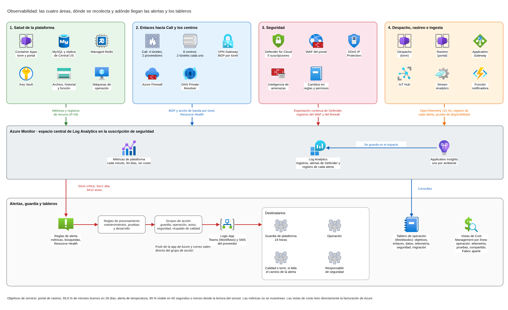
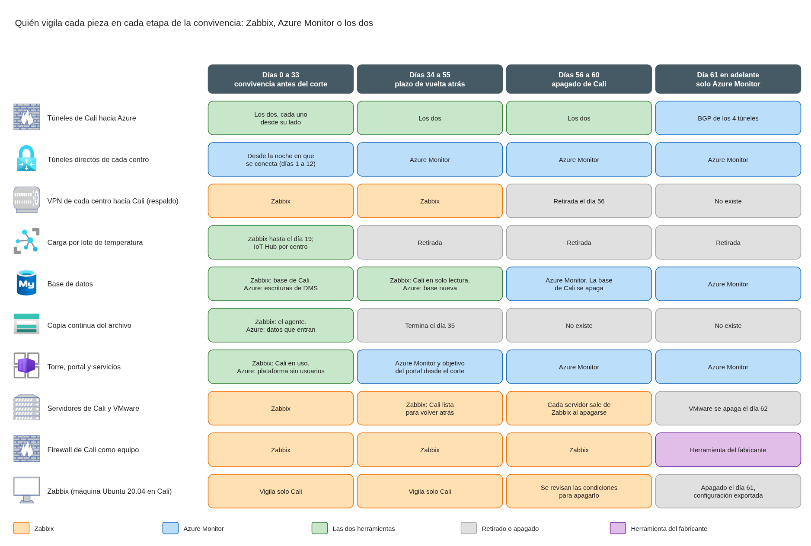

# Observabilidad, objetivos de servicio y transición desde Zabbix

Este documento define cómo FríoAndes ve la salud de su plataforma en Azure: qué se mide en el cómputo, los contenedores, las bases, el almacenamiento y los enlaces hacia Cali y los centros; cómo las señales de seguridad llegan a la operación; qué registros, métricas y trazas dejan el despacho, el rastreo y la ingesta de telemetría; los dos objetivos de servicio de la plataforma; a quién le llega cada alerta, de día y de noche; los tableros de operación y de costo, y cómo se deja Zabbix durante la convivencia. Usa la red, el firewall, la telemetría, los datos personales, la gobernanza, la auditoría, la plataforma logística y la migración ya diseñados, con sus mismos nombres y decisiones.

## Contenido

1. Contexto y alcance
2. Dónde se recolecta
3. Salud de la plataforma y de los enlaces
4. Registros, métricas y trazas de despacho, rastreo e ingesta
5. Los dos objetivos de servicio
6. Alertas, guardia y seguridad en la operación
7. Tableros de operación y de costo
8. Transición desde Zabbix
9. Costo
10. Supuestos y confirmaciones pendientes de FríoAndes

### Términos usados

| Término | Significado en este documento |
|---|---|
| Métrica de plataforma | Valor numérico que cada servicio de Azure publica solo, cada minuto. Se guarda 93 días y no tiene costo |
| Registro de recurso | Detalle de lo que hace un servicio (por ejemplo, cada solicitud del Application Gateway). Se envía al espacio de Log Analytics con una configuración de diagnóstico |
| Espacio de Log Analytics | El almacén central de registros. Hay uno solo, en la suscripción de seguridad |
| Application Insights | El servicio que recibe las trazas, métricas y registros de las aplicaciones. Guarda sus datos en el espacio de Log Analytics |
| Traza | El recorrido de una solicitud por todos los servicios que toca, con el tiempo de cada paso |
| Objetivo de servicio | Una meta medible de lo que perciben los usuarios, con su indicador, su ventana y su margen de error |
| Margen de error | Cuánto incumplimiento se tolera en la ventana antes de fallar el objetivo |
| Grupo de acción | La lista de destinatarios y canales a los que Azure Monitor envía una alerta |
| Guardia de plataforma | La persona del equipo de operación que atiende las alertas críticas fuera de horario |
| Día N | Los días del plan de migración: día 0, inicio de la convivencia; día 34, corte; día 56, cierre del plazo de vuelta atrás; día 61, apagado de Zabbix; día 62, apagado de VMware; día 90, límite de la convivencia |

---

## 1. Contexto y alcance

### 1.1 Qué necesita FríoAndes

Hoy una sola máquina Ubuntu 20.04 con Zabbix vigila el núcleo de Cali. La plataforma nueva corre en Azure, con servicios administrados que ya publican sus métricas, y con dos capacidades que la operación no puede perder de vista: el portal de rastreo, que usan unos 2.000 clientes corporativos, y la alerta de temperatura, que debe verse en menos de un minuto.

| Pieza | Qué necesita FríoAndes | Dónde se responde |
|---|---|---|
| Salud de la plataforma | Cómputo, contenedores, bases, almacenamiento | Sección 3 |
| Salud de los enlaces | Los túneles de Cali y de los ocho centros | Sección 3.5 |
| Seguridad en la operación | Que las alertas de Defender for Cloud, del firewall y del portal lleguen a alguien que actúe | Sección 6.4 |
| Aplicaciones | Registros, métricas y trazas de despacho, rastreo e ingesta | Sección 4 |
| Objetivos de servicio | Disponibilidad del portal y oportunidad de la alerta, cada uno con su indicador | Sección 5 |
| Tableros | De operación y de costo | Sección 7 |
| Zabbix | Qué sigue vigilando durante la convivencia y cuándo se apaga | Sección 8 |

El diseño se organiza en cuatro áreas, las mismas del diagrama de la sección 2: salud de la plataforma, enlaces, seguridad, y despacho, rastreo e ingesta.

### 1.2 Qué toma de los otros diseños

| Viene de | Qué se usa aquí |
|---|---|
| `gobierno-landing-zone.md` | El espacio de Log Analytics vive en `sub-fa-security`; la política P-04 crea los diagnósticos; los grupos de Entra ID (`grp-fa-ops-prod`, `grp-fa-network`, `grp-fa-security`, `grp-fa-dev`, `grp-fa-qa`, `grp-fa-finops`); los presupuestos por suscripción |
| `gobierno-auditoria-facturacion.md` | Un solo espacio para las cinco suscripciones; retención por tabla (90 días consultables en las tablas técnicas); los eventos de auditoría de negocio por la API de ingesta; las líneas de costo operación, telemetría, pruebas y Fabric aparte |
| `red-topologia-subnetting.md` | VPN Gateway VpnGw1AZ activo-activo de unos 650 Mbps; Cali con dos proveedores y cuatro túneles con BGP; dos túneles por centro; DNS Private Resolver en el hub |
| `red-firewall-y-publicacion.md` | Salida a Azure Monitor por el Azure Firewall con la etiqueta `AzureMonitor`; registros y alertas del perímetro (sección 6) |
| `seguridad-datos-personales-perimetro.md` | Planes de Defender for Cloud por suscripción, las cinco alertas del portal, el procedimiento ante una alerta de seguridad, las alertas que llevan solo identificadores |
| `carga-b-telemetria.md` | La definición del minuto de la alerta, las cinco marcas de tiempo, la alerta sintética, las señales de salud del camino de la alerta, los canales (Teams por Workflows, correo y SMS por un proveedor con cobertura en Colombia) y la guardia de calidad de noche |
| `carga-a-plataforma-logistica.md` | Container Apps con entornos de torre y portal, MySQL Flexible Server 8.4 con alta disponibilidad zonal y réplica en Central US para el RPO de 15 minutos, Azure Managed Redis y Key Vault |
| `carga-c-migracion-y-campana.md` | El calendario de la convivencia y del apagado, el pedido de OpenTelemetry y de un chequeo de salud a los cinco contenedores, las dos señales de la migración (sección 6.4) y el apagado de Zabbix el día 61 |

### 1.3 Qué queda en otros diseños

- La observabilidad de Fabric y el apagado de su capacidad: `fabric-acceso-casos-uso-costo.md`. Puede usar el mismo espacio y los mismos grupos de acción de este documento.
- La retención de los registros de auditoría y los eventos de acceso a datos de clientes, evidencias y temperatura: el diseño de auditoría.
- Los montos de los presupuestos y el costo consolidado: el documento de costos. Este documento entrega el costo de la observabilidad (sección 9).

---

## 2. Dónde se recolecta

### 2.1 Qué viaja y por dónde

| Fuente | Cómo se recolecta | Destino |
|---|---|---|
| Recursos de Azure: firewall, Application Gateway, VPN Gateway, MySQL, Redis, Key Vault, almacenamiento, IoT Hub, Stream Analytics, Event Hubs | Métricas de plataforma, cada minuto, sin configuración y sin costo | El almacén de métricas de cada recurso, 93 días |
| Los mismos recursos | Registros de recurso por diagnóstico, en modo de recurso específico, creados por la política P-04 | Espacio central |
| Registro de actividad de las cinco suscripciones | Diagnóstico de suscripción | Espacio central |
| Container Apps: salida de consola y registros del sistema | Destino "Azure Monitor" del entorno, más un diagnóstico del entorno | Espacio central |
| Los ocho servicios de torre y portal | Distro de OpenTelemetry de Microsoft dentro de cada contenedor, con la identidad administrada | Application Insights del ambiente |
| Función notificadora | Integración de Azure Functions con Application Insights, autenticada con Entra ID | Application Insights del ambiente |
| Registro de cada alerta de temperatura | API de ingesta de registros, desde la función notificadora | Tabla propia en el espacio central (sección 4.5) |
| Eventos de auditoría de negocio | API de ingesta de registros, como define el diseño de auditoría | Tabla de auditoría |
| Alertas de Defender for Cloud | Exportación continua de cada suscripción | Espacio central |
| Máquinas de operación de `snet-admin` | Métricas del host, sin agente | Almacén de métricas |

### 2.2 Decisiones de recolección

| Decisión | Alternativa descartada | Por qué |
|---|---|---|
| Un Application Insights por ambiente (producción, pruebas y desarrollo), guardado en el espacio central | Uno por servicio, o uno solo para todo | Microsoft recomienda separar las etapas y usar un solo recurso para componentes que se despliegan juntos y maneja el mismo equipo. El mapa de aplicación y las trazas de punta a punta quedan en un lugar |
| El Distro de OpenTelemetry dentro de cada servicio | El agente OpenTelemetry administrado de Container Apps | Según Microsoft, ese agente no envía métricas a Application Insights, corre en una sola réplica sin alta disponibilidad, no expone su propia salud y exige dejar activa la autenticación local. Con el Distro, cada servicio publica con su identidad administrada (rol Monitoring Metrics Publisher) y Application Insights puede desactivar la autenticación local |
| Registros de Container Apps con el destino "Azure Monitor" y un diagnóstico | El destino "Log Analytics" directo | Encaja con P-04 y con un espacio en otra suscripción. Es el único que admite Private Link si se activa después |
| Salida a Azure Monitor por el Azure Firewall con la etiqueta `AzureMonitor` (reglas FW-304, FW-310 y FW-316) | Private Link de Azure Monitor (AMPLS) en el hub | Los diagnósticos, el mayor volumen, viajan por un canal privado de Microsoft sin pasar por la red. Un AMPLS tiene que ser único para todas las redes que comparten DNS, y aquí son todas, incluidas Cali y los centros; su modo más estricto bloquea cualquier recurso de Azure Monitor fuera de él. Queda como camino de mejora si FríoAndes quiere impedir la salida de datos hacia espacios ajenos |
| El espacio en East US 2, sin réplica | Réplica del espacio en Central US | La réplica es de pago, el cambio de región es manual y Application Insights no se replica. Durante un failover, el procedimiento de continuidad se apoya en las métricas de plataforma de los recursos de Central US, que no dependen del espacio |
| Las métricas se quedan en su almacén y las alertas de salud se construyen sobre ellas | Exportar todas las métricas al espacio | La exportación cuesta ingesta, aplana las dimensiones y no admite todas las métricas |
| Máquinas de operación con métricas del host | Azure Monitor Agent con una regla de recolección | Son máquinas de salto, su seguridad la cubre Defender for Servers, y el agente exigiría abrir `AzureMonitor` desde `snet-admin` |

**Una regla nueva en el firewall.** La API de ingesta de registros (`*.ingest.monitor.azure.com`) no está cubierta por la etiqueta `AzureMonitor`: Microsoft indica que las etiquetas de servicio no incluyen las direcciones de los endpoints de recolección. La necesitan los eventos de auditoría de negocio y el registro de cada alerta. Se agregan FW-322, FW-323 y FW-324, una regla de aplicación HTTPS por ambiente desde la torre, el portal y la función notificadora (`red-firewall-y-publicacion.md`, sección 4.3).

---

## 3. Salud de la plataforma y de los enlaces

### 3.1 Criterios comunes

- Las alertas de salud usan métricas de plataforma o Resource Health. Solo lo que no existe como métrica se busca en los registros.
- Hay tres niveles, que la sección 6 convierte en destinatarios: **crítica**, afecta ahora el despacho, el portal o la alerta de temperatura; **alta**, se pierde redundancia o se acerca un límite; **aviso**, una tendencia que se revisa en horario.
- Los umbrales son iniciales y se ajustan con el primer mes de datos, igual que los límites del WAF.
- Cada recurso crítico tiene además una alerta de Resource Health (no disponible o degradado, nivel alto), y la suscripción una alerta de Service Health para East US 2 y Central US.

### 3.2 Cómputo y contenedores

| Componente | Señal | Umbral inicial | Nivel |
|---|---|---|---|
| Cada aplicación de torre y portal | Réplicas por debajo del mínimo configurado | 5 minutos | Alta |
| Ídem | Reinicios | Más de 3 en 15 minutos | Alta |
| Ídem | Uso de CPU y de memoria (métricas en preview) | Más de 80 % durante 15 minutos | Aviso |
| Servicios de la torre | Respuestas 5xx | Más del 5 % durante 5 minutos | Crítica |
| Entornos de torre y portal | Nodos del perfil dedicado (métrica en preview) | Más de 16 de los 20 reservados | Aviso |
| Máquinas de operación | Resource Health | No disponible | Aviso |

La disponibilidad del portal no aparece aquí porque es un objetivo de servicio (sección 5.2). En campaña, la regla de escala por calendario de la torre sube el mínimo de réplicas (`carga-c-migracion-y-campana.md`, sección 7.6); la alerta de réplicas compara contra el mínimo vigente.

### 3.3 Bases y caché

| Componente | Señal | Umbral inicial | Nivel |
|---|---|---|---|
| MySQL Flexible Server | CPU | Más de 70 % durante 30 minutos, el mismo tope que valida la prueba de carga de campaña | Aviso |
| Ídem | CPU | Más de 90 % durante 15 minutos | Alta |
| Ídem | Almacenamiento | 80 % aviso, 90 % alta | Aviso y alta |
| Ídem | Memoria y E/S | Más de 90 % durante 15 minutos | Alta |
| Alta disponibilidad zonal | Hilos de replicación hacia el servidor en espera | Detenidos 5 minutos | Alta |
| Réplica de Central US | Retraso de replicación | Más de 5 minutos aviso, más de 10 minutos alta | Aviso y alta |
| Azure Managed Redis | Carga del servidor y memoria usada | Más de 80 % durante 15 minutos | Aviso |
| Key Vault | Disponibilidad | Menos de 100 % durante 5 minutos | Alta |

El retraso de la réplica es la cantidad de datos que se perderían si hubiera que promoverla. Las alertas están por debajo del RPO de 15 minutos para que haya tiempo de actuar.

### 3.4 Almacenamiento

| Componente | Señal | Umbral inicial | Nivel |
|---|---|---|---|
| Cuentas del archivo, del historial de telemetría y de la función | Disponibilidad | Menos de 99,9 % durante 15 minutos | Alta |
| Ídem | Transacciones con error del servidor o limitadas | Más del 1 % durante 15 minutos | Aviso |
| Cuentas del archivo | Capacidad usada | Solo en el tablero: crece unos 12 TB al mes | Tablero |

### 3.5 Enlaces hacia Cali y los centros

| Componente | Señal | Umbral inicial | Nivel |
|---|---|---|---|
| Túneles del proveedor principal de Cali | Estado BGP de cada túnel | Uno caído 5 minutos alta, los dos crítica | Alta y crítica |
| Túneles del proveedor de respaldo de Cali | Estado BGP | Caído 15 minutos: no lleva tráfico, pero es la ruta redundante | Alta |
| Túneles de cada centro | Estado BGP | Uno caído 5 minutos aviso, los dos crítica | Aviso y crítica |
| VPN Gateway | Ancho de banda total | Más del 80 % de unos 650 Mbps durante 15 minutos | Aviso |
| Túnel de Cali | Ancho de banda | Más del 80 % de 400 Mbps durante 15 minutos | Aviso |
| Cada túnel | Paquetes descartados | Sostenidos 15 minutos | Aviso |
| VPN Gateway, conexiones y DNS Private Resolver | Resource Health | No disponible o degradado | Alta |
| Azure Firewall | Puertos SNAT y sonda de latencia | SNAT más de 80 % | Aviso |

El estado de los túneles se mide por BGP porque los túneles de respaldo de Cali no llevan tráfico: una alerta por ancho de banda no los distinguiría de un túnel caído. Cuando un centro pierde sus dos túneles, también se dispara la alerta "sensor sin señal" de sus cuartos fríos (`carga-b-telemetria.md`, sección 3.3); las dos se confirman entre sí. El umbral del túnel de Cali deja espacio para la copia continua del archivo, que usa hasta 250 Mbps de noche durante la convivencia.

Microsoft ofrece Connection Monitor para medir la latencia y la pérdida de punta a punta, pero exige una extensión en una máquina de Azure y una regla nueva desde `snet-admin` hacia las sedes. Al inicio basta con las métricas del gateway; si la operación necesita la latencia hacia cada sede, se activa con 9 pruebas, dentro de las 10 que Microsoft no cobra.

### 3.6 Señales de la migración

Solo existen durante la convivencia y responden a las dos señales que pide el plan de migración (`carga-c-migracion-y-campana.md`, sección 6.4).

| Señal | Cómo se mide | Umbral | Nivel |
|---|---|---|---|
| Replicación de DMS detenida | Escrituras aplicadas en el MySQL de Azure | Cero durante 10 minutos en horario de despacho | Alta |
| Retraso de DMS | Campo "Seconds behind source" de la pantalla de DMS | 5 minutos, revisado al abrir y al cerrar cada ventana y en el corte | Procedimiento |
| Copia continua del archivo detenida | Datos que entran a las cuentas del archivo | Cero durante 3 horas en horario de despacho | Alta |
| Atraso de la copia | Zabbix en Cali: antigüedad de la última pasada exitosa del agente de copia | Más de 24 horas, unos 400 GB | Alta |

Microsoft muestra el retraso de DMS en la pantalla de la migración y no lo publica como métrica de Azure Monitor. Por eso la alerta automática vigila que las escrituras sigan llegando, y el retraso exacto lo revisa el equipo de base de datos, como ya hace el guion del corte la noche anterior y antes de iniciar el corte (`carga-c-migracion-y-campana.md`, sección 5.3). El agente de copia vive en Cali, así que lo vigila Zabbix hasta que la copia termina el día 35.

---

## 4. Registros, métricas y trazas de despacho, rastreo e ingesta

### 4.1 Reglas para los servicios

Los servicios son los de la plataforma logística: en el entorno de la torre, el front de la torre, guías, asignación de muelle y ruta, inventario, facturación corporativa y evidencias; en el del portal, el front del portal y rastreo.

| Regla | Detalle | Por qué |
|---|---|---|
| Nombre y versión | Cada servicio declara su nombre (`service.name`) y la versión desplegada (`service.version`) | El mapa de aplicación identifica los componentes por ese nombre, y la versión separa la telemetría de cada salida a producción |
| Trazas | Automáticas en HTTP, MySQL, Redis, Key Vault y Blob. El contexto W3C (`traceparent`) viaja entre servicios | Una solicitud se sigue de punta a punta con un solo identificador de operación |
| Muestreo | Fijo del 10 % de las trazas en torre y portal. Se sube al 100 % durante el ensayo y el corte | Las métricas no se muestrean, así que las alertas, los tableros y los dos objetivos no pierden datos. Con 10 % quedan unas 65.000 trazas al día de la torre para diagnosticar |
| Registros | Por OpenTelemetry solo ERROR, y WARN cuando haya una acción que tomar. La consola del contenedor queda para el arranque y las caídas | Es lo que recomienda Microsoft y evita pagar dos veces el mismo registro |
| Datos personales | Solo identificadores internos: guía, cliente, cuarto, camión. Nunca nombres, documentos, firmas ni posiciones. La IP queda enmascarada (0.0.0.0), que es el comportamiento por defecto de Application Insights | Lo mismo que piden el mapa de datos personales y el diseño de auditoría |
| Telemetría del navegador | No se recolecta al inicio | El SDK de JavaScript no admite ingesta con Entra ID, y el objetivo del portal se mide en el gateway |

Estas reglas completan dos ajustes que el plan de migración ya pidió al equipo de desarrollo: emitir métricas, registros y trazas con OpenTelemetry y exponer un chequeo de salud por HTTP (`carga-c-migracion-y-campana.md`, sección 2.4).

### 4.2 Despacho (torre)

| Qué | Señal |
|---|---|
| Métricas de negocio | Guías creadas por minuto, asignaciones de muelle y ruta por minuto, tiempo de asignación |
| Métricas técnicas | Solicitudes, duración y fallas por servicio, que Application Insights calcula sin muestreo |
| Trazas | Front de la torre, guías o asignación, MySQL y Redis |
| Registros | Errores de negocio, como una asignación rechazada o una guía sin ruta |

### 4.3 Rastreo (portal)

| Qué | Señal |
|---|---|
| Métricas de negocio | Consultas de guía por minuto, respuestas 429 por el límite por cuenta, consultas a guías ajenas |
| Métricas técnicas | Duración p95 de la consulta de guía, fallas, dependencias lentas |
| Trazas | Front del portal, rastreo, Redis o MySQL, y Blob cuando se piden comprobantes y fotos |
| Registros | Errores. Los eventos de seguridad y de auditoría van por su propio camino (`seguridad-datos-personales-perimetro.md`, sección 5.4) |

### 4.4 Ingesta (telemetría)

| Qué | Señal |
|---|---|
| Métricas | Las de plataforma de IoT Hub, Stream Analytics y Event Hubs que ya nombra el diseño de telemetría (sección 6.2): dispositivos conectados, retraso de la marca de agua, alertas acumuladas sin leer |
| Traza de cada alerta | Las cinco marcas de tiempo del diseño de telemetría (sensor, IoT Hub, Stream Analytics, notificador y canal), unidas por el identificador de la alerta. Desde la función notificadora, la traza continúa con W3C hacia la API de la torre y los canales |
| Registros | Ejecuciones fallidas de la función y fallas de envío por canal |

Así, si una alerta llega tarde, se ve en qué tramo del presupuesto de 40 segundos se perdió el tiempo (`carga-b-telemetria.md`, sección 3.1).

### 4.5 Registro de cada alerta

La función notificadora escribe una fila por alerta, real o sintética, en una tabla propia del espacio central, por la API de ingesta de registros: identificador, sensor, tipo, si es sintética, las cinco marcas de tiempo, el canal y el resultado. Es la fuente del objetivo de la alerta. Va por la API de ingesta porque así no se muestrea ni depende del límite diario de Application Insights, y usa el mismo mecanismo que los eventos de auditoría.

### 4.6 Durante el corte

Live Metrics muestra en vivo las solicitudes y fallas de los servicios. Lo usa el monitoreo reforzado del corte, hasta las 06:00 del domingo, junto con el criterio "las ocho aplicaciones responden sus chequeos de salud y no hay errores 5xx en el Application Gateway" (`carga-c-migracion-y-campana.md`, sección 5.4). Sus endpoints entran en la etiqueta `AzureMonitor`.

---

## 5. Los dos objetivos de servicio

### 5.1 Común a los dos

- **Ventana móvil de 28 días.** Son cuatro semanas completas, con la misma cantidad de lunes y de domingos.
- Se calculan con consultas al espacio central. Las tablas que usan (registros del Application Gateway, resultados de la prueba de disponibilidad y registro de cada alerta) guardan 90 días consultables, más que la ventana.
- **Política del margen.** Si se agota el margen de un objetivo, se suspenden los cambios no urgentes de esa parte hasta recuperarlo y se analiza la causa.

### 5.2 Disponibilidad del portal de rastreo

| Elemento | Definición |
|---|---|
| Indicador | Porcentaje de minutos buenos en la ventana |
| Minuto malo | Más del 1 % de respuestas 5xx en el Application Gateway en ese minuto, o la prueba de disponibilidad falla en 3 de sus 5 ubicaciones |
| No cuentan como error | Las respuestas 4xx: bloqueos del WAF (403), límite por cuenta (429), guías inexistentes (404). Son los límites del diseño de datos personales funcionando como se espera |
| Prueba de disponibilidad | Prueba estándar de Application Insights cada 5 minutos desde Brazil South, East US, Central US, North Central US y South Central US, con reintentos y validación del certificado. Con cinco ubicaciones, el portal se prueba en promedio una vez por minuto. Llama a la ruta de salud del portal, que pasa por rastreo, Redis y MySQL |
| Mantenimientos | Los minutos de un mantenimiento aprobado y avisado a los clientes, como el corte, se marcan y no cuentan |
| Meta | **99,9 % de minutos buenos en 28 días** |
| Margen | Unos 40 minutos malos (40.320 minutos × 0,1 %) |

El indicador combina dos fuentes porque cada una ve lo que la otra no: de noche casi no hay tráfico, y si el gateway cae por completo no deja registros; en los dos casos la prueba sintética muestra la falla. La prueba llega desde fuera de Colombia, así que la regla 4 del WAF la registra; no afecta las alertas del portal, que se basan en cuentas.

Los mantenimientos anunciados no cuentan porque el corte avisa a los clientes con siete días de anticipación y dura dos horas: contarlo triplicaría el margen y haría fallar el objetivo por diseño en el mes del corte.

**Encaje con los SLA de Microsoft.** Application Gateway v2 ofrece 99,95 % y MySQL Flexible Server con alta disponibilidad zonal hasta 99,99 %. El SLA de Container Apps depende de las reglas de escala y su cifra está en el documento de SLA de servicios en línea de Microsoft, que se confirma antes de fijar la meta (sección 10.1). Con al menos dos réplicas del portal en zonas distintas, la meta de 99,9 % queda por debajo del SLA del gateway.

### 5.3 Oportunidad de la alerta de temperatura

| Elemento | Definición |
|---|---|
| Indicador | Porcentaje de alertas de excursión, reales y sintéticas, visibles en 60 segundos o menos desde la hora de la lectura del sensor |
| Visible | La API de la torre confirma la alerta (de día) o Teams acepta el mensaje (de noche y en el canal de monitoreo) |
| Exclusión | Las alertas cuya lectura tardó más de 25 segundos del sensor a IoT Hub. El resto del camino tiene un presupuesto de 35 segundos, así que en esos casos la red ya consumió el minuto. Se cuentan aparte |
| Meta | **99 % en 28 días** |
| Margen | Con unas 2.700 alertas sintéticas en 28 días (96 al día) más las reales, unas 27 pueden llegar tarde |

**Coherencia con el requisito de menos de un minuto.** El umbral del indicador es el mismo minuto que exige la operación, contado como lo define el diseño de telemetría (desde la lectura del sensor hasta que la alerta se ve), y la exclusión corresponde a "condiciones normales de red". El presupuesto de diseño de 40 segundos queda como alerta temprana.

Las alertas sintéticas cuentan junto con las reales porque recorren el mismo camino: sin ellas, un mes con pocas excursiones tendría tan pocos datos que una sola alerta tarde movería el resultado varios puntos.

### 5.4 Alertas sobre los objetivos

| Objetivo | Alerta | Nivel |
|---|---|---|
| Portal | La prueba de disponibilidad falla en 3 de 5 ubicaciones | Crítica |
| Portal | 5 minutos malos en la última hora (12 % del margen) | Crítica |
| Portal | 10 minutos malos en las últimas 6 horas | Alta |
| Portal | Más de la mitad del margen consumido | Aviso |
| Alerta | Una alerta sintética no llega en un minuto, dos veces seguidas | Crítica, con aviso de respaldo a calidad o a la torre (sección 6.2) |
| Alerta | 5 alertas tarde en 24 horas | Alta |
| Alerta | Percentil 95 por encima de 40 segundos durante 24 horas | Aviso |
| Alerta | Más de la mitad del margen consumido | Aviso |
| Alerta | Más de 5 alertas excluidas en una hora del mismo centro o del mismo operador | Aviso: problema de red que el objetivo no mide |

---

## 6. Alertas, guardia y seguridad en la operación

### 6.1 Niveles, destinatarios y canales

| Nivel | Severidad en Azure Monitor | Quién y cuándo | Canal |
|---|---|---|---|
| Crítica | Sev0 | Guardia de plataforma, las 24 horas | Push de la app de Azure, correo, Teams del canal de operación y SMS |
| Alta | Sev1 | Equipo de operación, las 24 horas | Push, correo y Teams |
| Aviso | Sev2 | Equipo de operación, en horario | Correo y Teams, con revisión semanal |

**Canales.** Se reutilizan los que ya fijó el diseño de telemetría: Teams por el webhook de Workflows, y SMS por el proveedor con cobertura en Colombia que elige FríoAndes. Los grupos de acción de Azure Monitor no envían SMS ni llamadas a Colombia (el país no está en sus listas) y su webhook no adapta la alerta al formato de Teams. Por eso una Logic App recibe la alerta, la convierte en una tarjeta adaptable y la envía al webhook de Workflows del canal de operación, y en las críticas envía también el SMS por el proveedor. El push y el correo salen directo del grupo de acción. La Logic App corre fuera de las redes de FríoAndes, así que no cambia el firewall.

Los mensajes llevan solo el recurso, la señal y el valor, igual que las alertas de temperatura llevan solo camión, guía y temperatura (`seguridad-datos-personales-perimetro.md`, sección 2.3).

### 6.2 Grupos de acción

| Grupo | Para qué |
|---|---|
| `ag-fa-guardia` | Alertas críticas: guardia de plataforma |
| `ag-fa-operacion` | Alertas altas: equipo de operación |
| `ag-fa-aviso` | Avisos |
| `ag-fa-calidad-respaldo` | Cuando falla el camino de la alerta de temperatura. Avisa de día al supervisor de turno de la torre y de noche a la guardia de calidad, para que vigilen de forma manual mientras se repara. Sale por la Logic App, sin pasar por la función notificadora: si la falla está en la función, este aviso no depende de ella |
| `ag-fa-seguridad` | Alertas de seguridad, al nivel que corresponda, más el responsable de seguridad de FríoAndes |

La guardia de calidad sigue recibiendo las alertas de temperatura por la función notificadora, con su cadena de escalamiento (`carga-b-telemetria.md`, sección 3.4). De la plataforma solo recibe el aviso de respaldo.

### 6.3 Reglas de procesamiento

| Regla | Qué hace |
|---|---|
| Pruebas y desarrollo | Toda alerta de esos ambientes va a `ag-fa-aviso`, sin push ni SMS |
| Mantenimientos aprobados | Suprime las notificaciones de los recursos en cambio durante la ventana, con su programación y la zona horaria de Bogotá. Nunca se aplica al camino de la alerta de temperatura, que sigue operando durante los cambios |
| Señales de la migración | Las alertas de escrituras de DMS y de la copia del archivo se suprimen de 22:00 a 04:00 |

### 6.4 Seguridad en la operación

- **Exportación continua de Defender for Cloud** desde las cinco suscripciones al espacio central. Las alertas de Defender no llegan solas al espacio: se configura por suscripción, con el rol Security Admin. Defender limita sus correos a 4 al día de severidad alta por dirección, así que las alertas se atienden desde el espacio.
- **Severidades.** Una regla de búsqueda sobre las alertas exportadas convierte la severidad alta de Defender en crítica, la media en alta y la baja en aviso, todas con `ag-fa-seguridad`.
- **Alertas del perímetro y del portal**, ya definidas en sus diseños, con su nivel:

| Alerta | Origen | Nivel |
|---|---|---|
| Destino malicioso en el firewall | `red-firewall-y-publicacion.md`, sección 6.2 | Crítica |
| Mitigación de DDoS en curso | Ídem | Crítica |
| El Application Gateway pierde acceso al certificado en Key Vault | Ídem | Crítica |
| Salud del firewall | Ídem | Crítica |
| Aumento de bloqueos del WAF | Ídem | Alta |
| Capacidad del portal por encima del 75 % | Ídem | Alta |
| Rechazos fuera de lo normal en el firewall | Ídem | Aviso |
| Cambio en reglas del firewall, los NSG o el WAF | Ídem | Aviso, contrastado con los cambios aprobados |
| Barrido de guías | `seguridad-datos-personales-perimetro.md`, sección 5.4 | Alta |
| Intentos de acceso fallidos | Ídem | Alta |
| Cuenta desde otro país, volumen anómalo de una cuenta, límites del WAF repetidos | Ídem | Aviso |

- **Después de una alerta de seguridad** se sigue el procedimiento del diseño de datos personales: bloquear la IP o la cuenta, avisar al cliente dueño de la cuenta, conservar los registros y evaluar el aviso a la SIC (`seguridad-datos-personales-perimetro.md`, sección 5.6).

### 6.5 Roles de monitoreo

| Grupo | Rol | Ámbito |
|---|---|---|
| `grp-fa-ops-prod` | Monitoring Contributor, Log Analytics Reader, Workbook Contributor | Suscripción de producción y espacio central |
| `grp-fa-network` | Monitoring Reader | Suscripción de conectividad, con acceso a los registros de sus recursos |
| `grp-fa-security` | Log Analytics Reader | Espacio central |
| `grp-fa-dev` y `grp-fa-qa` | Monitoring Reader y lectura de su Application Insights | Su suscripción, por contexto de recurso: ven solo los registros de sus recursos, sin lectura global del espacio |
| `grp-fa-finops` | Cost Management Reader | Las cinco suscripciones |
| Identidades de los servicios | Monitoring Metrics Publisher | Application Insights de su ambiente |
| Identidad de la función notificadora | Permiso de envío en la regla de recolección | Tabla del registro de cada alerta |
| Torre y calidad | Ninguno sobre el espacio | Solo reciben notificaciones |

El acceso por contexto de recurso cumple lo que fija el diseño de auditoría: las aplicaciones y los desarrolladores no reciben lectura global del espacio.

---

## 7. Tableros de operación y de costo

### 7.1 Tablero de operación

Un libro de Azure Workbooks, versionado como código junto con la infraestructura, con estas pestañas:

| Pestaña | Qué muestra |
|---|---|
| Ahora | Los dos objetivos con su margen, alertas abiertas, réplicas y 5xx de torre y portal, estado de los túneles de Cali y de cada centro, últimas alertas sintéticas |
| Enlaces | BGP y ancho de banda por sede, paquetes descartados, firewall |
| Datos | MySQL, retraso de la réplica, Redis, almacenamiento |
| Telemetría | IoT Hub, Stream Analytics, event hubs, alertas por hora y en qué tramo tardaron |
| Seguridad | Alertas de Defender abiertas, bloqueos del WAF, inteligencia de amenazas |
| Migración | Escrituras de DMS, copia del archivo y avance del apagado de Zabbix. Se retira al terminar la convivencia |
| Costo de la observabilidad | GB ingeridos por tabla y por día, para ver qué fuente crece |

Se eligió Workbooks porque combina texto, consultas, métricas y parámetros en el portal, sin costo, y sirve también para el informe mensual de los objetivos. Los dashboards de Grafana del portal tampoco tienen costo, pero no tienen alertas de Grafana y su recurso de definición está en una API preview; Managed Grafana es de pago y solo se justifica con fuentes fuera de Azure.

### 7.2 Tablero de costo

- Vistas compartidas de Cost Management con las líneas del modelo de facturación interna: operación, telemetría, pruebas y compartido, con Fabric aparte, más una vista por suscripción (`gobierno-auditoria-facturacion.md`, sección 5). Las vistas leen directamente la facturación de Azure.
- Los presupuestos y sus alertas siguen la landing zone y van a finanzas, nunca a la guardia: una alerta de costo no detiene el despacho ni la telemetría.
- La pestaña de costo de la observabilidad del tablero de operación (sección 7.1).

---

## 8. Transición desde Zabbix

### 8.1 Principio

Zabbix vigila solo lo que está en Cali y Azure Monitor solo lo que está en Azure. Los túneles cruzan las dos redes, y cada herramienta los ve desde su lado. Zabbix no recibe reglas nuevas hacia Azure y Azure Monitor no instala agentes en Cali: los servidores de Cali se apagan entre los días 56 y 60, y un agente en ellos se pagaría para dos meses.

### 8.2 Lo que vigila Zabbix hoy

El inventario se deduce del datacenter y se concilia con la exportación de la configuración de Zabbix antes del día 0, igual que la política real del firewall de Cali.

| Grupo | Piezas |
|---|---|
| Servidores | Las 14 máquinas virtuales: MySQL 5.7 de producción, desarrollo y pruebas; Redis 5; 4 de aplicación con Docker; 2 de Nginx; 2 de front; el servidor FTP y NFS; Zabbix |
| Virtualización | Los 3 clústeres de VMware, 6 servidores físicos |
| Red de la sede | Firewall de Cali, firewall de aplicaciones, VPN con los ocho centros, enlace de internet |
| Durante la convivencia | El agente de copia continua del archivo que se instala en la red del archivo de Cali |

### 8.3 Qué deja de cubrir Zabbix y cuándo

| Pieza | Zabbix la vigila hasta | Quién la cubre en Azure y desde cuándo | Condición para quitarla de Zabbix |
|---|---|---|---|
| Túneles de Cali hacia Azure | Día 61, desde el lado de Cali | BGP y ancho de banda del VPN Gateway, desde el día 0 | Alerta probada al activar los túneles |
| Túnel directo de cada centro | Zabbix no los ve | BGP del gateway, desde la noche en que se conecta cada centro (día 1 el piloto, días 3 a 12 los demás) | La alerta de cada centro se crea y se prueba esa misma noche |
| VPN de cada centro hacia Cali (respaldo) | Día 56 | Se retira | Cierre del plazo de vuelta atrás |
| Carga por lote de temperatura | Día 19 | IoT Hub y la alerta "sensor sin señal", desde que cada centro envía en línea | Siete días en paralelo por centro, como fija el plan de migración |
| Base de Cali | Día 34 como base activa; en solo lectura hasta el día 56 | MySQL Flexible Server: escrituras de DMS desde el día 5, toda su salud desde el corte | Corte firmado |
| Agente de copia del archivo | Día 35 | Datos que entran a las cuentas del archivo, desde el día 0 | Conciliación final del archivo |
| Contenedores, Nginx y front de Cali | Día 34 como servicio; hasta su apagado como servidores (días 56 a 60) | Container Apps, Application Gateway y el objetivo del portal, desde el corte | Cada servidor sale de Zabbix el día en que se apaga, para no generar falsas alarmas |
| Cali lista para volver atrás | Días 34 a 56 | No aplica | Cierre del plazo de vuelta atrás |
| NAT y firewall de aplicaciones del portal | Día 56 | El WAF del Application Gateway, desde el corte | Se retiran al cerrar el plazo |
| VMware | Día 61 | Se apaga el día 62 | Zabbix corre sobre VMware, así que se apaga antes |
| Firewall de Cali como equipo | Día 61 | Los cuatro túneles quedan en Azure Monitor; la salud del equipo (CPU, sesiones, firmware) la lleva el equipo de redes con la herramienta del fabricante | Herramienta del fabricante configurada |

Durante el plazo de vuelta atrás, Zabbix hace su último trabajo útil: confirmar que Cali sigue lista para volver atrás, con la base en solo lectura y los servidores encendidos (`carga-c-migracion-y-campana.md`, sección 6.1).

### 8.4 Condiciones para apagar Zabbix el día 61

El plan de migración fija el apagado de Zabbix el día 61, un día antes que VMware (`carga-c-migracion-y-campana.md`, sección 6.3). Se apaga si se cumplen estas condiciones:

1. Cada elemento de la configuración exportada de Zabbix está en una de dos listas: "ya no existe" (servidor apagado o regla retirada) o "cubierto en Azure", con su alerta probada.
2. Las alertas de los 4 túneles de Cali y de los 16 de los centros se dispararon al menos una vez en prueba.
3. El objetivo del portal lleva 27 días de datos desde el corte, y el de la alerta al menos 61, porque la alerta sintética corre desde antes del día 0.
4. La configuración final y los eventos de los últimos 90 días de Zabbix se exportan al archivo de Azure, como referencia.
5. Firman operación y redes.

Si una condición falla, Zabbix se apaga en una noche de reserva antes del día 90, y VMware se corre con él. Después del día 61 no queda ninguna herramienta de monitoreo en Cali.

---

## 9. Costo

### 9.1 Volumen mensual estimado en el espacio central

Producción, salvo donde se indica.

| Fuente | Supuesto | GB al mes |
|---|---|---|
| Trazas de torre y portal | Torre: 300 usuarios activos en promedio, 2 solicitudes por minuto, 18 horas, unos 19,4 millones de solicitudes al mes. Portal: 200 solicitudes por minuto durante 18 horas y 20 de noche, unos 6,7 millones. 4 registros de 1 KB por solicitud. Muestreo del 10 % | 10,5 |
| Registros de Container Apps | Solo errores y eventos del sistema | 3 |
| Application Gateway y WAF | 1 KB por solicitud del portal; el WAF solo con coincidencias | 7,7 |
| Azure Firewall | Reglas de red, de aplicación e inteligencia de amenazas | 15 |
| MySQL, telemetría y VPN Gateway | Consultas lentas, errores de IoT Hub, Stream Analytics y la función, registro de cada alerta, túneles, IKE y rutas | 4 |
| Pruebas y desarrollo | Application Insights con poco tráfico | 4 |
| Pruebas de disponibilidad y alertas de Defender | | 0,2 |
| **Total** | | **44,4** |

No incluye los eventos de auditoría de negocio, Entra ID ni los accesos directos a Blob, que dimensiona el diseño de auditoría. El registro de actividad y la tabla `Usage` no cobran ingesta. Los registros de flujo de red virtual van a una cuenta de almacenamiento y ya están en el costo del firewall.

### 9.2 Costo mensual de producción

Precios de lista en East US 2, con 730 horas al mes.

| Concepto | Cálculo | USD al mes |
|---|---|---|
| Ingesta en Log Analytics | (44,4 − 5 GB sin costo) × 2,76 | 108,74 |
| Retención consultable de 90 días en las tablas técnicas | El plan incluye 31 días y Application Insights 90. Unos 29,7 GB al mes de las demás tablas × 59/30 × 0,12 | 7,01 |
| Alertas de métricas | Unas 102 series, las primeras 10 sin costo: 92 × 0,10 | 9,20 |
| Alertas de búsqueda | 6 cada 5 minutos (tres de los objetivos y Defender, tres del perímetro: destino malicioso, rechazos y bloqueos del WAF) × 1,50 + 6 cada 15 minutos × 0,50 | 12,00 |
| Prueba de disponibilidad del portal | 5 ubicaciones × 12 por hora × 730 = 43.800 × 0,0005 | 21,90 |
| Logic App de notificaciones | Unas 1.500 acciones × 0,000125 | 0,19 |
| Métricas de plataforma, workbooks, vistas de costo, Resource Health, push y correo dentro de la cuota mensual | | 0 |
| **Total** | | **Unos 159** |

No incluye el proveedor de SMS, que depende de la cotización, igual que en la telemetría, ni las cinco alertas del portal y los planes de Defender for Cloud, que ya están en el costo del diseño de datos personales. Los cambios en reglas se vigilan con una alerta del registro de actividad, que no tiene medidor en la API de precios.

**Campaña.** El portal sube hasta 2.000 solicitudes por minuto unas 4 horas al día, y la torre tiene los mismos 450 usuarios. Con un 50 % más de solicitudes del portal en el mes, se suman unos 3,3 GB del gateway y 1,3 GB de trazas: cerca de USD 13. El mes de campaña cuesta unos USD 172.

### 9.3 Decisiones que bajan o evitan gasto

| Decisión | Alternativa descartada | Ahorro al mes |
|---|---|---|
| Muestreo del 10 % en las trazas; las métricas no se muestrean | El muestreo por defecto, que con este tráfico guarda casi todo | Unos USD 259: el total pasaría de 159 a unos 418 |
| Workbooks y vistas de Cost Management | Managed Grafana con redundancia de zonas y 10 usuarios | Unos USD 115 |
| Espacio sin réplica | Réplica del espacio en Central US (USD 0,25 por GB) | Unos USD 11 |
| Alertas sobre métricas de plataforma, sin exportarlas | Exportar todas las métricas al espacio | La ingesta de cada métrica exportada |
| Cali sin agentes de Azure | Azure Arc y agente en 14 servidores durante 61 días | Agentes e ingesta de servidores que se apagan |

Después del primer mes, las tablas de tráfico permitido del firewall pueden pasar al plan Basic, como ya propone el diseño del firewall (sección 6.3): con 15 GB son hasta unos USD 34 al mes menos, a cambio de sacar esas tablas del análisis de políticas.

---

## 10. Supuestos y confirmaciones pendientes de FríoAndes

### 10.1 Confirmaciones que necesita el diseño

| Tema | Pregunta para FríoAndes | Qué pasa si la respuesta cambia |
|---|---|---|
| Guardia de plataforma | ¿Quién integra la guardia de plataforma y cómo rota? | Cambian los destinatarios de las alertas críticas y quién ejecuta el procedimiento de continuidad de la plataforma logística |
| Metas | ¿Se aceptan 99,9 % para el portal y 99 % para la alerta, en 28 días y sin contar los mantenimientos anunciados? | Cambian el margen y las alertas de la sección 5.4 |
| SLA de Container Apps | Cifra vigente en el documento de SLA de servicios en línea de Microsoft | Si queda por debajo de la meta del portal, se ajusta la meta o el número de réplicas |
| Redirección del portal en un failover | La decide el diseño de continuidad de la plataforma logística | Si el portal pasa a otro Application Gateway en Central US, la consulta del objetivo suma sus registros y la prueba apunta al mismo nombre público |
| Configuración de Zabbix | Exportación de lo que vigila hoy | Completa la lista de condiciones del día 61 |
| Firewall de Cali | ¿Qué herramienta del fabricante vigila el equipo? | Define la salud del equipo después del día 61 |
| Tráfico real | Solicitudes por hora de la torre y del portal | Ajusta el volumen y el costo de la sección 9 |
| Microsoft 365 y proveedor de SMS | Las mismas confirmaciones del diseño de telemetría | Sin Teams, las alertas de operación llegan por push, correo y SMS |

### 10.2 Supuestos del diseño

| Supuesto | Por qué se asume |
|---|---|
| El tráfico de la sección 9.1 | El caso solo da los picos del portal. El dato real sale de la tabla `Usage` el primer mes |
| Cada solicitud deja 4 registros de 1 KB | La solicitud del front, la del servicio y dos dependencias |
| Los relojes de sensores y camiones se sincronizan por NTP | La exclusión de 25 segundos del objetivo de la alerta usa la hora del sensor |
| Existe una guardia de plataforma con rotación | Atiende las alertas críticas de noche |
| El inventario de Zabbix es el de la sección 8.2 | Se deduce del datacenter; se concilia con su exportación |
| Los umbrales de la sección 3 son iniciales | No hay datos reales para calibrarlos. Se ajustan con el primer mes |
| Los costos son precios de lista en East US 2, con 730 horas al mes, sin descuentos | Es la base común del cálculo de costos de la plataforma |
| La plataforma de contenedores es Container Apps con perfiles de carga | Lo mismo que la red y la plataforma logística. Con la variante de Kubernetes cambian las métricas de contenedores de la sección 3.2 y se agrega Defender for Containers |
