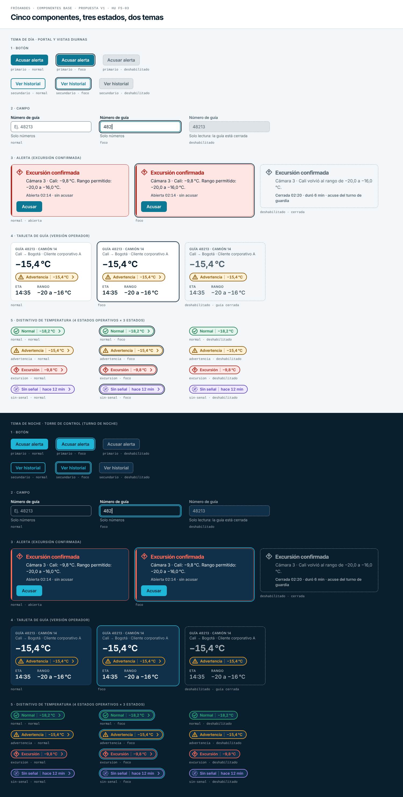
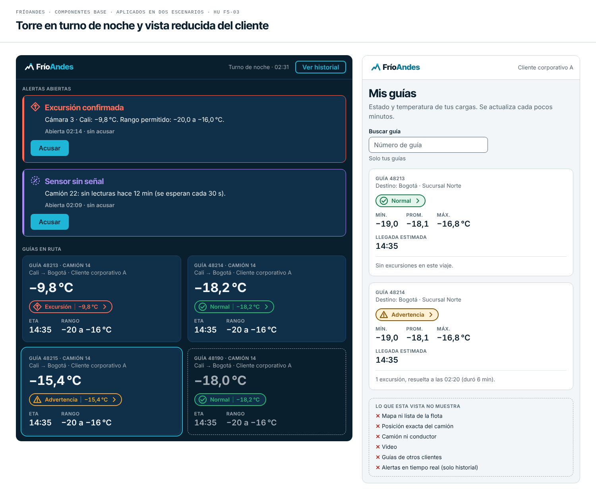

# Componentes base y reglas de uso — FríoAndes

HU F5-03 · Fase 5 (Diseño) · Estado: propuesta v1 para revisión del equipo.
Depende de F5-01 ([`logo-y-paleta.md`](logo-y-paleta.md)) y F5-02 ([`tipografia-espaciado.md`](tipografia-espaciado.md)): los colores, las fuentes, los espacios y los radios que se usan aquí salen de esos dos documentos.

Este documento define los cinco componentes con los que se construye la torre de control y el portal (botón, campo, alerta, tarjeta de guía y distintivo de temperatura), cada uno con sus tres estados (**normal, foco y deshabilitado**), y las reglas para que cualquier equipo los use sin romper el sistema. Cubre explícitamente dos escenarios: el **turno de noche de la torre** y la **vista reducida del cliente corporativo**, que no ve la flota completa.

(Los textos y los datos de las láminas son ejemplos inventados, no datos reales.)

## 1. Fundamentos compartidos

### 1.1 Dos temas

Hay un tema de **día** (portal y vistas diurnas) y un tema de **noche** (torre de control en turno de noche). Los componentes son los mismos; cambian solo estos colores. Los hex de los cuatro estados operativos (verde, ámbar, rojo y violeta) y sus «tintas» de día y de noche están en `logo-y-paleta.md`, sección 3.2.

| Uso | Día | Noche |
|---|---|---|
| Fondo de pantalla | niebla `#F2F6F8` | navy `#0A1F2E` |
| Superficie (tarjetas, alertas, paneles) | blanco `#FFFFFF` | navy-panel `#10304A` |
| Texto principal | navy `#0A1F2E` | niebla `#F2F6F8` |
| Texto secundario | gris-600 `#52646F` | gris-400 `#A0AAB0` |
| Botón primario (relleno / texto) | teal `#0D7894` / blanco `#FFFFFF` | cian `#1FB5D6` / navy `#0A1F2E` |
| Botón secundario (texto y borde) | teal `#0D7894` | cian `#1FB5D6` |
| Borde de campo | gris-600 `#52646F`, 1 px | gris-400 `#A0AAB0`, 1 px |
| Relleno de campo | blanco `#FFFFFF` | navy `#0A1F2E` |
| Anillo de foco | navy `#0A1F2E` | cian `#1FB5D6` |
| Deshabilitado (relleno / texto / borde) | `#DDE3E6` / `#52646F` / `#A0AAB0` | `#10304A` / `#A0AAB0` / `#A0AAB0` |
| Borde de tarjeta (decorativo) | gris-200 `#C9D4DA`, 1 px | `#1D4A6B`, 1 px |

### 1.2 Los tres estados

| Estado | Qué significa | Cómo se ve |
|---|---|---|
| **Normal** | El elemento está disponible y en reposo | Colores de la tabla anterior |
| **Foco** | El teclado está sobre el elemento (o el elemento fue elegido para actuar sobre él) | **Anillo de 2 px con 2 px de separación** en el color de anillo del tema, alrededor del elemento y siguiendo su radio. En los campos, además, el borde pasa a 2 px en teal (día) o cian (noche) |
| **Deshabilitado** | El elemento no admite acciones ahora mismo | Relleno apagado, **borde punteado de 1 px**, texto en gris, y cursor sin acción. Siempre se explica por qué (ayuda del campo, texto de apoyo o descripción accesible) |

Reglas comunes:

1. **El foco siempre se ve.** Nunca se quita el anillo; se ve igual sobre cualquier fondo porque su color contrasta al menos 3:1 con la pantalla y con la superficie (sección 3.2).
2. **Deshabilitado no es ilegible.** WCAG exime a los elementos deshabilitados del contraste mínimo, pero aquí se mantiene el texto en 4,5:1 o más (4,75:1 de día, 5,75:1 de noche) porque en la torre hay que poder leer *por qué* algo no se puede usar.
3. **El estado operativo no se atenúa.** Deshabilitar un elemento afecta a la interacción, no a la información: el color y el ícono de normal, advertencia, excursión y sin señal se conservan siempre (ver el distintivo, sección 2.5).

## 2. Los cinco componentes

Las medidas usan los tokens de `tipografia-espaciado.md`. El texto de botones y campos es `texto` (16/24); las etiquetas de campo, `texto-s` (14/20) en peso 600.

### 2.1 Botón

| | |
|---|---|
| Para qué | Una acción: acusar una alerta, ver el historial, buscar |
| Variantes | **Primario** (una sola por zona de pantalla) y **secundario** (contorno) |
| Medidas | Alto 40 px (32 compacto, 48 en el portal móvil), ancho mínimo 96 px, relleno horizontal 16 px, radio 8 px (`radio-m`), texto `texto` en peso 600 |
| Normal | Primario: relleno teal y texto blanco (día), relleno cian y texto navy (noche). Secundario: transparente, texto y borde de 2 px en teal (día) o cian (noche) |
| Foco | Anillo de 2 px, separación 2 px |
| Deshabilitado | Relleno apagado, borde punteado, texto gris |

Reglas: el texto del botón dice la acción («Acusar», «Ver historial»), no «Aceptar». Nunca va solo un ícono sin texto en la torre.

### 2.2 Campo

| | |
|---|---|
| Para qué | Que la persona escriba o elija un dato (número de guía, búsqueda) |
| Anatomía | Etiqueta arriba (`texto-s` 600), caja, texto de ayuda abajo (`texto-s`); 4 px entre etiqueta y caja, y entre caja y ayuda |
| Medidas | Alto 40 px, relleno horizontal 12 px, radio 8 px |
| Normal | Relleno blanco (día) o navy (noche), borde de 1 px, marcador de posición en el color secundario |
| Foco | Borde de 2 px en teal (día) o cian (noche) y anillo de foco |
| Deshabilitado | Relleno apagado y borde punteado; la ayuda dice el motivo («Solo lectura: la guía está cerrada») |

Reglas: la etiqueta siempre está visible; el marcador de posición no reemplaza la etiqueta (desaparece al escribir). El texto de ayuda es obligatorio cuando el campo está deshabilitado.

### 2.3 Alerta

| | |
|---|---|
| Para qué | Avisar a la torre o a la guardia de calidad de un evento de temperatura: excursión, advertencia o sensor sin señal. Sigue el ciclo de vida de `carga-b-telemetria.md` (abierta, reconocida, cerrada) |
| Anatomía | Barra de 4 px a la izquierda, ícono del estado (24 px), título (`titulo-2`), mensaje (`texto`), hora y estado (`dato-s`) y, si está abierta, el botón primario «Acusar» |
| Medidas | Relleno 16 px, radio 12 px (`radio-l`) |
| Normal (abierta) | Día: fondo suave y borde de 1 px en la tinta del estado. Noche: fondo navy-panel y borde en la tinta de noche. Título e ícono en el color del estado, mensaje en el color de texto principal |
| Foco | Anillo de foco alrededor de toda la alerta |
| Deshabilitado (cerrada) | Sin relleno de color, borde punteado, título y mensaje en gris, sin botón. **Conserva el ícono y el texto del estado** y dice cuándo se cerró, cuánto duró y el acuse |

Reglas: una alerta abierta siempre tiene el botón «Acusar»; una cerrada no. El color del estado se acompaña siempre de ícono y de texto (el título nombra el estado). La alerta es un componente **interno**: el cliente corporativo no recibe alertas en tiempo real (sección 3.3).

### 2.4 Tarjeta de guía

| | |
|---|---|
| Para qué | Resumir una guía: de dónde a dónde va, cómo está su temperatura y cuándo llega |
| Variantes | **Operador** (torre, calidad) y **cliente** (portal): son dos versiones con contenido distinto, ver sección 3.3 |
| Medidas | Relleno 16 px (compacta) o 24 px (cómoda), radio 12 px; 4 px entre etiqueta y cifra y 12 px entre bloques |
| Versión operador | Etiqueta con guía y camión, ruta, temperatura actual (`dato-l`), distintivo, y ETA y rango (`dato-m`) |
| Versión cliente | Etiqueta con la guía, destino, distintivo de estado, mínimo, promedio y máximo del viaje (`dato-m`) y hora estimada de llegada |
| Normal | Superficie del tema, borde de 1 px |
| Foco | Anillo de foco alrededor de la tarjeta (la tarjeta completa se puede abrir con el teclado) |
| Deshabilitado | Sin relleno, borde punteado y texto en gris; es una guía cerrada o que no se puede abrir. **El distintivo conserva su color** |

### 2.5 Distintivo de temperatura

| | |
|---|---|
| Para qué | Mostrar el estado operativo de una carga o de un cuarto frío, y su temperatura |
| Anatomía | Pastilla de 32 px de alto con borde de 2 px: ícono del estado (22 px), nombre del estado (`texto-s` 600), separador y valor (`dato-s`, cifras tabulares), y una flecha al final si abre el detalle |
| Los 4 estados operativos | **Normal** (círculo con check), **advertencia** (triángulo), **excursión de temperatura** (rombo con flecha hacia arriba), **sensor sin señal** (círculo punteado con raya). Cada uno con su color, ícono y texto de F5-01 |
| Valor | Temperatura con coma decimal y un decimal (`−18,2 °C`). Para sensor sin señal, el tiempo desde la última lectura (`hace 12 min`), no una cifra inventada |
| Normal | Día: fondo suave, borde y texto en la tinta del estado. Noche: fondo navy-panel, borde y texto en la tinta de noche. Con la flecha, porque se puede abrir el historial |
| Foco | Anillo de foco alrededor de la pastilla |
| Deshabilitado | Sin flecha (el detalle no se puede abrir). **Mantiene color, ícono y valor** |

La matriz completa (4 estados operativos × 3 estados del componente, en día y en noche) está en la lámina. Textos cortos para espacios estrechos: «Normal», «Advertencia», «Excursión» y «Sin señal»; el nombre completo («Excursión de temperatura», «Sensor sin señal») va donde cabe y en la descripción accesible.

## 3. Reglas de uso

### 3.1 Qué se puede cambiar y qué no

| Se puede cambiar (lo decide el equipo de producto) | No se puede cambiar (lo decide el sistema de diseño) |
|---|---|
| El texto de los botones, etiquetas, mensajes y ayudas | Los colores de los cuatro estados operativos y sus tintas de día y de noche |
| El ancho de los componentes y cuántos caben por fila (dentro de la grilla) | Que cada estado lleve color, **ícono y texto** a la vez |
| La altura del botón entre 32, 40 y 48 px, según la superficie | El anillo de foco (2 px, separación 2 px) y su color por tema |
| Qué datos secundarios muestra una tarjeta, siempre que la cifra principal sea la más grande | Las cifras tabulares, la coma decimal, el signo menos verdadero y la unidad a la mitad del tamaño de la cifra |
| Agregar una acción secundaria a una alerta o tarjeta | Los radios (8, 12 y pastilla), los espacios y la grilla de `tipografia-espaciado.md` |
| El orden de los campos de un formulario | Los dos temas: no se crean colores nuevos ni un tercer tema |
| Mostrar el nombre corto o el completo en un distintivo | Que el estado operativo no se atenúa al deshabilitar |
| | El logo: solo sus versiones aprobadas |

Si un equipo necesita algo de la columna derecha, lo propone al responsable de marca y se actualiza el sistema; no se hace una variante local.

### 3.2 Contraste para el turno de noche

**Regla:** en el tema de noche, **todo texto, ícono y borde que lleve información se mantiene en al menos 4,5:1** (nivel AA de WCAG para texto normal), y **todo elemento gráfico y el anillo de foco, en al menos 3:1**. Calculado con la fórmula de WCAG 2.x sobre los colores de este documento (todo cumple, ningún par falla):

| Tema de noche | Contraste | Mínimo exigido |
|---|---|---|
| Texto principal (niebla) sobre navy-panel | 12,51:1 | 4,5:1 |
| Texto secundario (gris-400) sobre navy-panel | 5,75:1 | 4,5:1 |
| Botón primario: texto navy sobre relleno cian | 6,92:1 | 4,5:1 |
| Botón secundario: cian sobre fondo navy | 6,92:1 | 4,5:1 |
| Texto deshabilitado (gris-400) sobre su fondo | 5,75:1 | 4,5:1 (más estricto que WCAG) |
| Texto escrito en un campo (niebla sobre navy) | 15,47:1 | 4,5:1 |
| Marcador de posición y ayuda (gris-400 sobre navy) | 7,11:1 | 4,5:1 |
| Estado normal: verde sobre navy-panel | 5,21:1 | 4,5:1 |
| Estado advertencia: ámbar sobre navy-panel | 6,67:1 | 4,5:1 |
| **Estado excursión: rojo `#FF6B57` sobre navy-panel** | **4,85:1** | 4,5:1 |
| Estado sin señal: violeta `#A58BF0` sobre navy-panel | 4,89:1 | 4,5:1 |
| Borde de campo (gris-400) sobre navy-panel | 5,75:1 | 3:1 |
| Anillo de foco (cian) sobre navy y sobre navy-panel | 6,92:1 y 5,60:1 | 3:1 |

**El valor más bajo en noche para texto es 4,85:1** (el rojo de excursión sobre navy-panel), y el más bajo para gráficos es 5,60:1 (el anillo de foco sobre navy-panel). En el tema de día el más bajo es 4,67:1 (el teal sobre el fondo niebla). Los pares completos de día y de noche, con sus hex, están calculados en `componentes/contrastes.json`.

Otras reglas de noche: el texto principal es niebla `#F2F6F8`, nunca blanco puro, para reducir el deslumbramiento sobre fondo oscuro; el borde decorativo de las tarjetas (`#1D4A6B`) no lleva información, por eso no se le exige contraste.

### 3.3 Cómo se presenta el cliente corporativo (sin mostrar la flota)

La regla sale de lo ya decidido en `fabric-acceso-casos-uso-costo.md` (F1-14, #18), `carga-b-telemetria.md`, `seguridad-iam-cifrado.md` y `seguridad-datos-personales-perimetro.md`: **el cliente corporativo ve solo sus guías y nada de la flota ni del video**.

| La vista del cliente muestra | La vista del cliente nunca muestra |
|---|---|
| Sus guías: número y destino | Mapa ni lista de la flota, ni cuántos camiones hay |
| El estado de cada guía (distintivo de temperatura, sin valor instantáneo) | La posición exacta del camión |
| Mínimo, promedio y máximo de temperatura del viaje o de la permanencia en bodega | El camión (número o placa) ni el conductor |
| Las excursiones y cuándo se resolvieron, como historial | Video |
| La hora estimada de llegada | Guías de otros clientes, ni siquiera su existencia |
| | Alertas en tiempo real (el cliente no las recibe) |

Cómo lo aplican los componentes:

1. **Tarjeta de guía versión cliente.** Es la única tarjeta que usa el cliente. No tiene línea de camión ni de ruta de la flota, no muestra la temperatura actual y no tiene acción que abra mapa o video. Los tres datos de temperatura salen de `cliente_guias`, la tabla curada de Fabric que no lleva posición, camión, conductor ni video.
2. **Distintivo sin valor instantáneo.** En la vista del cliente muestra solo el estado, porque `cliente_guias` trae mínimo, máximo y promedio, pero no la última lectura. Si el equipo de datos agrega la última lectura, el distintivo la mostrará.
3. **No usa el componente Alerta.** Una excursión aparece como una línea de historial dentro de la tarjeta («1 excursión, resuelta a las 02:20, duró 6 min»), nunca como una alerta con botón de acuse.
4. **Campo de búsqueda.** Solo busca entre las guías del cliente. Si el número no es suyo, la respuesta es la misma que para un número que no existe: «No encontramos esa guía». No se dice que exista pero esté restringida (es la regla de `seguridad-datos-personales-perimetro.md`, sección 4.4).
5. **Estado vacío.** Si el cliente no tiene guías activas, se dice «No tienes guías en curso» y nada más: sin cifras globales ni referencias a otros clientes.
6. **Tema de día** y componentes en su tamaño cómodo (relleno de 24 px).

## 4. Criterios de aceptación

| Criterio | Cómo se cumple |
|---|---|
| Los 5 componentes con sus 3 estados cada uno, y el distintivo con los 4 estados operativos | Sección 2 y lámina de componentes: botón, campo, alerta, tarjeta y distintivo en normal, foco y deshabilitado, de día y de noche; el distintivo en 4 estados operativos × 3 estados |
| Reglas de uso con contraste nocturno y ratio concreto | Sección 3.2: regla de 4,5:1 (texto) y 3:1 (gráficos); el mínimo medido en noche es 4,85:1 para texto y 5,60:1 para gráficos |
| Regla de presentación del cliente corporativo coherente con F1-14 | Sección 3.3, con la tabla de lo que se muestra y lo que no, tomada de #18 y de los diseños de telemetría, IAM y datos personales |
| Qué se puede cambiar y qué no | Sección 3.1 |

## 5. Archivos

Todo vive en `docs/design/componentes/`.

| Archivo | Para qué |
|---|---|
| `lamina-componentes.png` | Los cinco componentes en tres estados, día y noche |
| `lamina-escenarios.png` | La torre en turno de noche y la vista reducida del cliente, hechas con los componentes |
| `tokens-componentes.json` | Tokens de los componentes en formato Tokens Studio (colores por tema, medidas, radios) |
| `tokens-componentes.css` | Los mismos valores como variables CSS por tema |
| `muestra-componentes.html` | Hoja editable de las dos láminas (usa Google Fonts) |
| `contrastes.json` | Todos los pares de colores con su contraste calculado |

## 6. Pendientes y decisiones para el equipo

1. **«Foco» o «seleccionado».** La guía de lectura (Reto 8) habla de «normal, seleccionado y deshabilitado», pero el enunciado y esta HU dicen «normal, foco y deshabilitado». Se siguió la HU (foco). El anillo de foco sirve también para mostrar un elemento elegido.
2. **Última lectura para el cliente.** Hay que confirmar con el equipo de datos si `cliente_guias` incluirá la última temperatura; hoy la vista del cliente muestra mínimo, promedio y máximo.
3. **Estados fuera de alcance de la HU:** pasar el cursor, error de validación en el campo, cargando. Si se necesitan, se agregan con la misma regla (sin colores nuevos).
4. **Probar con personas del turno de noche** y en el monitor real de la torre; el contraste está calculado, no medido en pantalla.
5. **Lámina final (#35):** esta propuesta debe integrarse allí junto con el logo, la paleta y la tipografía.
