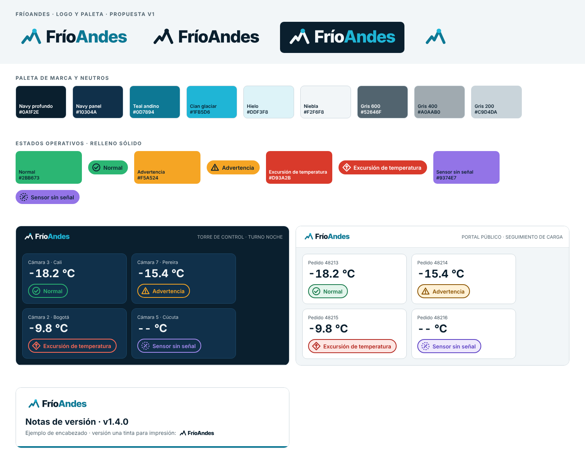

# Logo y paleta de color — FríoAndes

HU F5-02 · Fase 5 (Diseño) · Estado: propuesta v1 para revisión del equipo.

FríoAndes no tiene manual de marca. Este documento fija el logo y la paleta que usan la torre de control (de noche), el portal público (de día) y las notas de versión, para que las tres superficies se vean como la misma empresa. La paleta sale de los colores que ya usamos en la presentación de avance, así que no hay que rehacer nada de lo entregado.

## 1. Idea del logo

- **Nombre:** FríoAndes = frío (cadena de frío) + Andes (la empresa es colombiana, sede en Cali).
- **Isotipo:** una cresta de montaña dibujada como una traza de temperatura (línea de un gráfico). La cumbre termina en un punto: el sensor que mide. Una sola figura cuenta las dos cosas: montañas y monitoreo.
- **Wordmark:** «Frío» + «Andes» en Inter Tight ExtraBold (licencia OFL). Las letras van convertidas a trazos en el SVG, así el logo no depende de ninguna fuente instalada.
- **Por qué funciona en las tres superficies:** son solo trazos gruesos y un punto, sin degradados ni sombras. Se lee desde 16 px (favicon) y se imprime bien en una tinta.

## 2. Versiones del logo (criterio de aceptación 1)

| Versión | Archivo | Dónde se usa | Colores |
|---|---|---|---|
| Principal (a color, para fondos claros) | `logo/logo-principal.svg` | **Portal público** (encabezado, de día), pie de correos | «Frío» #0A1F2E, «Andes» y cresta #0D7894, punto #1FB5D6 |
| Negativo (para fondos oscuros) | `logo/logo-negativo.svg` | **Torre de control** (barra superior, turno noche) | «Frío» y cresta #F2F6F8, «Andes» y punto #1FB5D6 |
| Una tinta | `logo/logo-una-tinta.svg` (oscuro) y `logo/logo-una-tinta-blanco.svg` (blanco) | **Notas de versión** impresas o en PDF en blanco y negro, sellos, fax/etiquetas | Todo #0A1F2E, o todo blanco sobre fondo oscuro |
| Isotipo | `logo/isotipo-principal.svg`, `isotipo-una-tinta.svg`, `isotipo-negativo.svg` | Favicon, avatar, espacios cuadrados | Igual que arriba |
| Icono de app | `logo/icono-app.svg` | Pestaña fijada de la torre, ícono de instalación | Fondo #0A1F2E, isotipo negativo |

Las notas de versión usan la versión principal en pantalla y la de una tinta cuando se imprimen o van en blanco y negro.

**Reglas de uso**
- Espacio libre alrededor: no recortar el SVG; ya trae un margen de 16 unidades (un cuarto de la altura del isotipo) y ningún otro elemento debe entrar en él.
- Tamaño mínimo: isotipo 16 px; logo horizontal 24 px de alto.
- No recolorear fuera de las versiones de arriba, no estirar, no poner sobre fotos sin una capa oscura.
- Sobre fondo claro siempre principal o una tinta; sobre fondo oscuro siempre negativo o una tinta blanca.

## 3. Paleta

### 3.1 Marca y neutros

| Token | Hex | Uso |
|---|---|---|
| navy-profundo | `#0A1F2E` | Fondo de la torre de noche, texto principal de día |
| navy-panel | `#10304A` | Tarjetas y paneles en la torre |
| teal-andino | `#0D7894` | Color primario: enlaces, botones, «Andes» sobre fondo claro |
| cian-glaciar | `#1FB5D6` | Acento: punto del sensor, «Andes» sobre fondo oscuro, foco de teclado |
| hielo | `#DDF3F8` | Fondos suaves, selección |
| niebla | `#F2F6F8` | Fondo del portal de día |
| gris-600 | `#52646F` | Texto secundario |
| gris-400 | `#A0AAB0` | Texto secundario en la torre, íconos inactivos |
| gris-200 / gris-100 | `#C9D4DA` / `#DDE3E6` | Bordes y separadores |
| blanco | `#FFFFFF` | Superficies del portal |

### 3.2 Los 4 estados operativos (criterio de aceptación 2)

Cada estado tiene un color de relleno (el que se ve en puntos, barras y gráficos) y una «tinta» más oscura para texto sobre fondo claro, porque los colores de relleno por sí solos no alcanzan el contraste de texto sobre blanco.

| Estado | Relleno | Texto sobre relleno | Tinta de día (portal) | Fondo suave de día | Tinta de noche (torre) | Forma / ícono |
|---|---|---|---|---|---|---|
| Normal | `#2BB673` | `#0A1F2E` | `#17794A` | `#E3F5EC` | `#2BB673` | Círculo con check |
| Advertencia | `#F5A524` | `#0A1F2E` | `#8A5300` | `#FFF1D6` | `#F5A524` | Triángulo con ! |
| Excursión de temperatura | `#D93A2B` | `#FFFFFF` | `#B3261E` | `#FDE6E3` | `#FF6B57` | Rombo con flecha hacia arriba |
| Sensor sin señal | `#9374E7` | `#0A1F2E` | `#5B3FC4` | `#EEE9FC` | `#A58BF0` | Círculo punteado con raya diagonal |

**Regla de oro:** el color nunca va solo. Cada estado lleva siempre su ícono con forma distinta y su texto. Así se distingue aunque la persona sea daltónica, mire la pantalla de lejos o esté en un turno de noche con brillo bajo.

### 3.3 Insignias de estado

Las insignias combinan ícono, texto y color, y son la base de la insignia de temperatura de F5-03. Hay tres variantes por estado, todas en `insignias/`:

| Variante | Carpeta | Dónde | Composición |
|---|---|---|---|
| Día | `insignias/dia/` | Portal público | Fondo suave, borde y texto en tinta de día, ícono |
| Noche | `insignias/noche/` | Torre de control | Fondo navy-panel, borde, texto e ícono en tinta de noche |
| Sólida | `insignias/solido/` | Listas densas, boletines, fondos de cualquier tema | Relleno del estado, texto e ícono en el color «sobre relleno» |

Medidas: 32 px de alto, texto Inter SemiBold 14 px (convertido a trazos en el SVG), ícono de 22 px.

Decisiones respecto de la presentación: el rojo pasó de `#FF5A3C` a `#D93A2B` (con el anterior no llegaba a 4,5:1 con texto blanco ni se separaba bien del ámbar con daltonismo) y el violeta de `#8D6BE3` a `#9374E7` (con texto navy subía de 4,28:1 a 4,72:1). Los verdes y ámbar se mantienen.

## 4. Verificación

Calculado con las fórmulas de WCAG 2.x (script `fuentes-editables/pal.py`). Meta: ≥ 4,5:1 para texto y ≥ 3:1 para gráficos.

**Texto**

| Estado | Texto sobre relleno | Tinta de día / blanco | Tinta de día / fondo suave | Tinta de noche / navy | Tinta de noche / panel |
|---|---|---|---|---|---|
| Normal | 6,44 | 5,43 | 4,79 | 6,44 | 5,21 |
| Advertencia | 8,24 | 6,33 | 5,67 | 8,24 | 6,67 |
| Excursión | 4,57 | 6,54 | 5,48 | 6,00 | 4,85 |
| Sin señal | 4,72 | 7,11 | 5,99 | 6,05 | 4,89 |

Marca: teal sobre blanco 5,08; teal sobre niebla 4,67; cian sobre navy 6,92; gris-600 sobre blanco 6,16; hielo sobre navy 14,62.

**Daltonismo.** Se simularon protanopía, deuteranopía y tritanopía (matrices de Machado 2009) y se midió la diferencia de color (ΔE Lab) entre los rellenos de los 4 estados. Menor valor por tipo: visión normal 54, protanopía 28 (normal–excursión), deuteranopía 30 (advertencia–excursión), tritanopía 45 (normal–sin señal). Todos son distinguibles, pero la distancia en protanopía y deuteranopía es moderada, y por eso la forma y el texto son obligatorios.

**Límites de esta verificación**
- Rellenos sobre fondo claro (verde 2,61:1, ámbar 2,04:1 sobre blanco) no cumplen 3:1 como gráficos aislados; por eso en día se usa la insignia con borde y tinta oscura, no el relleno suelto.
- No se probó con personas ni con las pantallas reales de la torre. Pendiente: revisar en el monitor real del turno de noche (F5-03).

## 5. Archivos

Todo vive en `docs/design/brand/` (junto a este documento). Los scripts de `fuentes-editables/` son de referencia: para volver a generar los logos hay que ajustar la ruta de la fuente Inter Tight 800 (paquete npm `@fontsource/inter-tight`) en `build_logo.py`.

| Archivo | Para qué |
|---|---|
| `logo/*.svg` | Fuentes editables de todas las versiones (se abren en Figma, Inkscape o Illustrator) |
| `iconos/neutro`, `iconos/dia`, `iconos/noche` | Los 4 íconos de estado (24 px, trazo editable): neutro (#0A1F2E) para recolorear, y ya coloreados con la tinta de día y de noche |
| `insignias/dia`, `insignias/noche`, `insignias/solido` | Las 4 insignias de estado en 3 variantes (12 SVG, con el texto ya convertido a trazos) |
| `logo/*.png` | Exportaciones con fondo transparente (3x) |
| `tokens.json` / `tokens.css` | Colores como variables para el diseño de componentes (F5-03) |
| `hoja-previa.png` | Vista conjunta: logo, paleta, torre, portal y notas de versión |
| `fuentes-editables/build_logo.py` | Genera todos los SVG (cambiar colores o la cresta y volver a correr) |

## 6. Criterios de aceptación

| Criterio | Cómo se cumple |
|---|---|
| 3 versiones del logo (principal, una tinta, negativo) referidas a las 3 superficies (torre, portal, notas de versión) | Sección 2: torre = negativo, portal = principal, notas de versión = principal en pantalla y una tinta impresa |
| Los 4 estados operativos con color distinto y código exacto | Sección 3.2: `#2BB673`, `#F5A524`, `#D93A2B`, `#9374E7` (y sus tintas de día y noche) |
| Se distinguen en la insignia de temperatura y en el turno de noche (F5-03) | Sección 3.3: ícono de forma distinta + texto; sección 4: contraste de la variante de noche entre 4,85 y 8,24 |
| Archivos fuente editables | Sección 5: SVG, tokens y script |

Si el tablero tiene criterios adicionales que no se vean en la captura, hay que revisarlos contra esta tabla.

## 7. Pendientes y decisiones para el equipo

1. Confirmar con el cliente (o con el profesor) si el color de marca puede ser teal y cian, ya que no hay manual previo.
2. Validar el nombre con tilde «FríoAndes» en las tres superficies (nombres de archivo y URLs usan `frioandes`).
3. Revisar el contraste final de F5-03 (insignia de temperatura) con estos tokens.
