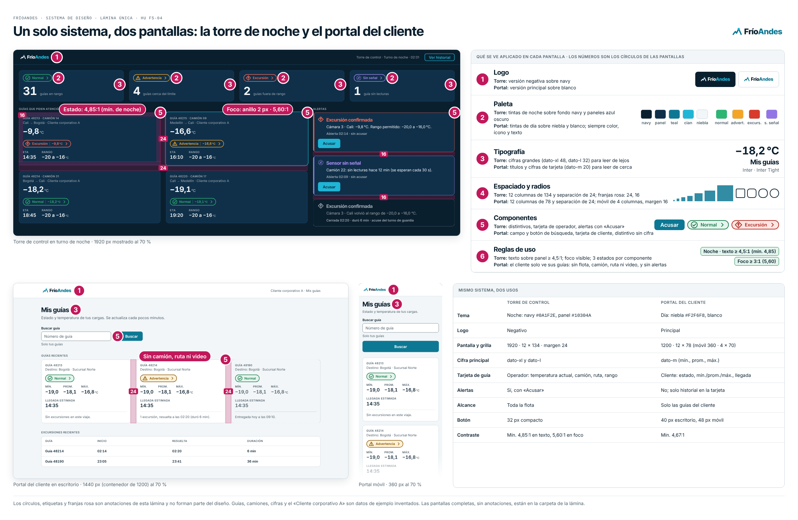
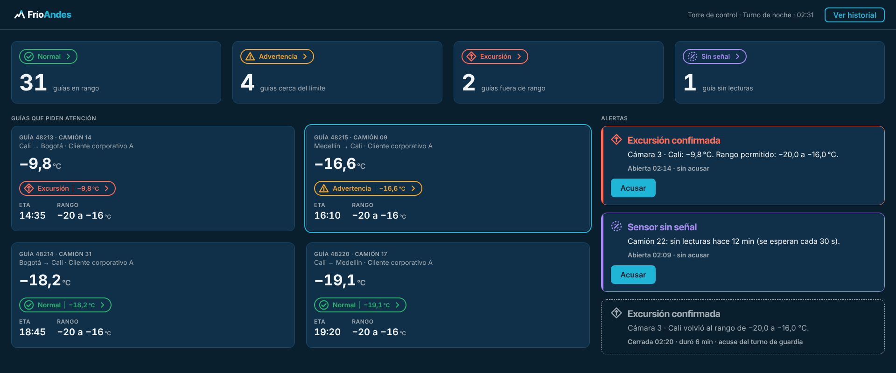
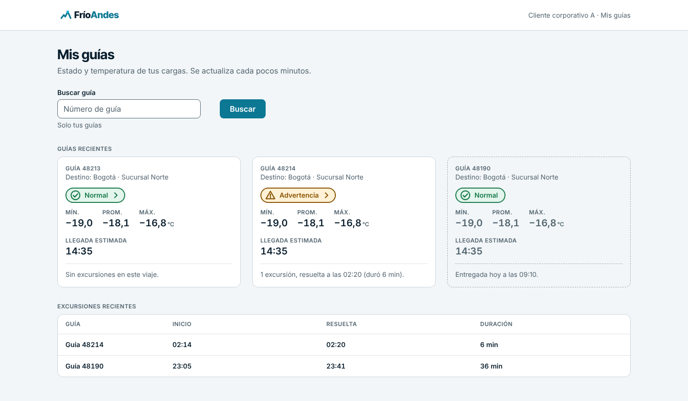
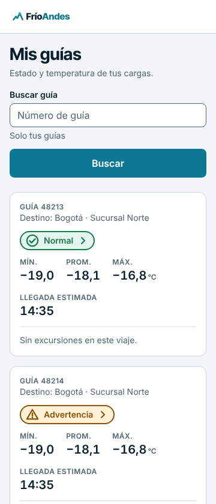

# Sistema de diseño FríoAndes — lámina final

HU F5-04 · Fase 5 (Diseño) · Estado: propuesta v1 para revisión del equipo.
Reúne y aplica lo definido en F5-01 ([`logo-y-paleta.md`](logo-y-paleta.md)), F5-02 ([`tipografia-espaciado.md`](tipografia-espaciado.md)) y F5-03 ([`componentes-y-reglas-de-uso.md`](componentes-y-reglas-de-uso.md)). Este documento no cambia ninguna decisión de esos tres: las muestra aplicadas y las resume en una sola página para que la marca se pueda evaluar de un vistazo.

*Los círculos, las etiquetas y las franjas rosa son anotaciones de la lámina y no forman parte del diseño. Guías, camiones, cifras y «Cliente corporativo A» son datos de ejemplo inventados.*

## 1. Cómo leer la lámina

La lámina muestra tres pantallas hechas **solo con piezas del sistema**: la torre de control en turno de noche, el portal del cliente en escritorio y el portal del cliente en el móvil. Cada círculo numerado señala dónde se ve aplicado un elemento:

| N.º | Elemento | Dónde se ve en la torre (noche) | Dónde se ve en el portal (día) | Definido en |
|---|---|---|---|---|
| 1 | **Logo** | Versión negativa sobre navy, en la barra superior | Versión principal sobre blanco, en la barra superior (también en el móvil) | F5-01 |
| 2 | **Paleta** | Fondo navy `#0A1F2E`, paneles `#10304A`, tintas de noche de los 4 estados | Fondo niebla `#F2F6F8`, tarjetas blancas, tintas de día de los 4 estados | F5-01 |
| 3 | **Tipografía** | Cifras `dato-xl` (48/56) en los contadores y `dato-l` (32/40) en las tarjetas | Títulos `titulo-1`, cifras `dato-m` (20/28) y `dato-s` en la tabla de excursiones | F5-02 |
| 4 | **Espaciado y radios** | Grilla de 12 columnas de 134 px con 24 px de separación; 24 px entre tarjetas, 16 px entre alertas, 16 px de relleno | Contenedor de 1200 px (12 × 78, separación 24); móvil de 4 columnas con margen 16 | F5-02 |
| 5 | **Componentes** | Distintivos, tarjetas de operador, alertas con «Acusar», botón compacto | Campo y botón de búsqueda, tarjetas de cliente, distintivo | F5-03 |
| 6 | **Reglas de uso** | Texto ≥ 4,5:1 (mínimo medido 4,85:1), foco ≥ 3:1 (5,60:1) | Solo las guías del cliente; sin flota, camión, ruta, video ni alertas | F5-03 |

Las etiquetas rosa de las pantallas ponen la regla en el lugar donde se cumple: «Estado: 4,85:1» sobre una tarjeta con excursión de noche, «Foco: anillo 2 px · 5,60:1» sobre la tarjeta enfocada y «Sin camión, ruta ni video» sobre una tarjeta del cliente.

## 2. Las pantallas completas

Las tres pantallas, sin anotaciones, a tamaño real, para evaluarlas o usarlas en una presentación.

### 2.1 Torre de control, turno de noche (1920 px)

- Los cuatro contadores arriba usan el distintivo de cada estado (color, ícono y texto) y una cifra `dato-xl`: un vistazo dice cuántas guías están en cada estado.
- «Guías que piden atención» usa la tarjeta de operador: temperatura actual, camión, ruta, rango y hora estimada. La tarjeta con borde cian está en foco.
- «Alertas» usa el componente alerta: abierta con «Acusar», y cerrada en estado deshabilitado (borde punteado) que conserva ícono y texto.

### 2.2 Portal del cliente, escritorio (1440 px, contenedor de 1200)

- Tema de día, logo principal y tarjetas de cliente: estado, mínimo, promedio y máximo del viaje, y hora estimada de llegada.
- El distintivo muestra solo el estado, sin la temperatura de este instante.
- Las excursiones aparecen como historial (tabla con cifras tabulares), nunca como alertas. La tarjeta deshabilitada es una guía ya entregada.

### 2.3 Portal del cliente, móvil (360 px)

- Mismo contenido en una columna de 4 columnas de grilla, con margen de 16 px, campo a todo el ancho y botón de 48 px de alto.

## 3. Mismo sistema, dos usos

| | Torre de control | Portal del cliente |
|---|---|---|
| Tema | Noche: navy `#0A1F2E`, panel `#10304A` | Día: niebla `#F2F6F8`, blanco |
| Logo | Negativo | Principal |
| Pantalla y grilla | 1920 · 12 × 134 · margen 24 · separación 24 | 1200 · 12 × 78 · separación 24 (móvil 360 · 4 × 70 · margen 16) |
| Cifra principal | `dato-xl` y `dato-l` | `dato-m` (mín., prom., máx.) |
| Tarjeta de guía | Operador: temperatura actual, camión, ruta, rango | Cliente: estado, mín./prom./máx., llegada |
| Alertas | Sí, con «Acusar» | No; solo historial en la tarjeta |
| Alcance de los datos | Toda la flota | Solo las guías del cliente |
| Botón | 32 px compacto (40 px normal) | 40 px en escritorio, 48 px en móvil |
| Contraste mínimo medido | 4,85:1 en texto, 5,60:1 en foco | 4,67:1 |

Lo que **no** cambia entre las dos pantallas: los colores y los íconos de los cuatro estados, las fuentes, las cifras tabulares con coma decimal, el anillo de foco, los radios y la escala de espacios.

## 4. Las reglas en una página

1. **Un estado nunca va solo en color.** Normal, advertencia, excursión de temperatura y sensor sin señal llevan siempre color, ícono y texto.
2. **Dos temas, ninguno más.** Noche para la torre y día para el portal; no se crean colores ni un tercer tema.
3. **Contraste:** texto de 4,5:1 o más y gráficos y anillo de foco de 3:1 o más, también en noche (mínimos medidos: 4,85:1 y 5,60:1).
4. **El foco siempre se ve:** anillo de 2 px con 2 px de separación, en cian de noche y navy de día.
5. **Deshabilitado sigue siendo legible** (borde punteado, texto en gris con 4,5:1 o más) y siempre explica el motivo. El estado operativo no se atenúa.
6. **Cifras:** `Inter` con cifras tabulares, coma decimal, signo menos verdadero (`−`), unidad a la mitad del tamaño de la cifra y reloj de 24 horas.
7. **Títulos** en `Inter Tight`; texto y cifras en `Inter`.
8. **Medidas:** espacios de 0, 4, 8, 12, 16, 24, 32, 48 y 64 px; radios de 4, 8, 12 y 16 px y pastilla; grillas de F5-02.
9. **El cliente corporativo ve solo sus guías:** sin flota, posición exacta, camión, conductor, video, guías ajenas ni alertas en tiempo real. Una guía ajena responde igual que una inexistente.
10. **Lo que no se puede cambiar** (colores de estado, foco, íconos, tipografía, radios, grilla, logo) se propone al responsable de marca; no se hacen variantes locales.

## 5. Para crear una pantalla nueva

1. Elegir el tema: noche para la torre, día para el portal.
2. Armar la grilla de la pantalla (1920, 1200, 768 o 360) con las medidas de F5-02.
3. Componer solo con los cinco componentes; si una pieza no existe, pedirla antes de inventarla.
4. Poner cada estado con color, ícono y texto, y las cifras en la escala `dato-*`.
5. Revisar el contraste y el estado de foco; si la pantalla es del cliente, comprobar la tabla «Lo que muestra / Lo que nunca muestra» de F5-03.

## 6. Archivos

| Archivo | Para qué |
|---|---|
| `lamina/lamina-sistema-de-diseno.png` | La lámina única con anotaciones |
| `lamina/pantalla-torre-noche.png` | Torre de control, 1920 × 800, sin anotaciones |
| `lamina/pantalla-portal-escritorio.png` | Portal del cliente, 1440 × 840, sin anotaciones |
| `lamina/pantalla-portal-movil.png` | Portal del cliente móvil, 360 × 840, sin anotaciones |
| `brand/` | Logo, íconos, insignias y tokens de color (F5-01) |
| `tipografia/` | Tokens y muestras de tipografía y espaciado (F5-02) |
| `componentes/` | Láminas, tokens y contrastes de los componentes (F5-03) |

## 7. Criterios de aceptación

| Criterio | Cómo se cumple |
|---|---|
| La lámina muestra cada elemento aplicado visualmente, no solo listado | Sección 1 y lámina: logo, paleta, tipografía, espaciado, componentes y reglas se ven sobre pantallas reales, marcados con los círculos 1 a 6 |
| Se muestra explícitamente cómo se ve la torre de control y cómo se ve el portal con el mismo sistema | Secciones 2 y 3: pantalla de la torre (noche), portal en escritorio y móvil (día), y la tabla de lo que cambia y lo que no |

## 8. Pendientes y decisiones para el equipo

1. **Validar con el monitor real de la torre y con el turno de noche:** el contraste está calculado, no medido en pantalla, y no se conocen la distancia de lectura ni el tamaño del monitor.
2. **Aprobación de marca:** el teal y el cian de la paleta, y el logo, siguen como propuesta.
3. **Última lectura para el cliente:** confirmar con el equipo de datos si `cliente_guias` incluirá la última temperatura (hoy la vista del cliente muestra el estado y mín./prom./máx.).
4. **Convenciones con el cliente:** coma decimal y reloj de 24 horas.
5. **«Foco» frente a «seleccionado»:** la guía de lectura dice «seleccionado»; el enunciado y las HU dicen «foco». Se siguió la HU.
6. **Estados fuera de alcance:** cursor encima, error de validación y cargando se agregarían con las mismas reglas, sin colores nuevos.
