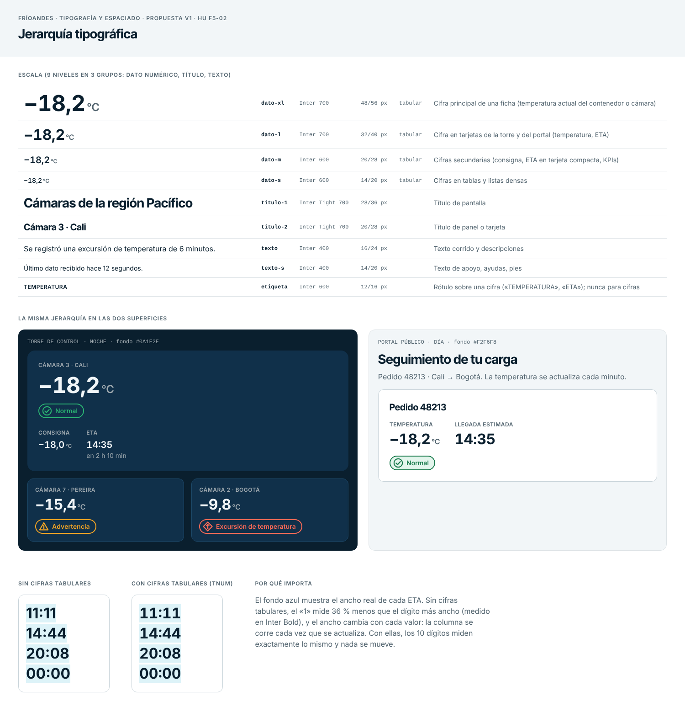
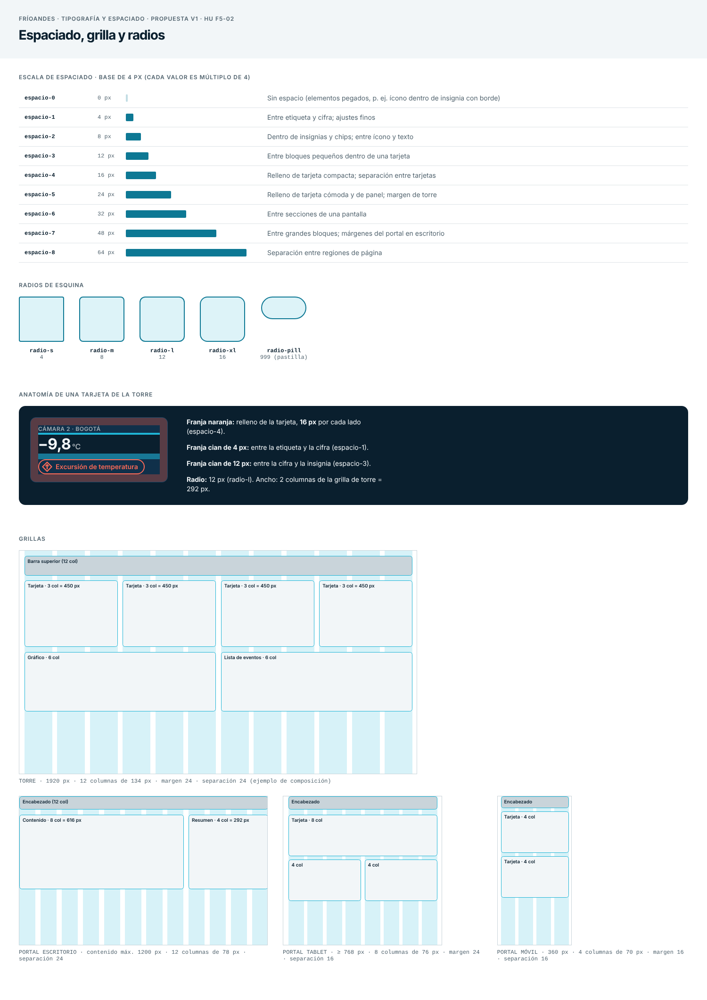

# Tipografía y espaciado — FríoAndes

HU F5-02 · Fase 5 (Diseño) · Estado: propuesta v1 para revisión del equipo.
Depende de F5-01 (logo y paleta): los colores que se mencionan aquí salen de [`logo-y-paleta.md`](logo-y-paleta.md).

Las pantallas de operación se miran bajo presión: lo que más importa (la temperatura y la hora estimada de llegada, ETA) tiene que leerse de un vistazo y sin errores. Este documento fija la tipografía, el espaciado, la grilla y los radios para que la torre de control (de noche) y el portal público (de día) compartan el mismo sistema.

## 1. Principios

1. **Las cifras mandan.** Hay cuatro niveles solo para datos numéricos, y en una ficha la cifra es siempre el elemento más grande.
2. **Una cifra nunca se mueve.** Las cifras son tabulares (todos los dígitos del mismo ancho), para que un valor que se actualiza no desplace la columna.
3. **El estado no se pinta en la cifra.** La cifra va en color neutro; el estado lo lleva la insignia (ícono, texto y color, ver F5-01).
4. **Todo es múltiplo de 4 px.** Tamaños de interlineado, espacios, anchos de grilla y radios salen de la misma base, para que nada quede «casi alineado».

## 2. Tipografía

### 2.1 Familias

| Uso | Familia | Por qué |
|---|---|---|
| Texto y cifras | **Inter** (400, 600, 700) | Diseñada para pantallas, con cifras tabulares (`tnum`), signo menos propio (U+2212) y buena legibilidad a tamaños pequeños. Licencia OFL (gratuita, se puede alojar en nuestro servidor). |
| Títulos | **Inter Tight** (700) | Es la misma familia del wordmark del logo, con espaciado más cerrado: los títulos se ven como parte de la marca. |

Pila de respaldo: `'Inter', system-ui, sans-serif` (y `'Inter Tight', 'Inter', system-ui, sans-serif` para títulos), por si la fuente no carga.

### 2.2 Escala (criterio de aceptación 1)

Son 9 niveles en tres grupos: dato numérico, título y texto. Todos los interlineados son múltiplos de 4 px.

| Token | Familia y peso | Tamaño / interlineado | Cifras tabulares | Uso |
|---|---|---|---|---|
| `dato-xl` | Inter 700 | 48 / 56 px | Sí | Cifra principal de una ficha (temperatura actual de una cámara o contenedor) |
| `dato-l` | Inter 700 | 32 / 40 px | Sí | Cifra en tarjetas de la torre y del portal (temperatura, ETA) |
| `dato-m` | Inter 600 | 20 / 28 px | Sí | Cifras secundarias (consigna, ETA en tarjeta compacta, KPIs) |
| `dato-s` | Inter 600 | 14 / 20 px | Sí | Cifras en tablas y listas densas |
| `titulo-1` | Inter Tight 700 | 28 / 36 px | No | Título de pantalla |
| `titulo-2` | Inter Tight 700 | 20 / 28 px | No | Título de panel o tarjeta |
| `texto` | Inter 400 | 16 / 24 px | No | Texto corrido y descripciones |
| `texto-s` | Inter 400 | 14 / 20 px | No | Texto de apoyo, ayudas, pies |
| `etiqueta` | Inter 600, +4 % de espaciado | 12 / 16 px | No | Rótulo sobre una cifra («TEMPERATURA», «ETA»); nunca se usa para cifras |

### 2.3 Cómo se escriben los datos

| Regla | Ejemplo |
|---|---|
| Coma decimal y un decimal para temperaturas | `−18,2 °C` |
| Signo menos verdadero (U+2212), no el guion del teclado: es más ancho y no se confunde con un separador | `−18,2` y no `-18,2` |
| Espacio fino (U+2009) entre la cifra y la unidad | `18,2 °C` |
| La unidad mide la mitad que la cifra (mínimo 12 px), peso 600 y color secundario, alineada a la línea base | `dato-xl` 48 px → unidad 24 px |
| ETA en 24 horas, y la distancia en tiempo como texto de apoyo | `14:35` · `en 2 h 10 min` |
| Rótulo en mayúsculas sobre la cifra, no a su lado | `TEMPERATURA` sobre `−18,2 °C` |
| Ninguna cifra por debajo de 14 px | `dato-s` es el mínimo |

Color de texto: de día, navy `#0A1F2E` sobre blanco o niebla y gris-600 `#52646F` para lo secundario; de noche, niebla `#F2F6F8` sobre navy o navy-panel y gris-400 `#A0AAB0` para lo secundario.

### 2.4 Justificación de legibilidad

Estos son los argumentos, con lo que se midió y lo que no.

**1. Cifras tabulares (medido).** En Inter, sin cifras tabulares el «1» es 36 % más angosto que el dígito más ancho en peso 700 (43,1 px frente a 67,6 px a un cuerpo de 100 px; 37 % en pesos 400 y 600). Con `tnum` los diez dígitos miden exactamente igual (64,7 px en peso 700). Medido en Chromium con las fuentes reales. Consecuencia: una ETA que pasa de `11:11` a `14:44` no cambia de ancho ni mueve lo que hay a su lado.

(La parte inferior de la hoja de jerarquía muestra el efecto con ETAs reales.)

**2. Tamaño de la cifra frente a la distancia (calculado, con supuestos).** Supuesto: monitor de 24" Full HD (0,277 mm por píxel). La altura de las cifras de Inter es 0,7275 del tamaño de fuente.

| Token | Altura de la cifra | Ángulo a 1 m | Ángulo a 2 m |
|---|---|---|---|
| `dato-xl` | 34,9 px = 9,7 mm | 33′ | 17′ |
| `dato-l` | 23,3 px = 6,4 mm | 22′ | 11′ |
| `dato-m` | 14,6 px = 4,0 mm | 14′ | 7′ |
| `dato-s` | 10,2 px = 2,8 mm | 10′ | 5′ |

(′ = minutos de arco). De memoria, las normas de ergonomía de pantallas (familia ISO 9241) recomiendan un mínimo de unos 16′ y preferiblemente 20–22′ para leer sin esfuerzo; esa cifra hay que confirmarla antes de citarla en el informe. Con ese criterio: a 1 m, `dato-xl` y `dato-l` cumplen y `dato-m` queda corto, por lo que se reserva para datos secundarios; a 2 m solo `dato-xl` queda al límite. Por eso la cifra principal es `dato-xl` y por eso los datos de lectura rápida nunca bajan de `dato-l`. Si la torre se mira desde más lejos (pantalla de pared), hay que aplicar a toda la escala un factor único de ampliación, no tamaños sueltos.

**3. Contraste (calculado).** Navy sobre blanco 16,82:1; navy sobre niebla 15,47:1; gris-600 sobre blanco 6,16:1; niebla sobre navy 15,47:1; niebla sobre navy-panel 12,51:1; gris-400 sobre navy 7,11:1 y sobre navy-panel 5,75:1. Todos superan el 4,5:1 de WCAG AA para texto.

**4. Interlineado y ritmo.** El interlineado va de 1,17× (cifras muy grandes, una sola línea) a 1,5× (texto corrido). Todos son múltiplos de 4 px, así que cualquier bloque de texto encaja en la grilla base.

**5. Jerarquía por tamaño y peso, no por color.** El orden de lectura de una ficha es etiqueta → cifra → estado → datos secundarios. La cifra es lo más grande y más pesado (700), el rótulo es pequeño (12 px) pero en mayúsculas para no competir.

**Límites.** No se probó con operadores reales ni en el monitor de la torre. El ángulo depende de la distancia real, que no conocemos (ver pendientes).

## 3. Espaciado

Base de **4 px**. Todo espacio es uno de estos valores (criterio de aceptación 2).

| Token | Valor | Uso |
|---|---|---|
| `espacio-0` | 0 px | Elementos pegados |
| `espacio-1` | 4 px | Entre etiqueta y cifra; ajustes finos |
| `espacio-2` | 8 px | Dentro de insignias y chips; entre ícono y texto |
| `espacio-3` | 12 px | Entre bloques pequeños dentro de una tarjeta |
| `espacio-4` | 16 px | Relleno de tarjeta compacta; separación entre tarjetas |
| `espacio-5` | 24 px | Relleno de tarjeta cómoda y de panel; margen de la torre |
| `espacio-6` | 32 px | Entre secciones de una pantalla |
| `espacio-7` | 48 px | Entre grandes bloques; márgenes del portal en escritorio |
| `espacio-8` | 64 px | Separación entre regiones de página |

Regla: dentro de un componente se usan valores de 4 a 16 px; entre componentes, de 16 a 32 px; entre regiones, de 48 px en adelante. Un componente nunca usa un valor que no esté en la tabla.

## 4. Grilla

Hay dos mallas: la **baseline de 4 px** (todo se alinea a múltiplos de 4 en vertical) y la **grilla de columnas** (horizontal).

| Superficie | Ancho de referencia | Columnas | Ancho de columna | Margen | Separación |
|---|---|---|---|---|---|
| Torre de control | 1920 px | 12 | 134 px | 24 px | 24 px |
| Portal, escritorio | contenido máx. 1200 px | 12 | 78 px | centrado | 24 px |
| Portal, tablet (≥ 768 px) | 768 px | 8 | 76 px | 24 px | 16 px |
| Portal, móvil | 360 px | 4 | 70 px | 16 px | 16 px |

Comprobación aritmética: torre (1920 − 2 × 24 − 11 × 24) / 12 = 134; portal escritorio (1200 − 11 × 24) / 12 = 78; tablet (768 − 2 × 24 − 7 × 16) / 8 = 76; móvil (360 − 2 × 16 − 3 × 16) / 4 = 70. Todas dan enteros, así que no hay medios píxeles.

Composición de la torre: una tarjeta de cámara ocupa 3 columnas (450 px) en filas de 4, o 2 columnas (292 px) en filas de 6; los gráficos y listas ocupan 6 columnas. La separación entre tarjetas es la misma de la grilla (24 px).

## 5. Radios de esquina

| Token | Valor | Uso |
|---|---|---|
| `radio-s` | 4 px | Etiquetas rectangulares, tooltips, campos pequeños |
| `radio-m` | 8 px | Botones y campos de texto |
| `radio-l` | 12 px | Tarjetas |
| `radio-xl` | 16 px | Paneles y diálogos |
| `radio-pill` | 999 px | Insignias de estado y chips (pastilla) |

Regla para elementos anidados: el radio interior es el exterior menos el relleno que los separa, con un mínimo de 4 px (una tarjeta de 12 px con elementos pegados al borde por 8 px lleva radio interior de 4 px).

## 6. Una tarjeta de la torre, medida

Tarjeta de 2 columnas (292 px): radio 12, relleno 16 px, 4 px entre la etiqueta y la cifra (`dato-l`), 12 px entre la cifra y la insignia. Fondo navy-panel `#10304A`, borde 1 px `#1d4a6b`. La ficha grande usa relleno 24 px, radio 16 y `dato-xl`.

## 7. Criterios de aceptación

| Criterio | Cómo se cumple |
|---|---|
| Jerarquía tipográfica con al menos 3 niveles (título, texto, dato numérico) y justificación de legibilidad | Sección 2.2 (9 niveles en 3 grupos) y 2.4 (cifras tabulares medidas, ángulo visual calculado, contraste calculado) |
| Escala de espaciado, grilla y radios con valores concretos | Secciones 3, 4 y 5, con valores en px y comprobación aritmética de la grilla |

## 8. Archivos

Todo vive en `docs/design/tipografia/`.

| Archivo | Para qué |
|---|---|
| `tokens-tipografia-espaciado.json` | Tokens en formato Tokens Studio (tipografía, espaciado, radios) para Figma |
| `tokens-tipografia-espaciado.css` | Los mismos valores como variables y clases CSS |
| `muestra-tipografia-espaciado.html` | Hoja de muestra editable (usa Google Fonts; abre en cualquier navegador) |
| `muestra-jerarquia.png`, `muestra-espaciado.png` | Vistas de la hoja |

En Figma, las cifras tabulares se activan en los ajustes avanzados de tipo del estilo de texto (opción de números tabulares); Tokens Studio no guarda esa característica, así que hay que activarla a mano en los cuatro estilos `dato-*`.

## 9. Pendientes y decisiones para el equipo

1. Confirmar la distancia real de lectura de la torre (y el tamaño y resolución de sus pantallas): de eso depende si hace falta ampliar la escala.
2. Confirmar la convención de coma decimal y reloj de 24 horas con el cliente.
3. Alojar Inter e Inter Tight en nuestros propios servidores (no depender de Google Fonts) cuando haya implementación.
4. Validar la hoja con una persona del turno de noche (F5-01/F5-02).
