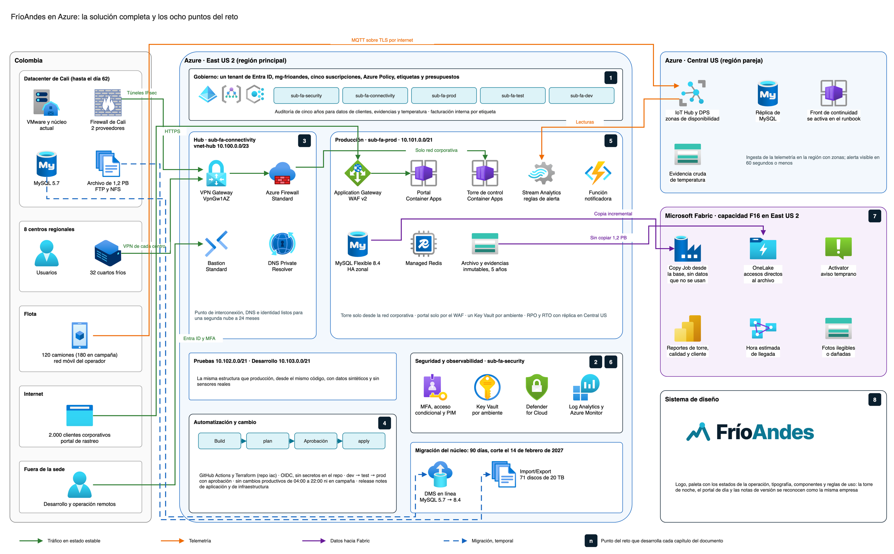
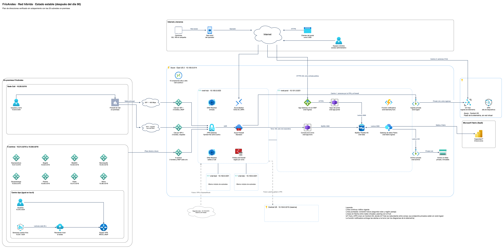
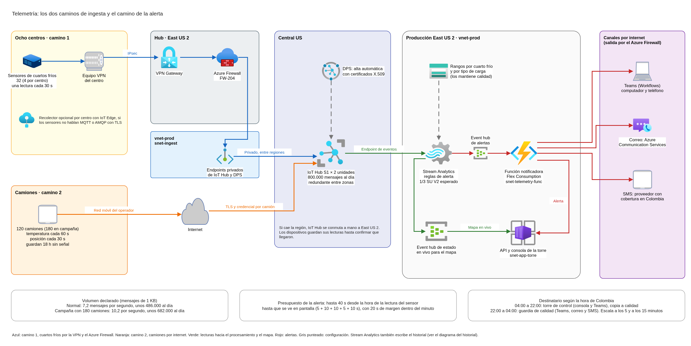
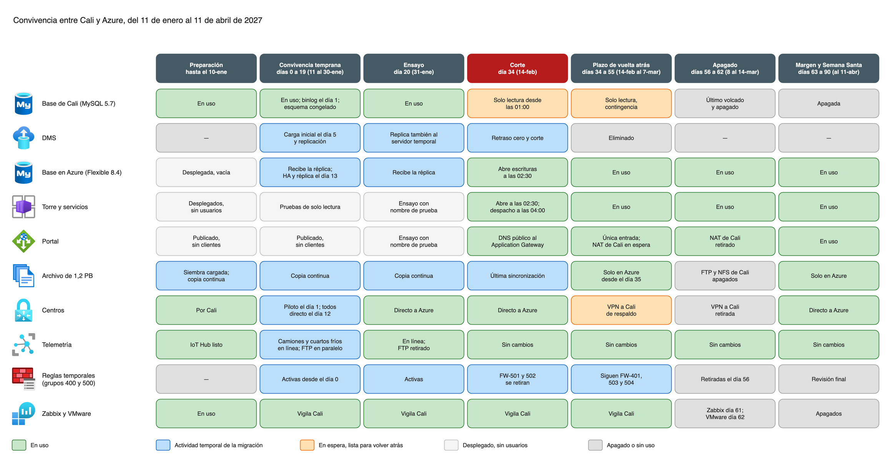
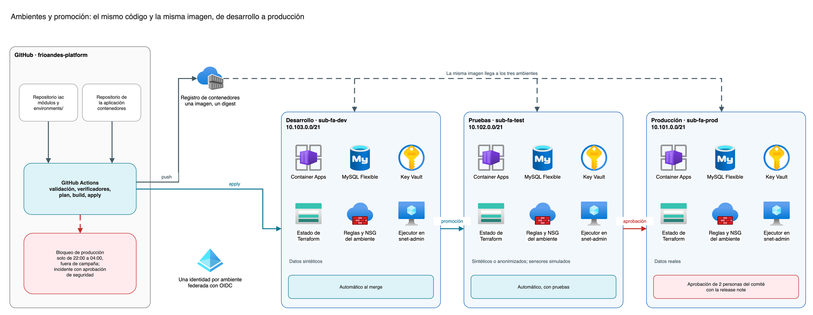
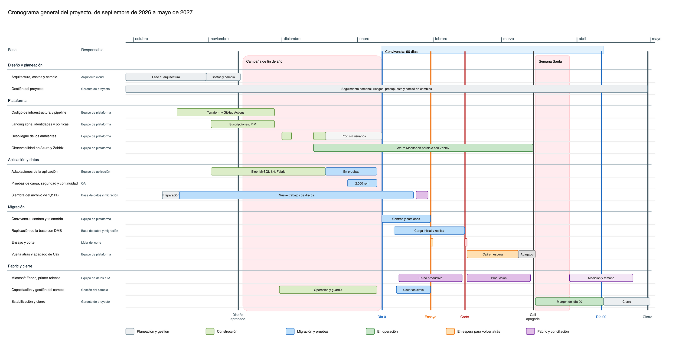

# 1. Resumen ejecutivo

FríoAndes opera la cadena de frío de alimentos desde un solo datacenter en Cali, con ocho centros regionales, 32 cuartos fríos, 120 camiones y una torre de control que despacha de 04:00 a 22:00. La plataforma actual comparte un mismo clúster para desarrollo, pruebas y producción, carga la temperatura por lotes, guarda un archivo de 1,2 PB en FTP y NFS, y depende de un firewall y un proveedor de internet únicos.

**Proponemos llevar la operación a Microsoft Azure, con East US 2 como región principal y Central US como región pareja**, en una convivencia de 90 días como máximo que termina con Cali apagada. La propuesta descansa en cinco decisiones:

1. **Una landing zone con cinco suscripciones** (seguridad, conectividad, producción, pruebas y desarrollo) bajo un solo grupo de administración. Las políticas, las etiquetas y los presupuestos se aplican desde ahí, y cada costo se asigna a operación, telemetría, pruebas o Fabric.
2. **Una red hub y spoke** con VPN Gateway activo-activo, Azure Firewall y un segundo proveedor de internet en Cali. Los centros se conectan directo a Azure, la torre queda fuera de internet y el portal solo se publica por un WAF.
3. **Servicios administrados para las cargas:** Container Apps para la torre y el portal, MySQL Flexible Server 8.4 con alta disponibilidad zonal y réplica en Central US, IoT Hub y Stream Analytics para una alerta de temperatura visible en menos de un minuto.
4. **Una migración con un solo corte**, el domingo 14 de febrero de 2027 de 01:00 a 03:00, ensayado dos semanas antes. El archivo de 1,2 PB llega en 71 discos con Azure Import/Export, porque copiarlo por el enlace de 400 Mbps tardaría más de nueve meses.
5. **Microsoft Fabric sin una segunda copia del archivo:** lee la base con una copia incremental y el archivo con accesos directos. Su primer release trae tres usos de IA: aviso temprano de excursión, hora estimada de llegada y revisión de fotos de entrega.

**Cifras clave**

| Concepto | Valor |
|---|---|
| Costos únicos del proyecto, con la migración y la contingencia | USD 419.355 (unos COP 1.388 millones) |
| Mes estable de la nube, con el archivo | USD 17.240 (unos COP 57 millones) |
| Fabric, en línea aparte | USD 2.892 en un mes normal y 2.938 en campaña |
| Costo total de propiedad | USD 864.360 a un año, 1,75 millones a tres y 2,63 millones a cinco |
| Ahorro de las decisiones ya tomadas | Unos USD 1,85 millones en cinco años |
| Objetivos de servicio | Portal: 99,9 % de minutos buenos en 28 días. Alerta: 99 % visible en 60 segundos o menos |
| Continuidad | RPO de 15 minutos y RTO de 4 horas, con la réplica en Central US |
| Fechas | Día 0 el 11 de enero de 2027, corte el 14 de febrero, Cali apagada el 14 de marzo y cierre del proyecto el 30 de abril |

> **Lo que pedimos a FríoAndes.** Aprobar el diseño y el presupuesto antes del viernes 13 de noviembre de 2026, y responder las confirmaciones de la sección 17. Las tres que más pesan son si los datos pueden quedar en Estados Unidos, qué plan de Microsoft 365 tiene FríoAndes (con E3 o E5 la línea de licencias baja de USD 35.004 a unos 3.700 al año) y cuánto cuesta hoy mantener Cali.

# 2. Punto de partida y requisitos

| Hoy | Qué exige el reto |
|---|---|
| Un datacenter en Cali con VMware y tres clústeres; desarrollo, pruebas y producción comparten el clúster de aplicación | Ambientes separados, con promoción controlada y código de infraestructura |
| Un firewall en Cali concentra políticas, VPN con los centros y NAT del rastreo; internet de 400 Mbps simétricos, sin enlace dedicado a una nube | Ruta redundante para Cali, despacho fuera de internet y un firewall de nube con tabla de políticas |
| Temperatura cargada por lote, sin alerta en tiempo real | Alerta de excursión visible en un minuto: de día en la torre y de noche en la guardia de calidad |
| Archivo de 1,2 PB en FTP y NFS (1,05 PB de video) que crece 12 TB al mes | Llevarlo a la nube sin copiarlo por el enlace de 400 Mbps y sin duplicarlo en Fabric |
| Zabbix vigila la plataforma | Observabilidad de nube con dos objetivos de servicio y transición desde Zabbix |
| Campañas de fin de año, Semana Santa y mitad de año en las que el despacho se degrada | Crecer en campaña, sin cambios productivos durante ella ni de 04:00 a 22:00 |
| Sin manual de marca | Un sistema de diseño común a la torre, al portal y a las notas de versión |

**Cifras que dimensionan el diseño.** 450 usuarios internos, unos 180 en los centros. Unos 2.000 clientes corporativos en el portal, con 800 solicitudes por minuto en el pico normal y 2.000 en campaña durante unas cuatro horas. 120 camiones, 180 en campaña. Unos 486.000 mensajes de telemetría al día, 682.000 en campaña. Las evidencias de entrega y la trazabilidad de temperatura se conservan cinco años por contrato, y no hay datos de tarjetas de pago.

# 3. La solución en una vista

**Por qué Azure y East US 2.** Microsoft Fabric es obligatorio y vive en Azure. Colombia no tiene región de Azure, así que se midió la latencia desde Cali: East US 2 dio una mediana de 85 a 97 ms, la mejor de las candidatas, y tiene los servicios del diseño. Central US es su región pareja y aloja la réplica de la base y el IoT Hub.

**Alineación con los cinco pilares de Well-Architected**

| Pilar | Qué lo cumple |
|---|---|
| Excelencia operacional | Todo se despliega desde Terraform y GitHub Actions, con los mismos módulos en los tres ambientes. Cambios solo de 22:00 a 04:00 y fuera de campaña, con nota de versión, aprobación y vuelta atrás. Un ensayo completo antes del corte real |
| Seguridad | Entra ID con mínimo privilegio, MFA y PIM. Segmentación por subred y NSG, Azure Firewall para todo lo que no es el portal y WAF delante del portal. Cifrado en tránsito y en reposo, un Key Vault por ambiente y auditoría de accesos por cinco años |
| Confiabilidad | MySQL con alta disponibilidad zonal y réplica en Central US. IoT Hub en la región con zonas para ese servicio. Dos proveedores de internet en Cali y VPN directa de cada centro. Un corte reversible con 21 días de Cali en espera |
| Eficiencia del rendimiento | Tamaños calculados con las cifras del caso. Escalado por calendario solo en la capa que crece en campaña. Región elegida por latencia medida |
| Optimización de costos | Siembra con discos en vez de la red. Fabric sin una segunda copia del archivo. Niveles Cold y LRS para el video. Facturación interna por etiqueta y presupuestos por suscripción |

# 4. Gobierno de la plataforma

**Jerarquía.** Un tenant de Entra ID y un grupo de administración `mg-frioandes`, con dos ramas: `mg-fa-platform` agrupa las suscripciones de seguridad y conectividad, y `mg-fa-workloads` las de producción, pruebas y desarrollo. Los ambientes se separan por suscripción, identidad de despliegue y red, no con más grupos de administración. Así, lo que en Cali compartía un clúster queda aislado por diseño.

| Suscripción | Qué contiene |
|---|---|
| `sub-fa-security` | Log Analytics central y herramientas de investigación |
| `sub-fa-connectivity` | Hub de red, Azure Firewall, VPN Gateway, Bastion y DNS híbrido |
| `sub-fa-prod` | Cargas productivas: logística, portal, datos, archivo y telemetría |
| `sub-fa-test` y `sub-fa-dev` | Pruebas y desarrollo, con datos sintéticos o anonimizados |

**Políticas.** Cinco iniciativas de Azure Policy: etiquetas obligatorias (rechaza lo que llegue sin ellas), regiones autorizadas (East US 2 y Central US), datos sin acceso público en producción, diagnósticos centralizados con `DeployIfNotExists` y transporte seguro con TLS 1.2 como mínimo.

**Etiquetas y facturación interna.** Cinco etiquetas obligatorias: `ambiente`, `carga`, `costo`, `criticidad` y `responsable`. Terraform las pone y Azure Policy las exige. Cost Management agrupa por suscripción y por `costo` en cuatro líneas visibles a finanzas: operación, telemetría, pruebas y Fabric. Lo compartido (red y seguridad) se reparte cada mes en proporción a operación y telemetría, y cada cargo se cuenta una sola vez. Los presupuestos avisan al 80 %, 100 % y 120 % del gasto real, pero nunca apagan recursos de despacho ni de telemetría.

**Auditoría.** Cada servicio de negocio emite un evento estructurado por acceso, exitoso o denegado, a datos de clientes, evidencias y lecturas de temperatura. El evento registra el actor, el objeto, la hora UTC, el resultado y la correlación, sin copiar el contenido. Esos eventos se guardan cinco años en total, con 90 días consultables. La evidencia contractual inmutable vive en contenedores de Blob con retención bloqueada.

# 5. Seguridad y datos personales

**Identidades y acceso.** Los grupos de Entra ID se asignan a roles por suscripción o grupo de recursos, y nadie tiene Owner global. MFA es obligatorio para administradores y para la consola de despacho, que además solo responde desde la red corporativa. Los cambios productivos se hacen con elevación temporal por PIM. Los clientes corporativos entran al portal como invitados B2B, sin ningún rol de Azure. La aplicación valida en cada solicitud que el usuario solo vea las guías de su propio cliente.

**Cifrado y secretos.** TLS 1.2 como mínimo en todo el tránsito y cifrado en reposo en todos los servicios de datos. Un Key Vault por ambiente, con endpoint privado y protección contra purga. Las aplicaciones leen sus secretos con identidad administrada, y el pipeline se autentica con OIDC, sin credenciales guardadas en GitHub. Se propone clave administrada por FríoAndes en los almacenes de evidencia contractual, y en la base si FríoAndes lo confirma.

**Datos personales.** FríoAndes es responsable de los datos de conductores, destinatarios, usuarios de clientes y empleados, y Microsoft los trata como encargado. La transmisión a Estados Unidos queda cubierta de dos formas: por el contrato de transmisión con Microsoft (Decreto 1377, artículos 24 y 25) y porque Estados Unidos está en la lista de países adecuados de la SIC. Las evidencias se conservan cinco años por la obligación contractual con los clientes de alimentos, y al vencer se borran o se anonimizan. **Las posiciones de los camiones quedan fuera de la copia inmutable**, para poder borrarlas si un titular o la SIC lo piden. Sin datos de tarjeta, PCI DSS no aplica.

**Perímetro del portal.** IP pública con DDoS IP Protection y Application Gateway WAF v2 en modo prevención, con el Default Rule Set 2.2 y el Bot Manager 1.1. Los límites van en dos capas:

| Capa | Límite | Para qué |
|---|---|---|
| WAF, por IP y por instancia | 300 solicitudes por minuto en general, 120 en la consulta de guías y 20 en el inicio de sesión | Frenar inundaciones, barridos de guías y adivinación de contraseñas, sin tocar el pico legítimo de 2.000 por minuto |
| Aplicación, por cuenta | 60 por usuario y 200 por cliente corporativo | Lo que el WAF no ve: un usuario legítimo que abusa |

**Detección.** Defender for Cloud por suscripción: los planes completos en producción y el plan sin costo en pruebas y desarrollo, que no tienen datos reales. Se suman cinco alertas propias sobre el portal, entre ellas barrido de guías y cuenta desde otro país. Sentinel se evalúa con el volumen de registros del primer mes.

# 6. Red híbrida y preparación para una segunda nube

**Topología.** Un hub propio en `sub-fa-connectivity` con VPN Gateway VpnGw1AZ activo-activo y BGP, Azure Firewall Standard, DNS Private Resolver y Azure Bastion. Los tres ambientes son spokes conectados por peering, y para hablar entre sí tienen que pasar por el firewall. Toda la red, incluido el segundo proveedor de Cali, cuesta unos USD 4.300 al mes. Virtual WAN cumpliría lo mismo por USD 562 a 672 más al mes.

**Redundancia y centros.** Cali contrata un segundo proveedor de internet por una ruta física distinta, como respaldo activo-pasivo. Cada uno de los ocho centros se conecta directo a Azure con dos túneles, para no depender de Cali cuando se apague. La VPN hacia Cali queda de respaldo hasta el cierre del plazo de vuelta atrás.

**Plan de direcciones.** Hub en `10.100.0.0/23`. Producción, pruebas y desarrollo en `10.101.0.0/21`, `10.102.0.0/21` y `10.103.0.0/21`, con once subredes iguales en cada ambiente: ingreso, torre, portal, datos, endpoints privados, archivo, ingesta, administración, integración con Cali, salida a Fabric y función de telemetría. Hay reservas para la región pareja (`10.104.0.0/15`) y para la segunda nube (`10.110.0.0/15`). Un script verifica que ningún rango se solape con las 23 subredes de Cali y los centros: los 48 rangos de la nube pasan las 12 comprobaciones.

**Firewall y publicación.** La tabla de políticas tiene 100 reglas, repartidas entre Azure Firewall, los NSG, el WAF e IoT Hub. Nueve de ellas son temporales de la migración y se retiran en fechas fijas. La torre no tiene ninguna entrada desde internet. El portal es la única entrada pública de aplicación, por el Application Gateway, que reemplaza a los dos Nginx de Cali.

**Acceso administrativo y segunda nube.** Los equipos remotos administran por Azure Bastion, con Entra ID, MFA y acceso condicional, sobre máquinas de administración concretas. Tener acceso a Bastion no da acceso a la consola de despacho. Para la segunda nube, en un horizonte de 24 meses, quedan listos el hub, el DNS Private Resolver, la identidad federada de Entra ID y el rango reservado.

# 7. Cargas de trabajo: plataforma logística y telemetría

## 7.1 Plataforma logística

La torre de control y el portal corren en **Azure Container Apps**, en dos entornos internos por ambiente: el de la torre, que solo alcanzan Cali y los centros por el firewall, y el del portal, que solo recibe tráfico del Application Gateway. Los cuatro servicios de negocio (guías, inventario, asignación de muelle y ruta, y facturación corporativa) se mueven tal cual. Evidencias cambia su acceso a archivos para usar la API de Blob, porque Container Apps no monta NFS.

**Datos.** MySQL Flexible Server 8.4 LTS con alta disponibilidad zonal y Azure Managed Redis como caché del rastreo. La base replica de forma continua a Central US: el RPO de 15 minutos se vigila con una alerta sobre el retraso de la réplica. El RTO de 4 horas es el tiempo del runbook que promueve la réplica y levanta Container Apps en Central US con el mismo módulo de Terraform.

**Kubernetes como variante.** Container Apps da el mismo patrón de red con menos operación. AKS queda documentado como variante, y la red ya reserva su espacio sin cambiar ningún rango.

## 7.2 Telemetría y alerta de temperatura

Los camiones envían por la red móvil y los cuartos fríos por la VPN de su centro. Los dos caminos llegan a un **IoT Hub S1 de dos unidades en Central US**, porque East US 2 no tiene redundancia entre zonas para IoT Hub. Cada dispositivo se da de alta con DPS y un certificado X.509 propio. Stream Analytics evalúa la alerta en East US 2. Una función la publica en la torre de 04:00 a 22:00 y en la guardia de calidad de noche, por Teams y SMS, y escala a los 5 y a los 15 minutos si nadie la reconoce.

**El minuto se cuenta desde que el sensor mide hasta que la alerta se ve en pantalla.** El camino completo tiene un presupuesto de 40 segundos, que deja 20 de margen. La alerta no pasa por Fabric, para no depender de que una capacidad esté encendida de noche.

**Historial.** Hay una copia de evidencia inmutable por cinco años en Central US, solo con temperatura y puertas, y una tabla Delta para análisis en East US 2, que Fabric lee con un acceso directo sin copiar. Data Explorer se descartó por costo: solo su recargo pasaba de USD 321 al mes.

# 8. Migración del núcleo, siembra del archivo y campaña

**Un solo corte.** La torre, el portal y los servicios comparten la base, y Cali está a 85–97 ms de East US 2. Moverlos por partes obligaría a sincronizar dos bases o a pagar esa latencia en cada consulta. Por eso cambian juntos, en un corte de dos horas un domingo, cuando el despacho no trabaja.

| Fecha | Qué pasa |
|---|---|
| Lunes 11 de enero de 2027 (día 0) | Empieza la convivencia: los centros se conectan a Azure y la telemetría entra a IoT Hub |
| Sábado 16 de enero | DMS arranca la réplica en línea de MySQL 5.7 de Cali hacia 8.4 en Azure. El esquema de Cali queda congelado hasta el corte |
| Domingo 31 de enero, 01:00 a 03:00 | Ensayo completo del corte sobre un servidor temporal |
| **Domingo 14 de febrero, 01:00 a 03:00** | **Corte.** Decisión a las 02:25 y punto de no retorno a las 02:30 |
| Hasta el domingo 7 de marzo | 21 días con Cali intacta y sin tráfico, como contingencia |
| Domingo 14 de marzo (día 62) | Cali apagada. Zabbix se retira el día 61 y VMware el 62 |

**Lo que el corte no puede deshacer.** MySQL no replica de 8.4 hacia 5.7. Hasta las 02:30, volver atrás es limpio: no se pierde ningún dato y el servicio vuelve antes de las 03:00. Después, la base de Azure ya recibió escrituras reales. Las salidas, en este orden, son: corregir en Azure; pasar a Central US con el runbook de continuidad (hasta 15 minutos de datos y 4 horas de recuperación), o volver a Cali recargando lo creado en Azure con una exportación de la aplicación. El corte tiene seis criterios cerrados para seguir: si uno falla a las 02:25, se vuelve atrás sin discusión.

**Siembra del archivo de 1,2 PB.** Data Box no sirve: Data Box Heavy está retirado y los equipos Data Box no cruzan fronteras comerciales. El archivo se siembra con **Azure Import/Export: 71 discos de 20 TB en nueve trabajos**: una prueba de un disco, siete trabajos principales copiados del 2 de noviembre al 16 de diciembre de 2026 y un último envío, el 6 de enero, con lo creado hasta el 4 de enero. Lo posterior viaja por la red desde el día 0. El archivo queda conciliado el 29 de enero, dos días antes del ensayo. El video, que es el 88 % del volumen, queda en el nivel Cold con LRS, y los documentos y los históricos de temperatura en GRS.

**Campaña.** El 40 % adicional de cómputo va solo al entorno de la torre: de 13 a 20 vCPU, de 04:00 a 22:00, con una regla de escalado por calendario. El portal pasa de dos a cuatro réplicas de rastreo, el Application Gateway ya tiene reservada su capacidad y la telemetría no cambia con 180 camiones. La convivencia empieza después de la campaña de fin de año y todo cambio termina antes de Semana Santa (15 al 28 de marzo de 2027).

# 9. Observabilidad

Un solo espacio de Log Analytics, en `sub-fa-security`, recoge la salud de la plataforma y de los enlaces, las trazas de despacho, rastreo e ingesta, y las señales de seguridad. Cada ambiente tiene un Application Insights con OpenTelemetry y muestreo del 10 % de las trazas. Un libro de Workbooks es el tablero de operación, y Cost Management tiene vistas compartidas por línea de costo. Todo cuesta unos USD 159 al mes.

| Objetivo de servicio | Meta en 28 días | Cuándo un evento cuenta como malo |
|---|---|---|
| Portal de rastreo | 99,9 % de minutos buenos | Más del 1 % de respuestas 5xx en el Application Gateway, o la prueba de disponibilidad falla en 3 de 5 ubicaciones. Los mantenimientos anunciados no cuentan |
| Alerta de temperatura | 99 % visible en 60 segundos o menos | Contando alertas reales y sintéticas, y excluyendo las lecturas que tardaron más de 25 segundos del sensor a IoT Hub |

Los grupos de acción de Azure no envían SMS ni hacen llamadas en Colombia, así que Teams y SMS salen por una Logic App con el mismo proveedor de la telemetría. Una guardia de plataforma atiende las alertas críticas de noche. **Zabbix vigila solo Cali y se apaga el día 61**, cuando todo lo que vigilaba ya está apagado o tiene su alerta probada en Azure.

# 10. Inteligencia artificial sobre Microsoft Fabric

**Ingesta sin duplicar.** La réplica espejo de Fabric no admite MySQL 8.4 con alta disponibilidad en red virtual. Por eso el libro operativo llega con un Copy Job incremental por el gateway de red virtual de `snet-fabric-egress`. Solo trae vistas que dejan fuera nombres, teléfonos, documentos y direcciones escritas. Del archivo no se copia nada: Fabric lee con accesos directos solo las fotos y los comprobantes nuevos y los clips de reclamos abiertos. Copiar el video a OneLake costaría unos USD 24.150 al mes.

**Espacios y región.** Un espacio de datos y tres de consumo (torre, calidad y cliente) por ambiente, en dos capacidades de East US 2, junto a sus fuentes. La región principal del tenant de Fabric se confirma antes de comprar la capacidad, porque ahí quedan los permisos y los metadatos.

**Tres usos de IA en el primer release**

| Uso | Cómo funciona | Quién lo ve |
|---|---|---|
| Aviso temprano de excursión o sensor caído | Eventstream y Activator sobre el estado en vivo: cerca del límite, puerta abierta de más, sensor intermitente | La torre, en Teams |
| Hora estimada de llegada | Estadística del historial propio por tramo, sin modelo entrenado, leída por el endpoint SQL | La torre, en su consola |
| Fotos ilegibles o dañadas | Revisión de calidad de imagen sin IA para todas las fotos. Las funciones de IA multimodales revisan las entregas con reclamo o excursión, las marcadas y un 10 % al azar | Calidad, que confirma cada marca |

**Capacidad y licencias.** `fcfaprod` arranca en F16 todo el año. Casi toda la carga es de segundo plano y Fabric la reparte en 24 horas, así que bajarla de noche no ahorra. Si el primer mes usa menos del 40 %, pasa a F8 fuera de campaña. Por debajo de F64, cada usuario interno que ve reportes necesita licencia Pro: solo unas 40 personas la necesitan, porque los clientes ven un reporte insertado sin licencia y los despachadores ven la IA en su consola.

# 11. Infraestructura como código y DevOps

**Repositorio.** `frioandes-platform/iac`, en Terraform con el proveedor `azurerm`. Los módulos son reutilizables y los tres ambientes los llaman con sus propios valores. El módulo de red lee el plan de direcciones del CSV verificado, sin copiar ningún rango a mano. El módulo de seguridad leerá de la misma forma la tabla de políticas del firewall. Cada ambiente tiene su estado remoto en su propia suscripción, con bloqueo y versiones.

**Pipeline.** GitHub Actions, con un Environment por ambiente. Un pull request valida el formato, los verificadores de la red y del firewall, y publica el `plan`. El merge construye las imágenes una sola vez y la misma imagen, por su digest, pasa de desarrollo a pruebas y a producción. Producción exige la aprobación de dos personas del comité de cambios con la nota de versión diligenciada. **Un paso del pipeline rechaza el `apply` de producción entre las 04:00 y las 22:00 y en las fechas de campaña**; la única excepción es un incidente, con etiqueta y aprobación de seguridad.

**Identidades.** Cada ambiente tiene su identidad de despliegue, federada con GitHub por OIDC y limitada a su suscripción. Los recursos privados se despliegan desde ejecutores autoalojados en la subred de administración, con salida solo a Azure, Entra ID, GitHub y el registro de contenedores.

> **Estado al 20 de octubre de 2026.** El módulo de red y la estructura del repositorio están en revisión: crean las once subredes de cada ambiente con CIDR idénticos al plan, y sus pruebas pasan en los tres ambientes. Los módulos de seguridad y de cómputo están en construcción. El pipeline y la evidencia de un `plan` limpio sobre los tres módulos cierran la Fase 2, prevista para el 27 de noviembre. Esta sección se actualiza con esa evidencia en la próxima versión del informe.

# 12. Gestión del cambio

Cada cambio en producción lleva una nota de versión. Hay dos plantillas: una de **aplicación**, para la torre, sus servicios y el portal, y otra de **infraestructura**, para red, firewall, cómputo, datos o un corte. Las dos tienen los seis campos que pide el reto: qué cambia, ventana, impacto, aprobación, aviso a despacho y a calidad, y cómo se vuelve atrás.

| Regla | Cómo se cumple |
|---|---|
| Ningún cambio en producción de 04:00 a 22:00 | La ventana va de 22:00 a 04:00 (de 03:00 a 09:00 UTC), y el pipeline bloquea el resto del día |
| Ningún cambio durante una campaña | Fin de año, Semana Santa y mitad de año, leídas de un archivo del repositorio |
| Aprobación | Dos personas del comité de cambios, distintas de quien escribió el cambio, al menos dos días hábiles antes. Un corte o un cambio que no se deshace con un `apply`, con al menos cinco días y una aprobación adicional |
| Aviso | Siempre a despacho y a la guardia de calidad, aunque el cambio no los toque. A los clientes, solo si el portal se interrumpe |
| Vuelta atrás | Aplicación: mover el tráfico a la revisión anterior de Container Apps, en minutos. Infraestructura: revertir el commit y aplicar por el mismo pipeline. Fuera de la ventana, solo como excepción por incidente |

**Ejemplos diligenciados.** El de aplicación es una mejora del portal: búsqueda por orden de compra y descarga en CSV, el martes 25 de mayo de 2027 de 22:30 a 23:45, sin interrupción. El de infraestructura es el corte del 14 de febrero, con sus dos `plan`, el guion hora por hora y la vuelta atrás en tres momentos. Una revisión cruzada comprobó cada hora de los dos ejemplos contra la ventana y las campañas, y corrigió ocho inconsistencias antes de darlos por buenos.

# 13. Sistema de diseño

La torre se usa de noche, el portal de día y las notas de versión se imprimen. El sistema de diseño hace que las tres superficies se vean como la misma empresa.

- **Logo.** Una cresta de montaña dibujada como una traza de temperatura, que termina en el punto del sensor. Tiene tres versiones: principal para el portal, negativo para la torre de noche y una tinta para las notas impresas.
- **Paleta.** Navy, teal andino y cian glaciar como colores de marca. Los cuatro estados de la operación tienen un color cada uno: normal `#2BB673`, advertencia `#F5A524`, excursión de temperatura `#D93A2B` y sensor sin señal `#9374E7`.
- **Accesibilidad.** Todas las combinaciones de texto pasan 4,5:1 de contraste. El color nunca va solo: cada estado lleva su ícono con una forma distinta y su texto, para que se distinga con daltonismo o con el brillo bajo del turno de noche.

> **Estado al 20 de octubre de 2026.** El logo y la paleta están cerrados. La tipografía, el espaciado, los componentes base y la lámina consolidada están en construcción, y se incorporan en la próxima versión del informe. Este documento ya usa el logo y la paleta del sistema.

# 14. Costos

Todas las cifras salen de scripts que consultan la API de precios de Azure, en USD a precios de lista. La conversión usa COP 3.311 por dólar.

| Horizonte | Únicos | Recurrentes acumulados | Total |
|---|---|---|---|
| 1 año | 419.354,89 | 445.004,97 | **864.359,86** |
| 3 años | 419.354,89 | 1.329.228,69 | **1.748.583,59** |
| 5 años | 419.354,89 | 2.205.740,36 | **2.625.095,25** |

**Costos únicos: USD 419.355.** Incluyen el equipo del proyecto (4.550 horas por rol y fase, USD 164.905), la migración con la siembra del archivo (USD 153.417), la capacitación (USD 42.681), la consultoría de un partner de Microsoft (USD 9.600) y una contingencia del 15 % sobre lo nuevo.

**Recurrentes del primer año: USD 445.005.** La nube en estado estable cuesta USD 207.672 al año, con las campañas. Se suman el equipo de operación con guardia (USD 167.471), las licencias y el soporte (USD 35.004) y Fabric (USD 34.858). El mes estable de la nube cuesta USD 17.240, y el archivo es el 45 % de ese mes. **El archivo no crece en costo**: el borrado a los cinco años saca lo mismo que entra. Sin ese borrado, su capacidad pasaría de USD 6.780 a 10.454 al mes. La campaña agrega USD 16,02 por día con la regla de escalado de la torre, muy por debajo de un 40 % plano, que sumaría 6.533 al mes.

**Qué pesa en cinco años.** La nube y Fabric son el 45 % del costo total, la operación el 32 % y el proyecto con la migración el 16 %.

**Decisiones que bajan el costo.** El documento de costos registra 25 decisiones ya tomadas, cada una con su alternativa obvia y su costo evitado: en conjunto evitan unos USD 1,85 millones en cinco años. Las mayores son leer el archivo desde Fabric con accesos directos (USD 325.498) y usar licencias Pro en vez de una capacidad F64 (USD 344.832). Hay siete propuestas más que restarían hasta USD 375.661, la mayor de las cuales solo necesita que FríoAndes autorice borrar los archivos de más de cinco años.

**Comparación con Cali.** Azure cuesta menos en cinco años si mantener Cali cuesta más de USD 29.796 al mes, sin contar su equipo de operación. FríoAndes tiene ese dato y con él se cierra la comparación.

# 15. Cronograma

| Hito | Fecha |
|---|---|
| Arranque del proyecto | Lunes 28 de septiembre de 2026 |
| Arranque de la siembra, con la compra de discos aprobada por separado | Martes 13 de octubre |
| **Diseño y presupuesto aprobados** | **Viernes 13 de noviembre** |
| Pruebas y desarrollo desplegados | Martes 1 de diciembre |
| Hub y producción desplegados, sin usuarios | Lunes 14 de diciembre |
| **Día 0: inicio de la convivencia** | **Lunes 11 de enero de 2027** |
| Siembra conciliada | Viernes 29 de enero |
| Ensayo del corte | Domingo 31 de enero |
| **Corte** | **Domingo 14 de febrero** |
| Fabric en producción | Viernes 12 de marzo |
| **Cali apagada** | **Domingo 14 de marzo** |
| Cierre del proyecto | Viernes 30 de abril |

**Ruta crítica.** La ruta crítica es la del archivo: siembra, conciliación, ensayo, corte, plazo de vuelta atrás y apagado de Cali. La conciliación termina dos días antes del ensayo, y por eso la compra de discos se aprueba por separado y antes que el diseño completo. La segunda cadena es la de la plataforma (código, despliegue, adaptaciones y prueba de carga), que tiene más holgura. El día 0 se puede correr hasta el 1 de febrero sin pasar el límite de los 90 días, siempre que el corte no pase del 7 de marzo.

# 16. Riesgos principales

| Riesgo | Efecto | Cómo se mitiga |
|---|---|---|
| La siembra se atrasa | Mueve el ensayo y el corte, con solo dos días de holgura | Compra de discos aprobada aparte. Ensayo de reserva el 7 de febrero. El corte puede ir hasta el 7 de marzo sin pasar del día 90 |
| Una falla después del punto de no retorno del corte | No hay vuelta atrás limpia a Cali | Ensayo completo, seis criterios cerrados para seguir y decisión a las 02:25. Después, corregir en Azure o pasar a Central US dentro del RPO y del RTO |
| Una adaptación de la aplicación no está lista el día 0 | Durante la convivencia la base no admite cambios de esquema | Las adaptaciones se prueban del 19 de diciembre al 8 de enero. Lo que falte espera al corte |
| El firewall de Cali es un solo equipo | Si falla, Cali pierde la conexión con la torre | Los centros ya van directo a Azure. FríoAndes decide la contingencia de Cali: un segundo equipo, una VPN de usuario o aceptar el riesgo |
| Los umbrales del WAF bloquean a un cliente legítimo | Un cliente pierde el portal durante un minuto | Las reglas arrancan registrando en la prueba de carga y se revisan con el primer mes de datos |
| La capacidad de Fabric queda corta o sobrada | Reportes lentos o gasto de más | F16 medido el primer mes, con un runbook para bajar a F8 y subir a F16 una semana antes de cada campaña |
| FríoAndes no acepta datos en Estados Unidos | Cambia la región | La alternativa es una región de un país de la lista de la SIC, como México. Exige revisar la latencia y los servicios disponibles |

# 17. Lo que FríoAndes tiene que confirmar

El registro de supuestos tiene {{supuestos}} entradas, y {{por_confirmar}} de ellas esperan una confirmación de FríoAndes. Estas son las que cambian el diseño, el costo o las fechas:

| Tema | Pregunta | Qué cambia si la respuesta es otra |
|---|---|---|
| Residencia de los datos | ¿Pueden quedar en Estados Unidos los datos personales y su procesamiento? | La región, la latencia y los servicios disponibles |
| Microsoft 365 | ¿Qué plan tiene FríoAndes? | Con E3 o E5, las licencias bajan de USD 35.004 a unos 3.700 al año |
| Costo de Cali | ¿Cuánto cuesta al mes mantener el datacenter? | Cierra la comparación del costo total de propiedad |
| Fechas de campaña | ¿Son reales las fechas supuestas de las tres campañas? | Mueven el día 0, el corte y el apagado de Cali |
| Equipos de los centros | ¿Soportan IKEv2, dos túneles y BGP? | Si no, se usa un túnel activo y otro de respaldo, con rutas fijas |
| Base de producción | ¿Pesa menos de unos 400 GB? ¿Admite el registro binario en formato ROW? | La duración de la carga inicial de DMS |
| Aplicación | ¿Tiene un modo de mantenimiento en solo lectura? ¿Puede evidencias pasar a Blob antes del día 0? | El guion del corte y la fecha del día 0 |
| Guardia | ¿Hay una guardia de plataforma con rotación de noche? | El costo de la operación y la respuesta a las alertas críticas |
| Retención | ¿Se pueden borrar los archivos de más de cinco años? | Es la mayor de las propuestas de ahorro |
| Fabric | ¿En qué región está el tenant principal? | Dónde quedan los permisos y los metadatos de Fabric |

# 18. Próximos pasos

1. **Revisión de este informe con el arquitecto cloud de FríoAndes**, con los documentos de arquitectura y de costos como anexos.
2. **Respuesta a las confirmaciones de la sección 17**, en una sesión de aclaraciones.
3. **Aprobación del diseño y del presupuesto** el viernes 13 de noviembre de 2026.
4. **Cierre de la Fase 2:** el código de infraestructura y el pipeline, con la evidencia de un `plan` limpio, a más tardar el 27 de noviembre.
5. **Despliegue de pruebas y desarrollo** el 1 de diciembre, y **de hub y producción** el 14 de diciembre, sin usuarios hasta el día 0.

# Anexos

## Anexo A. Glosario

| Término | Significado |
|---|---|
| Corte | El momento en que la operación pasa de Cali a Azure: domingo 14 de febrero de 2027, de 01:00 a 03:00 |
| Convivencia | Los días en que Cali y Azure funcionan juntos, del día 0 al apagado de Cali. Como máximo 90 |
| Día 0 | El lunes 11 de enero de 2027, cuando empieza la convivencia |
| DMS | Azure Database Migration Service, que replica la base de Cali hacia Azure mientras Cali sigue operando |
| Hub y spoke | Una red central (hub) con la conexión, el firewall y el acceso administrativo, a la que se conectan las redes de cada ambiente (spokes) |
| Import/Export | Servicio de Azure para enviar discos propios a un datacenter de Microsoft y cargar su contenido |
| Landing zone | La estructura de suscripciones, políticas, identidades y red sobre la que se despliegan las cargas |
| Nota de versión | El documento que describe, aprueba y avisa un cambio en producción, con su vuelta atrás |
| PIM | Privileged Identity Management: elevación temporal y aprobada de permisos administrativos |
| Punto de no retorno | 02:30 del corte. Desde ahí, la base de Azure tiene escrituras reales y volver a Cali no es limpio |
| RPO y RTO | Cuántos datos se pueden perder (15 minutos) y cuánto puede tardar en volver el servicio (4 horas) ante una falla regional |
| Siembra | La carga inicial del archivo de 1,2 PB con discos, antes de la convivencia |
| WAF | Web Application Firewall: filtra el tráfico del portal antes de que llegue a la aplicación |

## Anexo B. Supuestos que sostienen este informe

Cada cifra y cada decisión de este informe tiene su supuesto en el registro del proyecto (`docs/cross-cutting/assumptions-log.md`), con la justificación, el issue que lo originó y su estado. Los que más pesan en el informe:

| Supuesto | Dónde pesa en el informe |
|---|---|
| Los datos y el procesamiento pueden quedar en Estados Unidos | Secciones 3, 5 y 6 |
| Las campañas van del 15 de noviembre al 10 de enero, del 15 al 28 de marzo de 2027 y del 15 de junio al 15 de julio | Secciones 8, 12 y 15 |
| La convivencia empieza el 11 de enero de 2027, el corte es el 14 de febrero y Cali se apaga el 14 de marzo | Secciones 8 y 15 |
| La base de producción pesa menos de unos 400 GB | Sección 8 |
| El envío de discos tarda 7 días puerta a puerta y Microsoft los carga en 10 | Secciones 8 y 15 |
| El video queda en LRS y los documentos y los históricos de temperatura en GRS | Secciones 8 y 14 |
| El 1,2 PB se acumuló parejo en unos 100 meses: el 60 % tiene menos de cinco años | Sección 14 |
| Todos los roles del proyecto usan la tarifa promedio de COP 120.000 por hora | Sección 14 |
| FríoAndes no tiene Entra ID P1 y se compran licencias para los 450 usuarios internos | Secciones 1, 14 y 17 |
| Unas 40 personas necesitan licencia Pro de Fabric | Secciones 10 y 14 |
| El minuto de la alerta se cuenta desde que el sensor mide hasta que la alerta se ve | Secciones 7 y 9 |
| La aprobación de producción la dan dos personas del comité de cambios | Secciones 11 y 12 |

## Anexo C. Documentos de referencia

Este informe resume y no reemplaza a los documentos que lo acompañan:

| Documento | Qué amplía |
|---|---|
| Documento de arquitectura (`docs/architecture/architecture-frioandes.pdf`) | Los ocho puntos del reto en detalle, con todos los diagramas, la tabla de subnetting, la tabla de políticas del firewall, el cronograma y el registro de supuestos completo |
| Documento de costos (`docs/costs/costs-frioandes.pdf`) | Cada cifra de la sección 14, con su cálculo, sus supuestos y las 32 decisiones y propuestas de ahorro |
| Plantillas y ejemplos de notas de versión (`docs/change/`) | Las dos plantillas, sus ejemplos y la verificación de la ventana de cambio |
| Repositorio `frioandes-platform/iac` | El código de Terraform y el pipeline |
| Sistema de diseño (`docs/design/`) | Logo, paleta, tokens y la lámina del sistema |
